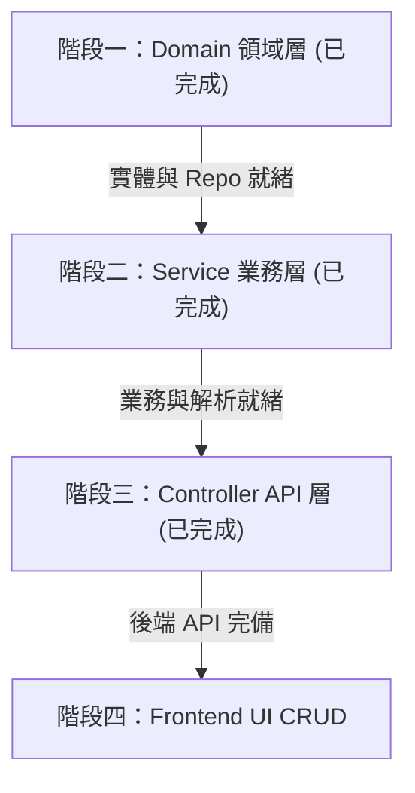

# [Fixed] Question 117：E-Trade RSU的預期損益永遠顯示0，不確定是刻意設計還是漏抓網頁數字

## 背景

這是在檢查「E-Trade持股明細匯入」這部分的程式邏輯時發現的。

使用者把E-Trade網頁另存下來匯入系統後，畫面上會顯示RSU（限制型股票單位，也就是公司無償配發、之後分批歸屬給員工的股票）跟ESPP（員工認股計畫，也就是員工可以用折扣價買公司股票的計畫）的持股明細，每一列都有一欄「預期損益」。

檢查程式碼發現，同一個檔案在處理這兩種持股時，「預期損益」這一欄的作法不一樣：
- ESPP那一列的「預期損益」，是真的去讀取E-Trade網頁上「Expected Gain/Loss」那一欄實際印出來的數字。
- RSU那一列的「預期損益」，程式碼裡直接寫死成0，完全不去讀網頁上的任何數字——也就是說，不管使用者的E-Trade網頁上RSU那一列實際顯示什麼損益數字，匯入後系統畫面上RSU的「預期損益」永遠都會是0。

## 不確定的地方

無法判斷「RSU的預期損益寫死0」這件事，是刻意這樣設計的，還是開發者這段忘了去抓網頁上的數字，理由如下：

- 一種可能：RSU本身是公司無償配發的，使用者取得股票的成本原本就是0（不像ESPP是员工自己出錢用折扣價買的），所以「RSU的預期損益理論上就等於市值」，開發者可能因此選擇直接寫死成0（或用市值）來簡化處理，這在會計邏輯上也說得通。
- 另一種可能：開發者單純漏寫了「去讀網頁上RSU那一列的Expected Gain/Loss欄位」這段邏輯，跟ESPP那段比對起來，程式結構明顯是「同一種欄位、兩種持股類型，一個有抓、一個完全沒抓」，看起來像是遺漏。

要判斷是哪一種，只能靠「E-Trade真實的RSU持股明細頁面上，到底有沒有提供一欄叫Expected Gain/Loss」這個事實來確認——如果網頁本身根本沒有這一欄給RSU用，那寫死0就是合理的（沒東西可抓）；如果網頁上RSU那一列其實也有這一欄、跟ESPP一樣會顯示實際數字，那現在的寫法就是漏抓了使用者的真實資料。這台機器上沒有使用者真實的E-Trade網頁樣本可以核對，單靠程式碼本身無法排除任何一種可能，所以無法直接下結論說這是不是問題。

## 相關檔案

- `finance-hub/finance-hub-backend/hub-app/src/main/java/ch/lin/finance/hub/backend/api/app/service/accounting/company_stock/etrade/ETradeHoldingsHtmlParserImpl.java:176-177`（ESPP那一列，真的去讀網頁上「Expected Gain/Loss」欄位的實際數字）
- `finance-hub/finance-hub-backend/hub-app/src/main/java/ch/lin/finance/hub/backend/api/app/service/accounting/company_stock/etrade/ETradeHoldingsHtmlParserImpl.java:213-215`（RSU那一列，直接寫死「預期損益 = 0」，完全沒有去讀網頁上任何對應欄位）

## 需要使用者確認的問題

麻煩您打開一份您自己E-Trade帳戶裡、有RSU持股明細的真實網頁（或您手邊留存的舊存檔網頁），確認一下：

1. RSU那個持股明細表格裡，有沒有一欄叫做「Expected Gain/Loss」（跟ESPP那個表格裡的那一欄同名或類似）？
2. 如果有這一欄，它顯示的數字，是不是跟旁邊的「Est. Market Value（預估市值）」那一欄數字一樣（因為RSU成本是0，理論上兩者會相等）？還是會顯示別的數字？

您看到的結果會決定接下來怎麼處理，這裡有兩種可能，看您看到的實際情況選一種：
- 如果RSU網頁上根本沒有「Expected Gain/Loss」這一欄：那現在系統寫死成0是合理的（沒有東西可以抓），不需要修改。
- 如果RSU網頁上其實也有「Expected Gain/Loss」這一欄、有顯示實際數字：那目前系統會忽略這個真實數字、永遠顯示0，這樣就需要修改成跟ESPP一樣去讀取這一欄的實際內容。

---

## 覆核結果與問題回覆（Review & Answers to Claude's Questions）

經核對使用者真實 E-Trade 股票計劃網頁樣本與匯出資料：
- [E_TRADE - Stock Plan Overview - holdings.html](file:///Users/edward/Desktop/Projects/youtube-data-hub-wrapper/finance-hub/finance-hub-backend/hub/data/reference/rsu&espp/E_TRADE%20-%20Stock%20Plan%20Overview%20-%20holdings.html)
- [E_TRADE - Stock Plan Overview - benefitHistory.html](file:///Users/edward/Desktop/Projects/youtube-data-hub-wrapper/finance-hub/finance-hub-backend/hub/data/reference/rsu&espp/E_TRADE%20-%20Stock%20Plan%20Overview%20-%20benefitHistory.html)
- 日文版：[E_TRADE - Stock Plan - holdings.html](file:///Users/edward/Desktop/Projects/youtube-data-hub-wrapper/finance-hub/finance-hub-backend/hub/data/reference/rsu&espp/Japanese/E_TRADE%20-%20Stock%20Plan%20-%20holdings.html)

正式確認：Claude 於提問中指出的疑慮完全屬實——**RSU 展開明細中明確存在每股預期損益與成本基準欄位，目前的 Parser 確實遺漏了子層明細的抓取，導致 `price` 填 null 且損益寫死 0。**

---

### 一、真實 E-Trade 網頁結構查證事實

在真實導出的 E-Trade 股票計劃總覽網頁（`holdings.html`）中：

1. **ESPP（員工認股計畫）總覽表格欄位**：
   - 英文版表頭：
     `Purchase Date` | `Purchase Price` | `Purchased Qty.` | `Sellable Qty.` | `Expected Gain/Loss` | `Est. Market Value`
   - **事實**：ESPP 在頂層表格即直接顯示扣除認購本金後的整筆預期損益總額。展開後亦包含 `Grant Date FMV`、`Purchase Date FMV`、`Est. Cost Basis(per share)`、`Expected Gain/Loss (per share)` 與 `Capital Gains Status`。

2. **RSU（限制型股票單位）的欄位結構與真實數據**：
   - **頂層 Grant 總覽列**：表頭為 `Grant Date` | `Granted Qty.` | `Vested Qty.` | `Unvested Qty.` | `Sellable Qty.` | `Est. Market Value`，僅列出整筆 Grant 的宏觀股數與市值。
   - **展開明細（Vesting Schedule 各期歸屬 Tranches）**：
     表頭包含 `Grant Number` | `Type` | `Vest Period` | `Vest Date` | `Release Date` | `Sellable Qty.` | `Pending Sale Qty.` | `Est. Cost Basis(per share)` | `Est. Market Value`。
   - **子層損益卡片（Gain/Loss Information）**：
     展開每一期已歸屬項目的損益資訊時，**確實明確存在以下欄位與真實數值**：
     * **`Expected Gain/Loss (per share)`**（例如真實數據顯示 `+$14.08`、`-$0.03`）
     * **`Capital Gains Status`**（例如 `Long Term` / `Short Term`）
     * **`Est. Cost Basis (per share)`**（各期 Vesting 當日的公允稅務成本基準）

3. **兩個 Parser 與頁面任務職責歸屬**：
   - **`ETradeHoldingsHtmlParserImpl`（負責 `holdings.html`）**：
     * 負責維護即時持股庫存與未實現損益。
     * 對應之資料庫實體為庫存批次（重構為父類別 [`BaseStockLot`](file:///Users/edward/Desktop/Projects/youtube-data-hub-wrapper/finance-hub/finance-hub-backend/hub-domain/src/main/java/ch/lin/finance/hub/backend/api/domain/model/accounting/company_stock/etrade/BaseStockLot.java) 與其子類別 `ETradeEsppStockLot`、`ETradeRsuStockLot`）。
     * 上述 RSU 各期之 `Expected Gain/Loss (per share)`、`Est. Cost Basis` 完全位於此頁面與對象表格範疇內。
   - **`ETradeBenefitHistoryHtmlParserImpl`（負責 `benefitHistory.html`）**：
     * 負責維護歷史合約、歸屬排程與已代扣繳稅額台帳（4 張 Benefit 歷史表），並無當前即時的每股預期損益。

---

### 二、針對 Claude 所提問題的明確答覆

1. **問題 1：RSU 持股明細表格裡，有沒有一欄叫做「Expected Gain/Loss」？**
   - **答：確認存在！**
   - 在 `holdings.html` 中，RSU 頂層 Grant 列僅顯示宏觀總數，但在展開各期歸屬明細（Vesting Tranches）的「Gain/Loss Information」卡片中，**明確存在欄位 `Expected Gain/Loss (per share)`**（例如真實數據顯示 `+$14.08`、`-$0.03`）。

2. **問題 2：如果有這一欄，它顯示的數字是什麼？是不是跟旁邊的預估市值一樣？**
   - **答：不等於市值，而是顯示真實的每股未實現資本利得！**
   - RSU 歸屬時是以當天公允市價（FMV）計入所得稅，該 FMV 即為股票後續的法定稅務成本基準（Cost Basis）。E-Trade 網頁同時提供了：
     * **`Est. Cost Basis (per share)`**（歸屬日 FMV 成本單價，例如 `$149.25`、`$163.36`）
     * **`Expected Gain/Loss (per share)`**（當前每股未實現損益，例如 `+$14.08`）
     * **`Capital Gains Status`**（長短期持有狀態，例如 `Long Term`）
   - 目前後端 [ETradeHoldingsHtmlParserImpl.java](file:///Users/edward/Desktop/Projects/youtube-data-hub-wrapper/finance-hub/finance-hub-backend/hub-app/src/main/java/ch/lin/finance/hub/backend/api/app/service/accounting/company_stock/etrade/ETradeHoldingsHtmlParserImpl.java) 僅解析頂層 Grant 列，直接將 `price` 設為 `null`、損益寫死 `0`，確實遺漏了展開項目中的真實核心數據。

---

### 三、未來擴充規劃連結（Plan & Tax Automation Integration）

此處所遺漏的數據，直接牽涉系統長期財務規劃藍圖：
👉 **[plan.md (Epic: Phase 3 - Tax Management & Reporting / Task 2: Tax Reporting 確定申告 Integration)](file:///Users/edward/Desktop/Projects/youtube-data-hub-wrapper/finance-hub/finance-hub-backend/todo/planned/plan.md#L4-L29)**

在未來的日本確定申告自動化模組中：
1. **給與所得申報（歸屬年度）**：RSU 在各期 Vest Date 當日按 FMV 與當天日圓 TTM 匯率認列給與所得。
2. **讓渡所得申報（股票賣出時）**：賣出計算資本利得時，必須取得當初該批股票的「取得日（Vest Date）」與「法定取得成本基準（Est. Cost Basis / FMV）」，用以乘以取得當日的歷史 TTM 匯率算出日圓取得成本。
3. **歷史台帳勾稽**：必須藉由 `Grant Number` 與 `Vest Period`（期別），將在庫庫存（Holdings）與過去的歷史歸屬排程（`ETradeBenefitRsuVestSchedule`）精確串接勾稽。

若庫存資料未能在批次（Tranche）層級完整保存這些欄位，未來的確定申告自動化將因缺乏取得日、FMV 與關聯鍵而無法正確計算。

---

### 四、本次修復與升級方案（架構、欄位與 Parser 擴充）

為了一次性徹底解決問題並奠定未來稅務自動化基礎，本次處置包含以下三個維度的全面擴充：

1. **實體模型重構（架構擴充）**：
   - 採物件導向與 JPA 標準設計，引入共用父類別 [`BaseStockLot`](file:///Users/edward/Desktop/Projects/youtube-data-hub-wrapper/finance-hub/finance-hub-backend/hub-domain/src/main/java/ch/lin/finance/hub/backend/api/domain/model/accounting/company_stock/etrade/BaseStockLot.java)（`@MappedSuperclass`），抽離兩者共通之庫存指標（成本、市值、可售股數、預期損益總額與每股損益、長短期狀態）。
   - 將 ESPP 與 RSU 庫存徹底分表，分別建立子類別實體：
     * `ETradeEsppStockLot`（資料表 `etrade_espp_stock_lot`）：擴充購入價、自付股數、折扣率與購入日 FMV。
     * `ETradeRsuStockLot`（資料表 `etrade_rsu_stock_lot`）：擴充大合約編號 `grantNumber`、授權日 `grantDate`、期別 `vestPeriod`、歸屬日 `vestDate` 與釋出日。
2. **服務與傳輸層對齊（DTO 擴充）**：
   - Service 層引入通用父類別 Result [`StockLotResult`](file:///Users/edward/Desktop/Projects/youtube-data-hub-wrapper/finance-hub/finance-hub-backend/hub-app/src/main/java/ch/lin/finance/hub/backend/api/app/service/accounting/company_stock/result/StockLotResult.java)（與 ESPP/RSU 子類別 Result）。
   - Controller 層同樣全面對齊父子類別 Response（以抽象父類別 [`CompanyStockResponse.StockLot`](file:///Users/edward/Desktop/Projects/youtube-data-hub-wrapper/finance-hub/finance-hub-backend/hub/src/main/java/ch/lin/finance/hub/backend/api/controller/accounting/company_stock/dto/response/CompanyStockResponse.java#L69) 為基底，衍生 `EsppStockLot` 與 `RsuStockLot` 子類別），透過 Jackson 多型註解支援 Discriminated Union，完美支援前端拆分雙獨立表格呈現。
3. **解析器改寫（Parser 擴充）**：
   - 重構 [`ETradeHoldingsHtmlParserImpl.java`](file:///Users/edward/Desktop/Projects/youtube-data-hub-wrapper/finance-hub/finance-hub-backend/hub-app/src/main/java/ch/lin/finance/hub/backend/api/app/service/accounting/company_stock/etrade/ETradeHoldingsHtmlParserImpl.java)，深入遍歷展開的各期明細表格（`RSblockdetails`），完整提取每一期 Tranche 的真實成本單價、每股損益、長短期狀態與期別。

---

## 五、庫存模型重構方案（方案 B：父子類別繼承分表）與必要欄位清單

經分析使用者提供之真實 E-Trade Holdings 頁面結構，為支撐未來 Phase 3 確定申告（給與所得與讓渡所得）自動化計算，定案採用**方案 B（以 `@MappedSuperclass` 共用父類別 `BaseStockLot`，並由 `ETradeEsppStockLot` 與 `ETradeRsuStockLot` 繼承擴充各自獨立建表）**。

明確標註各欄位定義於共用父類別（`BaseStockLot`）還是各自的子類別（`ETradeEsppStockLot` / `ETradeRsuStockLot`）：

---

### 一、ESPP 庫存（`ETradeEsppStockLot`）必要欄位

| 欄位名稱 | parent/child | 範例真實數值 | 確定申告與系統必要性 | 重要程度 |
| :--- | :---: | :--- | :--- | :---: |
| **`purchaseDate`** | **Child** | `06/15/2022` | **核心主鍵**。決定取得年度，以及抓取當日 TTM 匯率的基準日。 | ⭐️⭐️⭐️⭐️⭐️ |
| **`purchasePrice`** | **Child** | `$143.27` | **自付成本單價**。計算自付本金與給與所得價差必備。 | ⭐️⭐️⭐️⭐️⭐️ |
| **`purchasedQty`** | **Child** | `20` | 當初購買總股數。 | ⭐️⭐️⭐️⭐️ |
| **`sellableQty`** | **Parent** | `20` | 目前手上還可賣的庫存股數。 | ⭐️⭐️⭐️⭐️⭐️ |
| **`estCostBasis`** | **Parent** | `$163.33` | **法定每股取得成本**。賣出時算「讓渡所得」的扣除成本基準。 | ⭐️⭐️⭐️⭐️⭐️ |
| **`purchaseDateFmv`** | **Child** | `$168.55` | **購入日公允市價**。日本申報 ESPP 給與所得公式：$(\text{FMV} - \text{購入價}) \times \text{股數}$。有此欄位未來**免去外調歷史股價**！ | ⭐️⭐️⭐️⭐️⭐️ |
| **`grantDateFmv`** | **Child** | `$260.04` | 方案起始日 FMV（用於核算 Lookback 85折合規性）。 | ⭐️⭐️⭐️ |
| **`discountPercent`**| **Child** | `15%` | 折扣率。證明為員工認股計畫折價利益。 | ⭐️⭐️⭐️ |
| **`grantDate`** | **Child** | `12/15/2021` | 方案起始日（Offering Date）。 | ⭐️⭐️⭐️ |
| **`estMarketValue`** | **Parent** | `¥529,189.20` | 目前預估市值。 | ⭐️⭐️⭐️⭐️ |
| **`expectedGainLoss`**| **Parent** | `+$652.16` | 總未實現資本利得。 | ⭐️⭐️⭐️⭐️ |
| **`expectedGainLossPerShare`**| **Parent** | `+$27.17` | **每股預期損益**。直觀掌握每股利得。 | ⭐️⭐️⭐️⭐️⭐️ |
| **`capitalGainsStatus`**| **Parent** | `Long Term` | **持有年限狀態**。長期或短期利得標籤。 | ⭐️⭐️⭐️⭐️ |

> 註：`Qualified Plan?` 與 `Transferable Date`（讓渡可能日）可作為輔助屬性存入或忽略，非計算核心。

---

### 二、RS / RSU 庫存（`ETradeRsuStockLot`）必要欄位

| 欄位名稱 | parent/child | 範例真實數值 | 確定申告與系統必要性 | 重要程度 |
| :--- | :---: | :--- | :--- | :---: |
| **`grantNumber`** | **Child** | `00136443` | **大合約編號**。串聯 `benefitHistory` 歷史台帳的唯一業務外鍵。 | ⭐️⭐️⭐️⭐️⭐️ |
| **`grantDate`** | **Child** | `11/22/2021` | 原始配發合約日。識別是哪一年度獲得的股票大禮包。 | ⭐️⭐️⭐️⭐️ |
| **`vestPeriod`** | **Child** | `1`, `2` | **期別**。與 `grantNumber` 構成複合鍵，精確鎖定是哪一期。 | ⭐️⭐️⭐️⭐️⭐️ |
| **`vestDate`** | **Child** | `11/22/2022`, `02/22/2023` | **絕對核心**！直接判定**「屬於哪一年度的給與所得」**，也是賣出時換算日圓取得成本的 **TTM 匯率基準日**。 | ⭐️⭐️⭐️⭐️⭐️ |
| **`estCostBasis`** | **Parent** | `$149.25`, `$163.36` | **絕對核心**！即 Vest 當天的 FMV（公允市價）。它既是當期「給與所得」的單價，也是未來賣出算「讓渡所得」的法定每股取得成本！ | ⭐️⭐️⭐️⭐️⭐️ |
| **`sellableQty`** | **Parent** | `28`, `7` | **在庫可售股數**。扣除代扣繳稅後，真正撥入您帳戶且未賣出的股數。 | ⭐️⭐️⭐️⭐️⭐️ |
| **`estMarketValue`** | **Parent** | `¥740,864.88` | 該批 Tranche 當前預估市值。 | ⭐️⭐️⭐️⭐️ |
| **`expectedGainLossPerShare`** | **Parent** | `+$14.08`, `-$0.03` | **每股預期損益**（被 Claude 抓包的那個數字），反映該期每股未實現利得。 | ⭐️⭐️⭐️⭐️⭐️ |
| **`expectedGainLoss`**| **Parent** | `+$394.24` (計算值) | 該期未實現損益總額（$\text{Sellable Qty} \times \text{每股損益}$）。 | ⭐️⭐️⭐️⭐️ |
| **`capitalGainsStatus`**| **Parent** | `Long Term` | **持有年限狀態**。確認是否持有超過 1 年。 | ⭐️⭐️⭐️⭐️ |
| **`releaseDate`** | **Child** | `11/22/2022` | 實際釋出日（通常同 Vest Date）。 | ⭐️⭐️⭐️ |

---

### 三、欄位劃分摘要

* **父類別（`BaseStockLot`）集中管理的共用欄位（共 6 個）**：
  1. `sellableQty`
  2. `estCostBasis`
  3. `estMarketValue`
  4. `expectedGainLoss`
  5. `expectedGainLossPerShare`
  6. `capitalGainsStatus`
  （外加通用基礎欄位 `symbol` 與使用者識別 `ownerUserId`）

* **子類別（`ETradeEsppStockLot`）擴充**：專注於購入價、自付股數、折扣率與購入日 FMV。
* **子類別（`ETradeRsuStockLot`）擴充**：專注於 Grant Number、期別（Vest Period）、歸屬日（Vest Date）與釋出日。

---

## 六、父類別欄位與既有 `etrade_stock_lot` 之對照分析

將父類別（`BaseStockLot`）的欄位與既有資料表 [`etrade_stock_lot`](file:///Users/edward/Desktop/Projects/youtube-data-hub-wrapper/finance-hub/finance-hub-backend/hub-domain/src/main/java/ch/lin/finance/hub/backend/api/domain/model/accounting/company_stock/etrade/BaseStockLot.java) 進行逐一比對，兩者其實「高度重疊，只差 2 個新欄位」：

### 1. 父類別欄位 vs 既有欄位 對照表

| 父類別規劃欄位 | 既有 `etrade_stock_lot` 欄位 | 差異性質 | 說明 |
| :--- | :--- | :---: | :--- |
| **`symbol`** | `symbol` | **完全一致** | 股票代號（例如 GOOG）。 |
| **`sellableQty`** | `sellable_quantity` | **完全一致** | 目前可售股數（僅命名縮寫對齊）。 |
| **`estCostBasis`** | `price` | **完全一致** | 取得成本基準（先前 Parser 填 null 的那個欄位）。 |
| **`estMarketValue`** | `est_market_value` | **完全一致** | 目前預估市值。 |
| **`expectedGainLoss`**| `expected_gain_loss` | **完全一致** | 預期損益總額（先前寫死 0 的那個欄位）。 |
| **`expectedGainLossPerShare`** | *(無)* | 🟢 **全新新增** | **每股預期損益**（例如 `+$14.08`）。既有表只有總額，漏抓了每股數字。 |
| **`capitalGainsStatus`** | *(無)* | 🟢 **全新新增** | **稅務長短期狀態**（`Long Term` / `Short Term`）。既有表完全未記錄。 |

> 基礎欄位 `id`、`ownerUserId` 依然繼承自既有的 [`MultiUserBaseEntity`](file:///Users/edward/Desktop/Projects/youtube-data-hub-wrapper/finance-hub/finance-hub-backend/hub-domain/src/main/java/ch/lin/finance/hub/backend/api/domain/model/base/MultiUserBaseEntity.java)。

### 2. 既有資料表裡「剩下的欄位」之重構歸屬

既有表剩下的欄位，在方案 B 中被漂亮地各歸其所（下放給子類別）：

1. **`discount_percent`（折扣率）** $\rightarrow$ **移入 ESPP 子類別**
   * *原因*：原本硬塞在庫存表裡，導致 RSU 那列永遠是 `null`，現在歸還給 ESPP。
2. **`record_date`（日期）** $\rightarrow$ **移入子類別並精確化**
   * *原因*：原本粗暴共用一個欄位（ESPP 存購入日、RSU 存 Grant 日），現在 ESPP 明確存 `purchaseDate`，RSU 明確存 `vestDate`（取得日）與 `grantDate`（合約日）。
3. **`quantity`（總股數）** $\rightarrow$ **移入子類別**
   * *原因*：原本 RSU 把未歸屬股數混在一起，現在 ESPP 存 `purchasedQty`（當初購入數），真正的在庫可售數一律看父類別的 `sellableQty`。
4. **`record_type`（ESPP/RSU 區分標籤）** $\rightarrow$ **不再需要**
   * *原因*：既然兩者分表（`etrade_espp_stock_lot` 與 `etrade_rsu_stock_lot`），表名本身就代表類型，不需要在每一列多存一個 enum 標籤。

### 3. 總結

父類別的定義跟既有欄位相比：
* **核心骨幹（成本、股數、市值、損益總額）本來就都有！**
* **真正新補進去的只有 2 個欄位**：
  1. `expectedGainLossPerShare`（補齊每股損益真實數字，如 `+$14.08`）
  2. `capitalGainsStatus`（補齊長短期持有標籤，如 `Long Term`）

---

## 七、分階段實作計畫（Phased Implementation Plan）

> **實作原則與防護機制（嚴防 Content Window 污染與發散）**：
> 1. **分層循序漸進**：為避免單次重構範疇過大、跨越多層模組導致 context window 飽和或產生模型幻覺，本架構重構嚴格依據軟體工程分層（Layered Architecture）進行階段式推進。
>    **「Domain 完成才做 Service，Service 完成才做 Controller，最後才在時間允許下補足 Frontend UI CRUD」**。每一階段均有獨立的驗證邊界，確保代碼基底穩固。
> 2. **嚴禁中途編譯干擾**：跨層重構期間（例如 Entity 重構但 Service 尚未配合調整），出現暫態編譯錯誤為 100% 預期中的過渡現象。**重構進行中一律不進行全量編譯，嚴禁被中途編譯器的暫態報錯牽著走**，避免頻繁的錯誤日誌大幅污染 Content Window，導致 AI 注意力渙散或實作方向發散。**所有分層程式碼重構到位後，才一次性進行全量編譯與測試驗證！**
> 3. **純粹領域模型**：Domain 實體全面仰賴 Lombok `@Getter` 自動生成標準存取子，不保留多餘的相容別名或手寫 Getter，Service / DTO 轉換層統一採用現代 Java 的模式匹配（Pattern Matching `instanceof`）進行多態封裝。



### 階段一：Domain 領域層擴充（核心實體與 Repository）✅【已完成】
* **目標**：完成父子類別資料表模型與 JPA Repository 定義，確保領域層物件邊界乾淨。
* **具體任務**：
  1. **父類別 [`BaseStockLot`](file:///Users/edward/Desktop/Projects/youtube-data-hub-wrapper/finance-hub/finance-hub-backend/hub-domain/src/main/java/ch/lin/finance/hub/backend/api/domain/model/accounting/company_stock/etrade/BaseStockLot.java)**：
     - [x] 抽離為 `@MappedSuperclass`，收斂 7 個共用核心欄位（`symbol`, `sellableQuantity`, `estCostBasis`, `estMarketValue`, `expectedGainLoss`, `expectedGainLossPerShare`, `capitalGainsStatus`）。
     - [x] 保持純粹 Domain 模型，完全由 Lombok `@Getter` 提供標準方法，不留冗餘手寫別名。
  2. **新增 ESPP 子類別實體 [`ETradeEsppStockLot`](file:///Users/edward/Desktop/Projects/youtube-data-hub-wrapper/finance-hub/finance-hub-backend/hub-domain/src/main/java/ch/lin/finance/hub/backend/api/domain/model/accounting/company_stock/etrade/ETradeEsppStockLot.java)**：
     - [x] 資料表：`etrade_espp_stock_lot`。
     - [x] 擴充專屬欄位：`purchaseDate`, `purchasePrice`, `purchasedQty`, `purchaseDateFmv`, `grantDateFmv`, `discountPercent`, `grantDate`, `qualifiedPlan`, `transferableDate`。
  3. **新增 RSU 子類別實體 [`ETradeRsuStockLot`](file:///Users/edward/Desktop/Projects/youtube-data-hub-wrapper/finance-hub/finance-hub-backend/hub-domain/src/main/java/ch/lin/finance/hub/backend/api/domain/model/accounting/company_stock/etrade/ETradeRsuStockLot.java)**：
     - [x] 資料表：`etrade_rsu_stock_lot`。
     - [x] 擴充專屬欄位：`grantNumber`, `grantDate`, `vestPeriod`, `vestDate`, `releaseDate`, `pendingSaleQty`。
  4. **建立獨立 Repository 介面**：
     - [x] [`ETradeEsppStockLotRepository`](file:///Users/edward/Desktop/Projects/youtube-data-hub-wrapper/finance-hub/finance-hub-backend/hub-app/src/main/java/ch/lin/finance/hub/backend/api/app/repository/accounting/company_stock/etrade/ETradeEsppStockLotRepository.java)（繼承 `JpaRepository<ETradeEsppStockLot, String>`）。
     - [x] [`ETradeRsuStockLotRepository`](file:///Users/edward/Desktop/Projects/youtube-data-hub-wrapper/finance-hub/finance-hub-backend/hub-app/src/main/java/ch/lin/finance/hub/backend/api/app/repository/accounting/company_stock/etrade/ETradeRsuStockLotRepository.java)（繼承 `JpaRepository<ETradeRsuStockLot, String>`）。
     - [x] 舊的 `ETradeStockLotRepository` 待階段二 Service 層重構完成時一併除役。

---

### 階段二：Service 業務邏輯層（Parser、Result DTO 與 JobService）✅【已完成】
* **目標**：重構 HTML 解析器深入抓取子表格真實數據，建立父子繼承結構的 Result DTO 承接完整稅務欄位，並於 Service 實作多態存取。
* **具體任務**：
  1. **建立父子類別 Result DTO 體系（1:1 對齊 Domain 模型）**：
     - [x] **父類別 [`StockLotResult`](file:///Users/edward/Desktop/Projects/youtube-data-hub-wrapper/finance-hub/finance-hub-backend/hub-app/src/main/java/ch/lin/finance/hub/backend/api/app/service/accounting/company_stock/result/StockLotResult.java)**：
       - 定位為抽象/基底傳輸物件，收斂共通欄位：`id`、`ownerUserId`、`privacyLevel`、`recordType`、`symbol`、`sellableQuantity`、`estCostBasis`（與 `price` 對齊）、`estMarketValue`、`expectedGainLoss`、`expectedGainLossPerShare`、`capitalGainsStatus`。
       - 提供多態分派工廠方法 `fromEntity(BaseStockLot entity)`。
     - [x] **新增 ESPP 子類別 [`ETradeEsppStockLotResult`](file:///Users/edward/Desktop/Projects/youtube-data-hub-wrapper/finance-hub/finance-hub-backend/hub-app/src/main/java/ch/lin/finance/hub/backend/api/app/service/accounting/company_stock/result/ETradeEsppStockLotResult.java)**：
       - 繼承 `StockLotResult`。
       - 專屬欄位：`purchaseDate`（`LocalDate`）、`purchasePrice`（`MonetaryValue`）、`purchasedQty`（`Double`）、`purchaseDateFmv`（`MonetaryValue`）、`grantDateFmv`（`MonetaryValue`）、`discountPercent`（`Double`）、`grantDate`（`LocalDate`）、`qualifiedPlan`（`String`）、`transferableDate`（`LocalDate`）。
       - 專屬工廠方法：`fromEntity(ETradeEsppStockLot entity)`。
     - [x] **新增 RSU 子類別 [`ETradeRsuStockLotResult`](file:///Users/edward/Desktop/Projects/youtube-data-hub-wrapper/finance-hub/finance-hub-backend/hub-app/src/main/java/ch/lin/finance/hub/backend/api/app/service/accounting/company_stock/result/ETradeRsuStockLotResult.java)**：
       - 繼承 `StockLotResult`。
       - 專屬欄位：`grantNumber`（`String`）、`grantDate`（`LocalDate`）、`vestPeriod`（`Integer`）、`vestDate`（`LocalDate`）、`releaseDate`（`LocalDate`）、`pendingSaleQty`（`Double`）。
       - 專屬工廠方法：`fromEntity(ETradeRsuStockLot entity)`。
  2. **重構解析器 [`ETradeHoldingsHtmlParserImpl`](file:///Users/edward/Desktop/Projects/youtube-data-hub-wrapper/finance-hub/finance-hub-backend/hub-app/src/main/java/ch/lin/finance/hub/backend/api/app/service/accounting/company_stock/etrade/ETradeHoldingsHtmlParserImpl.java)**：
     - [x] ESPP：提取頂層與展開卡片中的購入日、購入價、FMV、折扣率、每股損益與長短期狀態，建構 `ETradeEsppStockLot`。
     - [x] RSU：深入解析各期展開明細子表格（`RSblockdetails`）與損益卡片（`Gain/Loss Information`），提取 `grantNumber`、`vestPeriod`、`vestDate`、每股成本基準（`estCostBasis`）、每股預期損益（`expectedGainLossPerShare`），不再寫死 0 與 null，建構 `ETradeRsuStockLot`。
     - [x] 更新 [`ETradeHoldingsParseResult`](file:///Users/edward/Desktop/Projects/youtube-data-hub-wrapper/finance-hub/finance-hub-backend/hub-app/src/main/java/ch/lin/finance/hub/backend/api/app/service/accounting/company_stock/etrade/result/ETradeHoldingsParseResult.java) 承接父類別清單 `List<BaseStockLot> lots`。
  3. **對齊業務服務 [`CompanyStockJobServiceImpl`](file:///Users/edward/Desktop/Projects/youtube-data-hub-wrapper/finance-hub/finance-hub-backend/hub-app/src/main/java/ch/lin/finance/hub/backend/api/app/service/accounting/company_stock/CompanyStockJobServiceImpl.java)**：
     - [x] 注入新建立的 `ETradeEsppStockLotRepository` 與 `ETradeRsuStockLotRepository`，除役舊的 `ETradeStockLotRepository`。
     - [x] 匯入持股檔案時，區分 ESPP 與 RSU 分別存入各自的 Repository。
     - [x] 查詢時在 `getStockLots()` 合併兩個 Repo 的資料，透過 `StockLotResult.fromEntity(BaseStockLot)` 多態封裝回傳 `List<StockLotResult>`。
     - [x] 維護現有 `saveExtensionData` 維持相容編譯，本次暫不擴充 Extension 指令。
  4. **驗證與修復 Service 單元測試**：
     - [x] 更新 `ETradeHoldingsHtmlParserImplTest`，驗證真實 HTML 樣本解析出的 RSU 每股損益與成本單價不再是 0 / null。

---

### 階段三：Controller 與 API 介面層（Response DTO、Mapper 與 Web 契約）✅【已完成】
* **目標**：對齊 REST API 讀取契約，建立父子繼承的 Response DTO 體系與多態映射，支援前端依 `recordType` 拆分獨立表格展示。
* **具體任務**：
  1. **建立父子類別 Response DTO 體系（全鏈路 1:1 對齊）**：
     - [x] **抽象父類別 [`CompanyStockResponse.StockLot`](file:///Users/edward/Desktop/Projects/youtube-data-hub-wrapper/finance-hub/finance-hub-backend/hub/src/main/java/ch/lin/finance/hub/backend/api/controller/accounting/company_stock/dto/response/CompanyStockResponse.java)**：
       - 定位為抽象基底類別，收斂共通欄位：`id`、`recordType`、`symbol`、`sellableQuantity`、`estCostBasis`（與 `price` 對齊）、`price`、`estMarketValue`、`expectedGainLoss`、`expectedGainLossPerShare`、`capitalGainsStatus`。
       - 標註 Jackson 多型註解（以 `recordType` 作為 discriminator）：
         ```java
         @JsonTypeInfo(use = JsonTypeInfo.Id.NAME, include = JsonTypeInfo.As.EXISTING_PROPERTY, property = "recordType", visible = true)
         @JsonSubTypes({
             @JsonSubTypes.Type(value = CompanyStockResponse.EsppStockLot.class, name = "ESPP"),
             @JsonSubTypes.Type(value = CompanyStockResponse.RsuStockLot.class, name = "RSU")
         })
         ```
     - [x] **新增 ESPP 子類別 [`CompanyStockResponse.EsppStockLot`](file:///Users/edward/Desktop/Projects/youtube-data-hub-wrapper/finance-hub/finance-hub-backend/hub/src/main/java/ch/lin/finance/hub/backend/api/controller/accounting/company_stock/dto/response/CompanyStockResponse.java)**：
       - 繼承 `StockLot`。
       - 專屬欄位：`purchaseDate`（`LocalDate`）、`purchasePrice`（`MonetaryValueResponse`）、`purchasedQty`（`Double`）、`purchaseDateFmv`（`MonetaryValueResponse`）、`grantDateFmv`（`MonetaryValueResponse`）、`discountPercent`（`Double`）、`grantDate`（`LocalDate`）、`qualifiedPlan`（`String`）、`transferableDate`（`LocalDate`）。
     - [x] **新增 RSU 子類別 [`CompanyStockResponse.RsuStockLot`](file:///Users/edward/Desktop/Projects/youtube-data-hub-wrapper/finance-hub/finance-hub-backend/hub/src/main/java/ch/lin/finance/hub/backend/api/controller/accounting/company_stock/dto/response/CompanyStockResponse.java)**：
       - 繼承 `StockLot`。
       - 專屬欄位：`grantNumber`（`String`）、`grantDate`（`LocalDate`）、`vestPeriod`（`Integer`）、`vestDate`（`LocalDate`）、`releaseDate`（`LocalDate`）、`pendingSaleQty`（`Double`）。
  2. **更新對應器 [`CompanyStockMapper`](file:///Users/edward/Desktop/Projects/youtube-data-hub-wrapper/finance-hub/finance-hub-backend/hub/src/main/java/ch/lin/finance/hub/backend/api/controller/accounting/company_stock/dto/CompanyStockMapper.java)**：
     - [x] 利用 Java 21 `switch pattern matching` 實作多態分派映射：
       - `ETradeEsppStockLotResult` $\rightarrow$ `CompanyStockResponse.EsppStockLot`
       - `ETradeRsuStockLotResult` $\rightarrow$ `CompanyStockResponse.RsuStockLot`
     - [x] 更新隱私遮罩邏輯（`applyStockLotMasking`），全面支援父子類別敏感數值遮罩。
  3. **控制器與 Web 層驗證**：
     - [x] 更新 `CompanyStockMapperTest`，驗證父子 Response 映射與隱私遮罩行為。
     - [x] 確保 `/assets/company-stock/etrade/lots` 端點回傳多型 JSON 結構完全正確，通過現有 Controller 單元測試。
  > 註：Chrome Extension 寫入請求（Command / Request）暫不擴充，待未來專門開發 Extension 模組時，再視傳遞原始 HTML 或 JSON 之架構決策一併設計。

---

### 階段四：前端 UI 檢視與雙表格獨立展示（TypeScript Discriminated Union & Tabs）✅【已完成】
* **現狀盤點（前端目前呈現了什麼？）**：
  - 現有 `StockLotsTable`（[`stock-lots-table.tsx`](file:///Users/edward/Desktop/Projects/youtube-data-hub-wrapper/hub-ui/hub-ui/src/app/finance/portfolios/company-stock/components/stock-lots-table.tsx)）過去僅為**單一混合表格**，只顯示 7 個通用欄位：`Type`（ESPP/RSU Badge）、`Symbol`、`Date`（快照日）、`Price`、`Quantity`、`Est. Market Value`、`Expected Gain/Loss`。
  - **痛點**：
    1. **ESPP 稅務資訊完全缺失**：缺乏購入價、認購日 FMV、起始日 FMV、15% 折扣率、資本利得狀態等關鍵欄位。
    2. **RSU 歸屬明細完全缺失**：缺乏大合約編號（Grant #）、期別（Vest Period）、歸屬日（Vest Date）、釋出日、待售股數、每股成本基準、每股損益等，且過去損益寫死 0。
    3. 兩個生命週期完全不同的商品混在同張表，資訊呈現過於簡陋。
* **目標**：利用後端已完成的 `recordType` Discriminator，在前端建立 TypeScript 辨別聯合（Discriminated Union），並將介面升級為 **Tabs 分頁（ESPP 持股明細 vs RSU 歸屬明細）**，各自以強型別欄位渲染完整財務與稅務資訊。
* **具體任務**：
  1. **前端型別定義（TypeScript Discriminated Union）**：
     - [x] 修改 [`use-company-stock.ts`](file:///Users/edward/Desktop/Projects/youtube-data-hub-wrapper/hub-ui/hub-ui/src/app/finance/portfolios/company-stock/hooks/use-company-stock.ts)：
     - [x] 定義 `BaseStockLot` 收斂共通欄位（`id`, `recordType`, `symbol`, `sellableQuantity`, `estCostBasis`, `estMarketValue`, `expectedGainLoss`, `expectedGainLossPerShare`, `capitalGainsStatus`）。
     - [x] 定義 `EsppStockLot`（`recordType: 'ESPP'`）：包含 `purchaseDate`, `purchasePrice`, `purchasedQty`, `purchaseDateFmv`, `grantDateFmv`, `discountPercent`, `grantDate`。
     - [x] 定義 `RsuStockLot`（`recordType: 'RSU'`）：包含 `grantNumber`, `grantDate`, `vestPeriod`, `vestDate`, `releaseDate`, `pendingSaleQty`。
     - [x] 匯出型別別名 `type StockLot = EsppStockLot | RsuStockLot;`。
  2. **持股明細雙表格獨立展示畫面（Tabs / Sub-tables）**：
     - [x] 更新 [`stock-lots-table.tsx`](file:///Users/edward/Desktop/Projects/youtube-data-hub-wrapper/hub-ui/hub-ui/src/app/finance/portfolios/company-stock/components/stock-lots-table.tsx)，採用 `Tabs` 整合雙表格：
     - [x] **Tab 1: ESPP 持股明細 (Employee Stock Purchase Plan)**：
       - 欄位：`認購日期` | `認購價格` | `購買股數` | `可售股數` | `每股成本基準` | `認購日 FMV` | `起始日 FMV` | `折扣率` | `估算市值` | `預期總損益` | `持有狀態 (Long/Short Term)`。
     - [x] **Tab 2: RSU 歸屬明細 (Restricted Stock Units - Vesting Tranches)**：
       - 欄位：`Grant 編號` | `Vest 期別` | `歸屬日期` | `釋出日期` | `可售股數` | `待售股數` | `每股成本基準` | `每股預期損益` | `預期總損益` | `估算市值` | `持有狀態 (Long/Short Term)`。
     - [x] 具備正負損益紅綠標示（`text-emerald-600` / `text-rose-600`）與千分位貨幣格式化。
  3. **載入與空狀態防呆**：
     - [x] 若使用者只有 ESPP 或只有 RSU，在該 Tab 內顯示個別的 Empty State 提示；若兩者皆無則顯示全局無持股提示。
  4. **建置與型別檢查驗證**：
     - [x] 透過 `pnpm build`（或 `npx tsc --noEmit`）驗證全專案型別與 Next.js 打包無誤。

> **架構邊界說明**：
> 個別持股的刪除與專屬 CRUD 端點（`GET /lots/espp`、`DELETE /lots/espp/{id}` 等）已獨立解耦至 [**Plan 15**](../planned/Plan-15-etrade-stock-lot-endpoints-and-ui.md) 規劃，以確保 Question-117 的 PR 聚焦於「修復 RSU 損益抓取與前後端雙表格完整呈現」，維持 Code Review 單一職責原則。

## Diff

 edward@Edwards-MacBook-Pro   ~/Desktop/Projects/youtube-data-hub-wrapper/hub-ui/hub-ui     feature/FINDING-34-mortgage-bonus-payment   INSERT  git --no-pager diff                                                 10010  12.71G   5.65    08:06:46  
diff --git a/hub-ui/src/app/finance/portfolios/company-stock/components/stock-lots-table.tsx b/hub-ui/src/app/finance/portfolios/company-stock/components/stock-lots-table.tsx
index e0deec0..d5f7589 100644
--- a/hub-ui/src/app/finance/portfolios/company-stock/components/stock-lots-table.tsx
+++ b/hub-ui/src/app/finance/portfolios/company-stock/components/stock-lots-table.tsx
@@ -1,6 +1,6 @@
 "use client"
 
-import { useCompanyStock } from "../hooks/use-company-stock"
+import { useCompanyStock, EsppStockLot, RsuStockLot, MonetaryValue } from "../hooks/use-company-stock"
 import {
   Table,
   TableBody,
@@ -8,12 +8,16 @@ import {
   TableHead,
   TableHeader,
   TableRow,
+  TableFooter,
 } from "@/components/ui/table"
 import { Card, CardContent, CardDescription, CardHeader, CardTitle } from "@/components/ui/card"
-import { Loader2 } from "lucide-react"
+import { Tabs, TabsContent, TabsList, TabsTrigger } from "@/components/ui/tabs"
+import { Badge } from "@/components/ui/badge"
+import { Loader2, Layers, Briefcase, TrendingUp, TrendingDown, DollarSign } from "lucide-react"
+import { format } from "date-fns"
 
 export function StockLotsTable() {
-  const { lots, isLoading, isError } = useCompanyStock()
+  const { esppLots, rsuLots, lots, isLoading, isError } = useCompanyStock()
 
   if (isLoading) {
     return (
@@ -41,56 +45,303 @@ export function StockLotsTable() {
         <CardContent className="p-12 text-center flex flex-col items-center justify-center gap-4">
           <h3 className="text-xl font-medium">No Stock Lots Found</h3>
           <p className="text-muted-foreground max-w-md">
-            Upload an E-Trade snapshot or sync via the Chrome extension.
+            Upload an E-Trade snapshot or sync via the Chrome extension to view your holdings.
           </p>
         </CardContent>
       </Card>
     );
   }
 
+  // Currency & formatting helpers
+  const formatCurrency = (val?: MonetaryValue | null) => {
+    if (!val || val.amount == null) return "--";
+    return new Intl.NumberFormat("en-US", {
+      style: "currency",
+      currency: val.currency || "USD",
+      minimumFractionDigits: 2,
+      maximumFractionDigits: 2,
+    }).format(val.amount);
+  };
+
+  const formatGainLoss = (val?: MonetaryValue | null) => {
+    if (!val || val.amount == null) return { text: "--", className: "text-muted-foreground" };
+    const formatted = new Intl.NumberFormat("en-US", {
+      style: "currency",
+      currency: val.currency || "USD",
+      minimumFractionDigits: 2,
+      maximumFractionDigits: 2,
+    }).format(Math.abs(val.amount));
+
+    if (val.amount > 0) {
+      return { text: `+${formatted}`, className: "text-emerald-600 dark:text-emerald-400 font-medium" };
+    } else if (val.amount < 0) {
+      return { text: `-${formatted}`, className: "text-rose-600 dark:text-rose-400 font-medium" };
+    }
+    return { text: formatted, className: "text-muted-foreground" };
+  };
+
+  const formatQty = (qty?: number | null) => {
+    if (qty == null) return "--";
+    return new Intl.NumberFormat("en-US", {
+      minimumFractionDigits: 2,
+      maximumFractionDigits: 4,
+    }).format(qty);
+  };
+
+  const formatDate = (dateStr?: string | null) => {
+    if (!dateStr) return "--";
+    try {
+      return format(new Date(dateStr), "yyyy-MM-dd");
+    } catch {
+      return dateStr;
+    }
+  };
+
+  const renderHoldingStatusBadge = (status?: string | null) => {
+    if (!status) return null;
+    const isLongTerm = status.toLowerCase().includes("long");
+    return (
+      <Badge
+        variant="outline"
+        className={
+          isLongTerm
+            ? "border-emerald-300 bg-emerald-50 text-emerald-700 dark:border-emerald-800 dark:bg-emerald-950/40 dark:text-emerald-300 text-xs font-normal"
+            : "border-amber-300 bg-amber-50 text-amber-700 dark:border-amber-800 dark:bg-amber-950/40 dark:text-amber-300 text-xs font-normal"
+        }
+      >
+        {status}
+      </Badge>
+    );
+  };
+
+  // ESPP Totals
+  const esppTotalPurchasedQty = esppLots.reduce((sum, l) => sum + (l.purchasedQty ?? 0), 0);
+  const esppTotalSellableQty = esppLots.reduce((sum, l) => sum + (l.sellableQuantity ?? 0), 0);
+  const esppTotalMarketValue = esppLots.reduce((sum, l) => sum + (l.estMarketValue?.amount ?? 0), 0);
+  const esppTotalGainLoss = esppLots.reduce((sum, l) => sum + (l.expectedGainLoss?.amount ?? 0), 0);
+
+  // RSU Totals
+  const rsuTotalSellableQty = rsuLots.reduce((sum, l) => sum + (l.sellableQuantity ?? 0), 0);
+  const rsuTotalPendingQty = rsuLots.reduce((sum, l) => sum + (l.pendingSaleQty ?? 0), 0);
+  const rsuTotalMarketValue = rsuLots.reduce((sum, l) => sum + (l.estMarketValue?.amount ?? 0), 0);
+  const rsuTotalGainLoss = rsuLots.reduce((sum, l) => sum + (l.expectedGainLoss?.amount ?? 0), 0);
+
   return (
-    <Card>
-      <CardHeader>
-        <CardTitle>Current Stock Lots</CardTitle>
-        <CardDescription>
-          Detailed breakdown of your ESPP and RSU holdings.
-        </CardDescription>
+    <Card className="shadow-xs">
+      <CardHeader className="pb-4">
+        <div className="flex flex-col sm:flex-row sm:items-center sm:justify-between gap-2">
+          <div>
+            <CardTitle className="text-xl font-semibold flex items-center gap-2">
+              Company Stock Holdings
+            </CardTitle>
+            <CardDescription className="text-sm text-muted-foreground mt-1">
+              Detailed breakdown of ESPP purchases and RSU vesting tranches from E-Trade.
+            </CardDescription>
+          </div>
+          <div className="flex items-center gap-2">
+            <Badge variant="secondary" className="px-2.5 py-1 text-xs font-normal">
+              Total Lots: {lots.length}
+            </Badge>
+          </div>
+        </div>
       </CardHeader>
+
       <CardContent>
-        <div className="rounded-md border">
-          <Table>
-            <TableHeader>
-              <TableRow>
-                <TableHead>Type</TableHead>
-                <TableHead>Symbol</TableHead>
-                <TableHead>Date</TableHead>
-                <TableHead className="text-right">Price</TableHead>
-                <TableHead className="text-right">Quantity</TableHead>
-                <TableHead className="text-right">Est. Market Value</TableHead>
-                <TableHead className="text-right">Expected Gain/Loss</TableHead>
-              </TableRow>
-            </TableHeader>
-            <TableBody>
-              {lots.map((lot) => (
-                <TableRow key={lot.id}>
-                  <TableCell className="font-medium">
-                    <span className={`px-2 py-1 rounded text-xs ${lot.recordType === 'ESPP' ? 'bg-blue-100 text-blue-800 dark:bg-blue-900 dark:text-blue-200' : 'bg-purple-100 text-purple-800 dark:bg-purple-900 dark:text-purple-200'}`}>
-                      {lot.recordType}
-                    </span>
-                  </TableCell>
-                  <TableCell>{lot.symbol}</TableCell>
-                  <TableCell>{lot.recordDate}</TableCell>
-                  <TableCell className="text-right">${lot.price?.amount?.toFixed(2) ?? '0.00'}</TableCell>
-                  <TableCell className="text-right">{lot.quantity?.toFixed(4) ?? '0.0000'}</TableCell>
-                  <TableCell className="text-right">${lot.estMarketValue?.amount?.toLocaleString() ?? '0'}</TableCell>
-                  <TableCell className={`text-right ${(lot.expectedGainLoss?.amount ?? 0) >= 0 ? 'text-emerald-600 dark:text-emerald-400' : 'text-rose-600 dark:text-rose-400'}`}>
-                    {(lot.expectedGainLoss?.amount ?? 0) >= 0 ? '+' : ''}${(lot.expectedGainLoss?.amount ?? 0).toLocaleString()}
-                  </TableCell>
-                </TableRow>
-              ))}
-            </TableBody>
-          </Table>
-        </div>
+        <Tabs defaultValue="espp" className="w-full">
+          <TabsList className="grid w-full sm:w-[420px] grid-cols-2 mb-4">
+            <TabsTrigger value="espp" className="flex items-center gap-2">
+              <Briefcase className="w-4 h-4 text-blue-500" />
+              <span>ESPP Holdings</span>
+              <Badge variant="outline" className="ml-1 text-xs py-0 px-1.5 h-4.5 bg-blue-50/50 dark:bg-blue-950/50 text-blue-600 dark:text-blue-400">
+                {esppLots.length}
+              </Badge>
+            </TabsTrigger>
+            <TabsTrigger value="rsu" className="flex items-center gap-2">
+              <Layers className="w-4 h-4 text-purple-500" />
+              <span>RSU Tranches</span>
+              <Badge variant="outline" className="ml-1 text-xs py-0 px-1.5 h-4.5 bg-purple-50/50 dark:bg-purple-950/50 text-purple-600 dark:text-purple-400">
+                {rsuLots.length}
+              </Badge>
+            </TabsTrigger>
+          </TabsList>
+
+          {/* TAB 1: ESPP */}
+          <TabsContent value="espp" className="space-y-4">
+            {esppLots.length === 0 ? (
+              <div className="p-8 text-center text-muted-foreground border rounded-lg bg-muted/20">
+                No ESPP lots found.
+              </div>
+            ) : (
+              <div className="rounded-lg border overflow-x-auto bg-card">
+                <Table>
+                  <TableHeader className="bg-muted/50">
+                    <TableRow>
+                      <TableHead>Purchase Date</TableHead>
+                      <TableHead>Symbol</TableHead>
+                      <TableHead className="text-right">Purchase Price</TableHead>
+                      <TableHead className="text-right">Purchased Qty</TableHead>
+                      <TableHead className="text-right">Sellable Qty</TableHead>
+                      <TableHead className="text-right">Cost Basis</TableHead>
+                      <TableHead className="text-right">Discount</TableHead>
+                      <TableHead className="text-right">Grant / Purch. FMV</TableHead>
+                      <TableHead className="text-right">Est. Market Value</TableHead>
+                      <TableHead className="text-right">Expected Gain/Loss</TableHead>
+                      <TableHead className="text-center">Status</TableHead>
+                    </TableRow>
+                  </TableHeader>
+                  <TableBody>
+                    {esppLots.map((lot) => {
+                      const gainLoss = formatGainLoss(lot.expectedGainLoss);
+                      return (
+                        <TableRow key={lot.id} className="hover:bg-muted/30 transition-colors">
+                          <TableCell className="font-medium whitespace-nowrap">
+                            {formatDate(lot.purchaseDate ?? lot.recordDate)}
+                          </TableCell>
+                          <TableCell>
+                            <Badge variant="outline" className="font-mono text-xs font-semibold">
+                              {lot.symbol}
+                            </Badge>
+                          </TableCell>
+                          <TableCell className="text-right font-mono">
+                            {formatCurrency(lot.purchasePrice ?? lot.price)}
+                          </TableCell>
+                          <TableCell className="text-right font-mono">
+                            {formatQty(lot.purchasedQty ?? lot.quantity)}
+                          </TableCell>
+                          <TableCell className="text-right font-mono">
+                            {formatQty(lot.sellableQuantity)}
+                          </TableCell>
+                          <TableCell className="text-right font-mono">
+                            {formatCurrency(lot.estCostBasis)}
+                          </TableCell>
+                          <TableCell className="text-right font-mono text-xs">
+                            {lot.discountPercent != null ? `${lot.discountPercent}%` : "--"}
+                          </TableCell>
+                          <TableCell className="text-right font-mono text-xs text-muted-foreground whitespace-nowrap">
+                            {formatCurrency(lot.grantDateFmv)} / {formatCurrency(lot.purchaseDateFmv)}
+                          </TableCell>
+                          <TableCell className="text-right font-mono font-medium">
+                            {formatCurrency(lot.estMarketValue)}
+                          </TableCell>
+                          <TableCell className={`text-right font-mono ${gainLoss.className}`}>
+                            {gainLoss.text}
+                          </TableCell>
+                          <TableCell className="text-center whitespace-nowrap">
+                            {renderHoldingStatusBadge(lot.capitalGainsStatus)}
+                          </TableCell>
+                        </TableRow>
+                      );
+                    })}
+                  </TableBody>
+                  <TableFooter className="bg-muted/40 font-medium">
+                    <TableRow>
+                      <TableCell colSpan={3}>ESPP Total ({esppLots.length} lots)</TableCell>
+                      <TableCell className="text-right font-mono">{formatQty(esppTotalPurchasedQty)}</TableCell>
+                      <TableCell className="text-right font-mono">{formatQty(esppTotalSellableQty)}</TableCell>
+                      <TableCell colSpan={3}></TableCell>
+                      <TableCell className="text-right font-mono font-bold">
+                        {new Intl.NumberFormat("en-US", { style: "currency", currency: "USD" }).format(esppTotalMarketValue)}
+                      </TableCell>
+                      <TableCell className={`text-right font-mono font-bold ${esppTotalGainLoss >= 0 ? "text-emerald-600 dark:text-emerald-400" : "text-rose-600 dark:text-rose-400"}`}>
+                        {esppTotalGainLoss >= 0 ? "+" : ""}{new Intl.NumberFormat("en-US", { style: "currency", currency: "USD" }).format(esppTotalGainLoss)}
+                      </TableCell>
+                      <TableCell></TableCell>
+                    </TableRow>
+                  </TableFooter>
+                </Table>
+              </div>
+            )}
+          </TabsContent>
+
+          {/* TAB 2: RSU */}
+          <TabsContent value="rsu" className="space-y-4">
+            {rsuLots.length === 0 ? (
+              <div className="p-8 text-center text-muted-foreground border rounded-lg bg-muted/20">
+                No RSU tranches found.
+              </div>
+            ) : (
+              <div className="rounded-lg border overflow-x-auto bg-card">
+                <Table>
+                  <TableHeader className="bg-muted/50">
+                    <TableRow>
+                      <TableHead>Grant #</TableHead>
+                      <TableHead className="text-center">Period</TableHead>
+                      <TableHead>Vest Date</TableHead>
+                      <TableHead>Release Date</TableHead>
+                      <TableHead className="text-right">Sellable Qty</TableHead>
+                      <TableHead className="text-right">Pending Qty</TableHead>
+                      <TableHead className="text-right">Cost Basis (FMV)</TableHead>
+                      <TableHead className="text-right">Gain/Loss (per share)</TableHead>
+                      <TableHead className="text-right">Total Gain/Loss</TableHead>
+                      <TableHead className="text-right">Est. Market Value</TableHead>
+                      <TableHead className="text-center">Status</TableHead>
+                    </TableRow>
+                  </TableHeader>
+                  <TableBody>
+                    {rsuLots.map((lot) => {
+                      const gainLossPerShare = formatGainLoss(lot.expectedGainLossPerShare);
+                      const totalGainLoss = formatGainLoss(lot.expectedGainLoss);
+                      return (
+                        <TableRow key={lot.id} className="hover:bg-muted/30 transition-colors">
+                          <TableCell className="font-medium font-mono text-xs whitespace-nowrap">
+                            {lot.grantNumber ?? "UNKNOWN"}
+                          </TableCell>
+                          <TableCell className="text-center">
+                            <Badge variant="secondary" className="text-xs px-2 py-0">
+                              {lot.vestPeriod != null ? `#${lot.vestPeriod}` : "--"}
+                            </Badge>
+                          </TableCell>
+                          <TableCell className="whitespace-nowrap">
+                            {formatDate(lot.vestDate ?? lot.recordDate)}
+                          </TableCell>
+                          <TableCell className="whitespace-nowrap text-muted-foreground text-xs">
+                            {formatDate(lot.releaseDate ?? lot.vestDate)}
+                          </TableCell>
+                          <TableCell className="text-right font-mono font-medium">
+                            {formatQty(lot.sellableQuantity ?? lot.quantity)}
+                          </TableCell>
+                          <TableCell className="text-right font-mono text-xs text-muted-foreground">
+                            {formatQty(lot.pendingSaleQty)}
+                          </TableCell>
+                          <TableCell className="text-right font-mono">
+                            {formatCurrency(lot.estCostBasis ?? lot.price)}
+                          </TableCell>
+                          <TableCell className={`text-right font-mono text-xs ${gainLossPerShare.className}`}>
+                            {gainLossPerShare.text}
+                          </TableCell>
+                          <TableCell className={`text-right font-mono font-medium ${totalGainLoss.className}`}>
+                            {totalGainLoss.text}
+                          </TableCell>
+                          <TableCell className="text-right font-mono font-medium">
+                            {formatCurrency(lot.estMarketValue)}
+                          </TableCell>
+                          <TableCell className="text-center whitespace-nowrap">
+                            {renderHoldingStatusBadge(lot.capitalGainsStatus)}
+                          </TableCell>
+                        </TableRow>
+                      );
+                    })}
+                  </TableBody>
+                  <TableFooter className="bg-muted/40 font-medium">
+                    <TableRow>
+                      <TableCell colSpan={4}>RSU Total ({rsuLots.length} tranches)</TableCell>
+                      <TableCell className="text-right font-mono">{formatQty(rsuTotalSellableQty)}</TableCell>
+                      <TableCell className="text-right font-mono text-xs">{formatQty(rsuTotalPendingQty)}</TableCell>
+                      <TableCell colSpan={2}></TableCell>
+                      <TableCell className={`text-right font-mono font-bold ${rsuTotalGainLoss >= 0 ? "text-emerald-600 dark:text-emerald-400" : "text-rose-600 dark:text-rose-400"}`}>
+                        {rsuTotalGainLoss >= 0 ? "+" : ""}{new Intl.NumberFormat("en-US", { style: "currency", currency: "USD" }).format(rsuTotalGainLoss)}
+                      </TableCell>
+                      <TableCell className="text-right font-mono font-bold">
+                        {new Intl.NumberFormat("en-US", { style: "currency", currency: "USD" }).format(rsuTotalMarketValue)}
+                      </TableCell>
+                      <TableCell></TableCell>
+                    </TableRow>
+                  </TableFooter>
+                </Table>
+              </div>
+            )}
+          </TabsContent>
+        </Tabs>
       </CardContent>
     </Card>
   )
diff --git a/hub-ui/src/app/finance/portfolios/company-stock/hooks/use-company-stock.ts b/hub-ui/src/app/finance/portfolios/company-stock/hooks/use-company-stock.ts
index 8c59968..ea585e9 100644
--- a/hub-ui/src/app/finance/portfolios/company-stock/hooks/use-company-stock.ts
+++ b/hub-ui/src/app/finance/portfolios/company-stock/hooks/use-company-stock.ts
@@ -16,19 +16,47 @@ export interface ETradeAccountSnapshot {
   exchangeRate: number | null;
 }
 
-export interface ETradeStockLot {
+export interface BaseStockLot {
   id: number;
   recordType: "ESPP" | "RSU";
   symbol: string;
-  recordDate: string;
-  price: MonetaryValue;
-  quantity: number;
-  sellableQuantity: number;
-  estMarketValue: MonetaryValue;
-  expectedGainLoss: MonetaryValue;
-  discountPercent: number | null;
+  recordDate?: string | null;
+  price?: MonetaryValue | null;
+  quantity?: number | null;
+  sellableQuantity?: number | null;
+  estCostBasis?: MonetaryValue | null;
+  estMarketValue?: MonetaryValue | null;
+  expectedGainLoss?: MonetaryValue | null;
+  expectedGainLossPerShare?: MonetaryValue | null;
+  capitalGainsStatus?: string | null;
+  discountPercent?: number | null;
+}
+
+export interface EsppStockLot extends BaseStockLot {
+  recordType: "ESPP";
+  purchaseDate?: string | null;
+  purchasePrice?: MonetaryValue | null;
+  purchasedQty?: number | null;
+  purchaseDateFmv?: MonetaryValue | null;
+  grantDateFmv?: MonetaryValue | null;
+  grantDate?: string | null;
+  qualifiedPlan?: string | null;
+  transferableDate?: string | null;
+}
+
+export interface RsuStockLot extends BaseStockLot {
+  recordType: "RSU";
+  grantNumber?: string | null;
+  grantDate?: string | null;
+  vestPeriod?: number | null;
+  vestDate?: string | null;
+  releaseDate?: string | null;
+  pendingSaleQty?: number | null;
 }
 
+export type StockLot = EsppStockLot | RsuStockLot;
+export type ETradeStockLot = StockLot;
+
 export interface ETradeCashTransaction {
   id: number;
   transactionDate: string;
@@ -48,7 +76,7 @@ export function useCompanyStock() {
     fetcher
   );
 
-  const { data: lots, error: lotsError, isLoading: lotsLoading } = useSWR<ETradeStockLot[]>(
+  const { data: lots, error: lotsError, isLoading: lotsLoading } = useSWR<StockLot[]>(
     "/api/finance/assets/company-stock/etrade/lots",
     fetcher
   );
@@ -63,9 +91,18 @@ export function useCompanyStock() {
     new Date(a.recordDate).getTime() - new Date(b.recordDate).getTime()
   ) : [];
 
+  const esppLots: EsppStockLot[] = (lots || []).filter(
+    (l): l is EsppStockLot => l.recordType === "ESPP"
+  );
+  const rsuLots: RsuStockLot[] = (lots || []).filter(
+    (l): l is RsuStockLot => l.recordType === "RSU"
+  );
+
   return {
     snapshots: sortedSnapshots,
     lots: lots || [],
+    esppLots,
+    rsuLots,
     cashTransactions: cashTxs || [],
     isLoading: snapLoading || lotsLoading || cashLoading,
     isError: snapError || lotsError || cashError,
 edward@Edwards-MacBook-Pro   ~/Desktop/Projects/youtube-data-hub-wrapper/hub-ui/hub-ui     feature/FINDING-34-mortgage-bonus-payment   INSERT  cd ../../finance-hub/finance-hub-backend                            10011  13.16G   4.30    08:20:08  
 edward@Edwards-MacBook-Pro   ~/Desktop/Projects/youtube-data-hub-wrapper/finance-hub/finance-hub-backend     main    INSERT  git --no-pager diff                                                                  10012  13.25G   4.25    08:20:19  
diff --git a/finance-hub-backend/hub-app/src/main/java/ch/lin/finance/hub/backend/api/app/repository/accounting/company_stock/etrade/ETradeStockLotRepository.java b/finance-hub-backend/hub-app/src/main/java/ch/lin/finance/hub/backend/api/app/repository/accounting/company_stock/etrade/ETradeStockLotRepository.java
deleted file mode 100644
index ec1f2614..00000000
--- a/finance-hub-backend/hub-app/src/main/java/ch/lin/finance/hub/backend/api/app/repository/accounting/company_stock/etrade/ETradeStockLotRepository.java
+++ /dev/null
@@ -1,34 +0,0 @@
-/*
- * The MIT License (MIT)
- *
- * Copyright (c) 2026 Che-Hung Lin
- *
- * Permission is hereby granted, free of charge, to any person obtaining a copy
- * of this software and associated documentation files (the "Software"), to deal
- * in the Software without restriction, including without limitation the rights
- * to use, copy, modify, merge, publish, distribute, sublicense, and/or sell
- * copies of the Software, and to permit persons to whom the Software is
- * furnished to do so, subject to the following conditions:
- *
- * The above copyright notice and this permission notice shall be included in
- * all copies or substantial portions of the Software.
- *
- * THE SOFTWARE IS PROVIDED "AS IS", WITHOUT WARRANTY OF ANY KIND, EXPRESS OR
- * IMPLIED, INCLUDING BUT NOT LIMITED TO THE WARRANTIES OF MERCHANTABILITY,
- * FITNESS FOR A PARTICULAR PURPOSE AND NONINFRINGEMENT. IN NO EVENT SHALL THE
- * AUTHORS OR COPYRIGHT HOLDERS BE LIABLE FOR ANY CLAIM, DAMAGES OR OTHER
- * LIABILITY, WHETHER IN AN ACTION OF CONTRACT, TORT OR OTHERWISE, ARISING FROM,
- * OUT OF OR IN CONNECTION WITH THE SOFTWARE OR THE USE OR OTHER DEALINGS IN
- * THE SOFTWARE.
- */
-package ch.lin.finance.hub.backend.api.app.repository.accounting.company_stock.etrade;
-
-import org.springframework.data.jpa.repository.JpaRepository;
-import org.springframework.stereotype.Repository;
-
-import ch.lin.finance.hub.backend.api.domain.model.accounting.company_stock.etrade.ETradeStockLot;
-
-@Repository
-public interface ETradeStockLotRepository extends JpaRepository<ETradeStockLot, String> {
-
-}
diff --git a/finance-hub-backend/hub-app/src/main/java/ch/lin/finance/hub/backend/api/app/service/accounting/company_stock/CompanyStockJobServiceImpl.java b/finance-hub-backend/hub-app/src/main/java/ch/lin/finance/hub/backend/api/app/service/accounting/company_stock/CompanyStockJobServiceImpl.java
index bf76d250..be2549c3 100644
--- a/finance-hub-backend/hub-app/src/main/java/ch/lin/finance/hub/backend/api/app/service/accounting/company_stock/CompanyStockJobServiceImpl.java
+++ b/finance-hub-backend/hub-app/src/main/java/ch/lin/finance/hub/backend/api/app/service/accounting/company_stock/CompanyStockJobServiceImpl.java
@@ -46,7 +46,8 @@ import ch.lin.finance.hub.backend.api.app.repository.accounting.company_stock.et
 import ch.lin.finance.hub.backend.api.app.repository.accounting.company_stock.etrade.ETradeBenefitRsuGrantRepository;
 import ch.lin.finance.hub.backend.api.app.repository.accounting.company_stock.etrade.ETradeBenefitRsuVestScheduleRepository;
 import ch.lin.finance.hub.backend.api.app.repository.accounting.company_stock.etrade.ETradeCashTransactionRepository;
-import ch.lin.finance.hub.backend.api.app.repository.accounting.company_stock.etrade.ETradeStockLotRepository;
+import ch.lin.finance.hub.backend.api.app.repository.accounting.company_stock.etrade.ETradeEsppStockLotRepository;
+import ch.lin.finance.hub.backend.api.app.repository.accounting.company_stock.etrade.ETradeRsuStockLotRepository;
 import ch.lin.finance.hub.backend.api.app.service.accounting.company_stock.command.SaveETradeExtensionCommand;
 import ch.lin.finance.hub.backend.api.app.service.accounting.company_stock.etrade.ETradeParser;
 import ch.lin.finance.hub.backend.api.app.service.accounting.company_stock.etrade.result.ETradeBenefitHistoryParseResult;
@@ -57,15 +58,18 @@ import ch.lin.finance.hub.backend.api.app.service.accounting.company_stock.resul
 import ch.lin.finance.hub.backend.api.app.service.accounting.company_stock.result.ETradeBenefitRsuGrantResult;
 import ch.lin.finance.hub.backend.api.app.service.accounting.company_stock.result.ETradeBenefitRsuVestScheduleResult;
 import ch.lin.finance.hub.backend.api.app.service.accounting.company_stock.result.ETradeCashTransactionResult;
-import ch.lin.finance.hub.backend.api.app.service.accounting.company_stock.result.ETradeStockLotResult;
+import ch.lin.finance.hub.backend.api.app.service.accounting.company_stock.result.StockLotResult;
 import ch.lin.finance.hub.backend.api.app.service.job.JobExecutor;
 import ch.lin.finance.hub.backend.api.app.service.job.file.FileProcessingResult;
 import ch.lin.finance.hub.backend.api.app.service.job.file.FileProcessingStrategy;
 import ch.lin.finance.hub.backend.api.app.service.job.file.utils.HtmlArchiveUtils;
 import ch.lin.finance.hub.backend.api.app.service.job.result.JobResult;
+import ch.lin.finance.hub.backend.api.domain.model.accounting.company_stock.etrade.BaseStockLot;
 import ch.lin.finance.hub.backend.api.domain.model.accounting.company_stock.etrade.ETradeAccountSnapshot;
 import ch.lin.finance.hub.backend.api.domain.model.accounting.company_stock.etrade.ETradeCashTransaction;
-import ch.lin.finance.hub.backend.api.domain.model.accounting.company_stock.etrade.ETradeStockLot;
+import ch.lin.finance.hub.backend.api.domain.model.accounting.company_stock.etrade.ETradeEsppStockLot;
+import ch.lin.finance.hub.backend.api.domain.model.accounting.company_stock.etrade.ETradeRecordType;
+import ch.lin.finance.hub.backend.api.domain.model.accounting.company_stock.etrade.ETradeRsuStockLot;
 import ch.lin.finance.hub.backend.api.domain.model.config.scheduler.TransactionSource;
 
 @Service
@@ -74,7 +78,8 @@ public class CompanyStockJobServiceImpl implements JobExecutor, FileProcessingSt
     private static final Logger logger = LoggerFactory.getLogger(CompanyStockJobServiceImpl.class);
 
     private final ETradeAccountSnapshotRepository repository;
-    private final ETradeStockLotRepository stockLotRepository;
+    private final ETradeEsppStockLotRepository esppStockLotRepository;
+    private final ETradeRsuStockLotRepository rsuStockLotRepository;
     private final ETradeCashTransactionRepository cashTransactionRepository;
     private final ETradeBenefitEsppPurchaseRepository esppRepository;
     private final ETradeBenefitRsuGrantRepository rsuGrantRepository;
@@ -85,14 +90,19 @@ public class CompanyStockJobServiceImpl implements JobExecutor, FileProcessingSt
     private final String importPath;
 
     public CompanyStockJobServiceImpl(ETradeAccountSnapshotRepository repository,
-            ETradeStockLotRepository stockLotRepository, ETradeCashTransactionRepository cashTransactionRepository,
-            ETradeBenefitEsppPurchaseRepository esppRepository, ETradeBenefitRsuGrantRepository rsuGrantRepository,
+            ETradeEsppStockLotRepository esppStockLotRepository,
+            ETradeRsuStockLotRepository rsuStockLotRepository,
+            ETradeCashTransactionRepository cashTransactionRepository,
+            ETradeBenefitEsppPurchaseRepository esppRepository,
+            ETradeBenefitRsuGrantRepository rsuGrantRepository,
             ETradeBenefitRsuEventRepository rsuEventRepository,
-            ETradeBenefitRsuVestScheduleRepository rsuVestScheduleRepository, List<ETradeParser<?>> parsers,
+            ETradeBenefitRsuVestScheduleRepository rsuVestScheduleRepository,
+            List<ETradeParser<?>> parsers,
             TransactionTemplate transactionTemplate,
             @Value("${finance.hub.input.base-path:/app/data}") String basePath) {
         this.repository = repository;
-        this.stockLotRepository = stockLotRepository;
+        this.esppStockLotRepository = esppStockLotRepository;
+        this.rsuStockLotRepository = rsuStockLotRepository;
         this.cashTransactionRepository = cashTransactionRepository;
         this.esppRepository = esppRepository;
         this.rsuGrantRepository = rsuGrantRepository;
@@ -138,7 +148,7 @@ public class CompanyStockJobServiceImpl implements JobExecutor, FileProcessingSt
 
                     // For now, assume snapshot recordDate for archiving
                     String year = String.valueOf(LocalDate.now().getYear());
-                    if (result instanceof ch.lin.finance.hub.backend.api.app.service.accounting.company_stock.etrade.result.ETradeHoldingsParseResult hParsed) {
+                    if (result instanceof ETradeHoldingsParseResult hParsed) {
                         if (hParsed.getSnapshot() != null) {
                             year = String.valueOf(hParsed.getSnapshot().getRecordDate().getYear());
                         }
@@ -193,26 +203,45 @@ public class CompanyStockJobServiceImpl implements JobExecutor, FileProcessingSt
                 command.getPotentialBenefitValue().toDomain(), command.getEsppPurchasedQty(), command.getRsGrantedQty(),
                 command.getExchangeRate());
 
-        List<ETradeStockLot> lots = new java.util.ArrayList<>();
+        List<ETradeEsppStockLot> esppLots = new ArrayList<>();
+        List<ETradeRsuStockLot> rsuLots = new ArrayList<>();
+
         if (command.getLots() != null) {
             for (SaveETradeExtensionCommand.Lot lotReq : command.getLots()) {
                 LocalDate lotRecordDate = lotReq.getRecordDate() != null ? lotReq.getRecordDate()
                         : command.getRecordDate();
-                ETradeStockLot lot = new ETradeStockLot(
-                        lotReq.getRecordType(),
-                        lotReq.getSymbol(),
-                        lotRecordDate,
-                        lotReq.getPrice().toDomain(),
-                        lotReq.getQuantity(),
-                        lotReq.getSellableQuantity(),
-                        lotReq.getEstMarketValue().toDomain(),
-                        lotReq.getExpectedGainLoss().toDomain(),
-                        lotReq.getDiscountPercent());
-                lots.add(lot);
+                if (lotReq.getRecordType() == ETradeRecordType.ESPP) {
+                    ETradeEsppStockLot esppLot = new ETradeEsppStockLot(
+                            lotReq.getSymbol(),
+                            lotRecordDate,
+                            lotReq.getPrice().toDomain(),
+                            lotReq.getQuantity(),
+                            lotReq.getSellableQuantity(),
+                            lotReq.getPrice().toDomain(),
+                            lotReq.getEstMarketValue().toDomain(),
+                            lotReq.getExpectedGainLoss().toDomain(),
+                            lotReq.getDiscountPercent());
+                    esppLots.add(esppLot);
+                } else {
+                    String grantNumber = "EXT-" + lotRecordDate.toString().replace("-", "");
+                    ETradeRsuStockLot rsuLot = new ETradeRsuStockLot(
+                            lotReq.getSymbol(),
+                            grantNumber,
+                            lotRecordDate,
+                            1,
+                            lotRecordDate,
+                            lotReq.getSellableQuantity(),
+                            lotReq.getPrice().toDomain(),
+                            lotReq.getEstMarketValue().toDomain(),
+                            lotReq.getExpectedGainLoss().toDomain(),
+                            null,
+                            null);
+                    rsuLots.add(rsuLot);
+                }
             }
         }
 
-        List<ETradeCashTransaction> cashTxs = new java.util.ArrayList<>();
+        List<ETradeCashTransaction> cashTxs = new ArrayList<>();
         if (command.getCashTransactions() != null) {
             for (SaveETradeExtensionCommand.CashTransaction txReq : command.getCashTransactions()) {
                 cashTxs.add(new ETradeCashTransaction(
@@ -228,9 +257,15 @@ public class CompanyStockJobServiceImpl implements JobExecutor, FileProcessingSt
                 repository.save(snapshot);
                 logger.info("Saved E-Trade snapshot from extension for date: {}", command.getRecordDate());
 
-                stockLotRepository.deleteAll();
-                stockLotRepository.saveAll(lots);
-                logger.info("Overwrote E-Trade stock lots ({} lots)", lots.size());
+                esppStockLotRepository.deleteAll();
+                rsuStockLotRepository.deleteAll();
+                if (!esppLots.isEmpty()) {
+                    esppStockLotRepository.saveAll(esppLots);
+                }
+                if (!rsuLots.isEmpty()) {
+                    rsuStockLotRepository.saveAll(rsuLots);
+                }
+                logger.info("Overwrote E-Trade stock lots ({} ESPP lots, {} RSU lots)", esppLots.size(), rsuLots.size());
 
                 int insertedCashTxs = 0;
                 for (ETradeCashTransaction tx : cashTxs) {
@@ -245,7 +280,7 @@ public class CompanyStockJobServiceImpl implements JobExecutor, FileProcessingSt
             });
         } else {
             logger.info("DRY RUN - E-Trade snapshot from extension parsed successfully (lots: {}, cash txs: {})",
-                    lots.size(), cashTxs.size());
+                    esppLots.size() + rsuLots.size(), cashTxs.size());
         }
     }
 
@@ -255,8 +290,11 @@ public class CompanyStockJobServiceImpl implements JobExecutor, FileProcessingSt
     }
 
     @Override
-    public List<ETradeStockLotResult> getStockLots() {
-        return stockLotRepository.findAll().stream().map(ETradeStockLotResult::fromEntity).toList();
+    public List<StockLotResult> getStockLots() {
+        List<StockLotResult> results = new ArrayList<>();
+        esppStockLotRepository.findAll().forEach(lot -> results.add(StockLotResult.fromEntity(lot)));
+        rsuStockLotRepository.findAll().forEach(lot -> results.add(StockLotResult.fromEntity(lot)));
+        return results;
     }
 
     @Override
@@ -295,8 +333,27 @@ public class CompanyStockJobServiceImpl implements JobExecutor, FileProcessingSt
                 }
 
                 logger.info("Overwriting E-Trade stock lots ({} lots parsed)", parsed.getLots().size());
-                stockLotRepository.deleteAll();
-                stockLotRepository.saveAll(Objects.requireNonNull(parsed.getLots()));
+                esppStockLotRepository.deleteAll();
+                rsuStockLotRepository.deleteAll();
+
+                List<ETradeEsppStockLot> esppLots = new ArrayList<>();
+                List<ETradeRsuStockLot> rsuLots = new ArrayList<>();
+                for (BaseStockLot lot : parsed.getLots()) {
+                    switch (lot) {
+                        case ETradeEsppStockLot espp ->
+                            esppLots.add(espp);
+                        case ETradeRsuStockLot rsu ->
+                            rsuLots.add(rsu);
+                        default -> {
+                        }
+                    }
+                }
+                if (!esppLots.isEmpty()) {
+                    esppStockLotRepository.saveAll(esppLots);
+                }
+                if (!rsuLots.isEmpty()) {
+                    rsuStockLotRepository.saveAll(rsuLots);
+                }
 
                 logger.info("Processing Cash Transactions ({} parsed)", parsed.getCashTransactions().size());
                 int insertedCashTxs = 0;
diff --git a/finance-hub-backend/hub-app/src/main/java/ch/lin/finance/hub/backend/api/app/service/accounting/company_stock/CompanyStockService.java b/finance-hub-backend/hub-app/src/main/java/ch/lin/finance/hub/backend/api/app/service/accounting/company_stock/CompanyStockService.java
index f66c79af..84f390d9 100644
--- a/finance-hub-backend/hub-app/src/main/java/ch/lin/finance/hub/backend/api/app/service/accounting/company_stock/CompanyStockService.java
+++ b/finance-hub-backend/hub-app/src/main/java/ch/lin/finance/hub/backend/api/app/service/accounting/company_stock/CompanyStockService.java
@@ -27,28 +27,28 @@ import java.util.List;
 
 import ch.lin.finance.hub.backend.api.app.service.accounting.company_stock.command.SaveETradeExtensionCommand;
 import ch.lin.finance.hub.backend.api.app.service.accounting.company_stock.result.ETradeAccountSnapshotResult;
-import ch.lin.finance.hub.backend.api.app.service.accounting.company_stock.result.ETradeStockLotResult;
-import ch.lin.finance.hub.backend.api.app.service.accounting.company_stock.result.ETradeCashTransactionResult;
 import ch.lin.finance.hub.backend.api.app.service.accounting.company_stock.result.ETradeBenefitEsppPurchaseResult;
-import ch.lin.finance.hub.backend.api.app.service.accounting.company_stock.result.ETradeBenefitRsuGrantResult;
 import ch.lin.finance.hub.backend.api.app.service.accounting.company_stock.result.ETradeBenefitRsuEventResult;
+import ch.lin.finance.hub.backend.api.app.service.accounting.company_stock.result.ETradeBenefitRsuGrantResult;
 import ch.lin.finance.hub.backend.api.app.service.accounting.company_stock.result.ETradeBenefitRsuVestScheduleResult;
+import ch.lin.finance.hub.backend.api.app.service.accounting.company_stock.result.ETradeCashTransactionResult;
+import ch.lin.finance.hub.backend.api.app.service.accounting.company_stock.result.StockLotResult;
 
 public interface CompanyStockService {
-    
+
     void saveExtensionData(SaveETradeExtensionCommand command, boolean dryRun);
-    
+
     List<ETradeAccountSnapshotResult> getAllSnapshots();
-    
-    List<ETradeStockLotResult> getStockLots();
-    
+
+    List<StockLotResult> getStockLots();
+
     List<ETradeCashTransactionResult> getCashTransactions();
-    
+
     List<ETradeBenefitEsppPurchaseResult> getEsppPurchases();
-    
+
     List<ETradeBenefitRsuGrantResult> getRsuGrants();
-    
+
     List<ETradeBenefitRsuEventResult> getRsuEvents();
-    
+
     List<ETradeBenefitRsuVestScheduleResult> getRsuVestSchedules();
 }
diff --git a/finance-hub-backend/hub-app/src/main/java/ch/lin/finance/hub/backend/api/app/service/accounting/company_stock/etrade/ETradeHoldingsHtmlParserImpl.java b/finance-hub-backend/hub-app/src/main/java/ch/lin/finance/hub/backend/api/app/service/accounting/company_stock/etrade/ETradeHoldingsHtmlParserImpl.java
index 8bde2aee..446be880 100644
--- a/finance-hub-backend/hub-app/src/main/java/ch/lin/finance/hub/backend/api/app/service/accounting/company_stock/etrade/ETradeHoldingsHtmlParserImpl.java
+++ b/finance-hub-backend/hub-app/src/main/java/ch/lin/finance/hub/backend/api/app/service/accounting/company_stock/etrade/ETradeHoldingsHtmlParserImpl.java
@@ -26,6 +26,7 @@ package ch.lin.finance.hub.backend.api.app.service.accounting.company_stock.etra
 import java.io.File;
 import java.io.IOException;
 import java.math.BigDecimal;
+import java.math.RoundingMode;
 import java.time.LocalDate;
 import java.time.format.DateTimeFormatter;
 import java.util.ArrayList;
@@ -43,10 +44,12 @@ import org.jsoup.select.Elements;
 import org.springframework.stereotype.Component;
 
 import ch.lin.finance.hub.backend.api.app.service.accounting.company_stock.etrade.result.ETradeHoldingsParseResult;
+import ch.lin.finance.hub.backend.api.domain.model.accounting.company_stock.etrade.BaseStockLot;
 import ch.lin.finance.hub.backend.api.domain.model.accounting.company_stock.etrade.ETradeAccountSnapshot;
 import ch.lin.finance.hub.backend.api.domain.model.accounting.company_stock.etrade.ETradeCashTransaction;
+import ch.lin.finance.hub.backend.api.domain.model.accounting.company_stock.etrade.ETradeEsppStockLot;
 import ch.lin.finance.hub.backend.api.domain.model.accounting.company_stock.etrade.ETradeRecordType;
-import ch.lin.finance.hub.backend.api.domain.model.accounting.company_stock.etrade.ETradeStockLot;
+import ch.lin.finance.hub.backend.api.domain.model.accounting.company_stock.etrade.ETradeRsuStockLot;
 import ch.lin.finance.hub.backend.api.domain.model.valueobject.CurrencyCode;
 import ch.lin.finance.hub.backend.api.domain.model.valueobject.MonetaryAmount;
 import lombok.extern.slf4j.Slf4j;
@@ -86,8 +89,7 @@ public class ETradeHoldingsHtmlParserImpl implements ETradeParser<ETradeHoldings
 
         log.info("Parsing E*TRADE holdings HTML: {}", file.getName());
 
-        // Lists to hold results
-        List<ETradeStockLot> lots = new ArrayList<>();
+        List<BaseStockLot> lots = new ArrayList<>();
         List<ETradeCashTransaction> cashTransactions = new ArrayList<>();
 
         String bodyText = doc.body().text();
@@ -133,9 +135,17 @@ public class ETradeHoldingsHtmlParserImpl implements ETradeParser<ETradeHoldings
         Elements rows = doc.select("tr");
 
         ETradeRecordType currentSectionType = null;
+        boolean isRsuTrancheSection = false;
         String currentSymbol = "UNKNOWN";
         Map<String, Integer> currentHeaderMap = new HashMap<>();
 
+        List<ETradeEsppStockLot> esppLots = new ArrayList<>();
+        List<ETradeRsuStockLot> rsuTrancheLots = new ArrayList<>();
+        List<ETradeRsuStockLot> rsuSummaryLots = new ArrayList<>();
+
+        LocalDate lastRsuGrantDate = null;
+        String lastRsuGrantNumber = null;
+
         for (Element row : rows) {
             String rowText = row.text();
 
@@ -149,27 +159,37 @@ public class ETradeHoldingsHtmlParserImpl implements ETradeParser<ETradeHoldings
             if (rowText.contains("Purchase Date") && rowText.contains("Purchase Price")
                     && rowText.contains("Purchased Qty.")) {
                 currentSectionType = ETradeRecordType.ESPP;
+                isRsuTrancheSection = false;
+                currentHeaderMap = buildHeaderMap(row);
+                continue;
+            } else if ((rowText.contains("Grant Number") || rowText.contains("Grant #"))
+                    && (rowText.contains("Vest Period") || rowText.contains("Vest Date"))) {
+                currentSectionType = ETradeRecordType.RSU;
+                isRsuTrancheSection = true;
                 currentHeaderMap = buildHeaderMap(row);
                 continue;
             } else if (rowText.contains("Grant Date") && rowText.contains("Granted Qty.")
                     && rowText.contains("Unvested Qty.")) {
                 currentSectionType = ETradeRecordType.RSU;
+                isRsuTrancheSection = false;
                 currentHeaderMap = buildHeaderMap(row);
                 continue;
             } else if (rowText.contains("Other Holdings")
                     || (rowText.contains("Date") && rowText.contains("Description") && rowText.contains("Value"))) {
-                currentSectionType = null; // Cash transactions section
+                currentSectionType = null;
+                isRsuTrancheSection = false;
             }
 
             Elements cells = row.select("td");
-            if (cells.isEmpty())
+            if (cells.isEmpty()) {
                 continue;
+            }
 
-            // Heuristic for ESPP row
+            // 2.1 ESPP row
             if (currentSectionType == ETradeRecordType.ESPP && cells.size() >= 5) {
                 String dateStr = getCellValue(cells, currentHeaderMap, "Purchase Date");
-                if (dateStr != null && dateStr.matches("\\d{2}/\\d{2}/\\d{4}")) {
-                    LocalDate date = LocalDate.parse(dateStr, DATE_FORMATTER);
+                LocalDate purchaseDate = parseDate(dateStr);
+                if (purchaseDate != null) {
                     MonetaryAmount price = parseCurrencyValue(getCellValue(cells, currentHeaderMap, "Purchase Price"));
                     Double purchasedQty = parseDouble(getCellValue(cells, currentHeaderMap, "Purchased Qty."));
                     Double sellableQty = parseDouble(getCellValue(cells, currentHeaderMap, "Sellable Qty."));
@@ -178,78 +198,228 @@ public class ETradeHoldingsHtmlParserImpl implements ETradeParser<ETradeHoldings
                     MonetaryAmount estMarketValue = parseCurrencyValue(
                             getCellValue(cells, currentHeaderMap, "Est. Market Value"));
 
-                    Double discount = null; // Sometimes hidden in expandable details
+                    MonetaryAmount estCostBasis = parseCurrencyValue(
+                            getCellValue(cells, currentHeaderMap, "Est. Cost Basis(per share)", "Est. Cost Basis", "Cost Basis"));
+                    if (estCostBasis == null || estCostBasis.getAmount().compareTo(BigDecimal.ZERO) == 0) {
+                        estCostBasis = price;
+                    }
 
-                    ETradeStockLot lot = new ETradeStockLot(ETradeRecordType.ESPP, currentSymbol, date, price,
-                            purchasedQty, sellableQty, estMarketValue, expectedGainLoss, discount);
-                    lots.add(lot);
+                    MonetaryAmount purchaseDateFmv = parseCurrencyValue(
+                            getCellValue(cells, currentHeaderMap, "Purchase Date FMV"));
+                    MonetaryAmount grantDateFmv = parseCurrencyValue(
+                            getCellValue(cells, currentHeaderMap, "Grant Date FMV"));
+                    Double discount = parseDouble(getCellValue(cells, currentHeaderMap, "Discount", "% Discount"));
+                    LocalDate grantDate = parseDate(getCellValue(cells, currentHeaderMap, "Grant Date"));
+
+                    MonetaryAmount expectedGainLossPerShare = parseCurrencyValue(
+                            getCellValue(cells, currentHeaderMap, "Expected Gain/Loss (per share)"));
+                    if ((expectedGainLossPerShare == null || expectedGainLossPerShare.getAmount().compareTo(BigDecimal.ZERO) == 0)
+                            && sellableQty != null && sellableQty > 0 && expectedGainLoss != null
+                            && expectedGainLoss.getAmount().compareTo(BigDecimal.ZERO) != 0) {
+                        BigDecimal perShare = expectedGainLoss.getAmount().divide(BigDecimal.valueOf(sellableQty), 2, RoundingMode.HALF_UP);
+                        expectedGainLossPerShare = MonetaryAmount.of(perShare, expectedGainLoss.getCurrency());
+                    }
+
+                    String capitalGainsStatus = getCellValue(cells, currentHeaderMap, "Capital Gains Status");
+                    if (capitalGainsStatus == null) {
+                        if (rowText.contains("Long Term")) {
+                            capitalGainsStatus = "Long Term";
+                        } else if (rowText.contains("Short Term")) {
+                            capitalGainsStatus = "Short Term";
+                        }
+                    }
+
+                    String qualifiedPlan = getCellValue(cells, currentHeaderMap, "Qualified Plan?", "Qualified Plan");
+                    LocalDate transferableDate = parseDate(getCellValue(cells, currentHeaderMap, "Transferable Date"));
+
+                    ETradeEsppStockLot lot = new ETradeEsppStockLot(
+                            currentSymbol, purchaseDate, price, purchasedQty, sellableQty,
+                            estCostBasis, purchaseDateFmv, grantDateFmv, discount,
+                            grantDate, estMarketValue, expectedGainLoss, expectedGainLossPerShare,
+                            capitalGainsStatus, qualifiedPlan, transferableDate);
+                    esppLots.add(lot);
                 }
             }
 
-            // Heuristic for RSU row
-            if (currentSectionType == ETradeRecordType.RSU && cells.size() >= 5) {
-                String dateStr = getCellValue(cells, currentHeaderMap, "Grant Date");
-                if (dateStr != null
-                        && (dateStr.matches("\\d{2}/\\d{2}/\\d{2}") || dateStr.matches("\\d{2}/\\d{2}/\\d{4}"))) {
-                    // Normalize 2-digit year to 4-digit year if necessary, but DATE_FORMATTER
-                    // handles MM/dd/yyyy.
-                    // If it's MM/dd/yy, we need to handle it. The DOM usually has full years in
-                    // title or text.
-                    // Assuming DATE_FORMATTER might fail if strictly "yyyy", let's be careful.
-                    LocalDate date;
-                    if (dateStr.length() == 8) {
-                        dateStr = dateStr.substring(0, 6) + "20" + dateStr.substring(6); // Quick hack for yy -> 20yy
+            // 2.2 RSU Tranche row (detailed schedule)
+            if (currentSectionType == ETradeRecordType.RSU && isRsuTrancheSection && cells.size() >= 4) {
+                String grantNumber = getCellValue(cells, currentHeaderMap, "Grant Number", "Grant #", "Grant");
+                if (grantNumber != null && !grantNumber.trim().isEmpty()) {
+                    lastRsuGrantNumber = grantNumber.trim();
+                } else {
+                    grantNumber = lastRsuGrantNumber != null ? lastRsuGrantNumber : "UNKNOWN";
+                }
+
+                String periodStr = getCellValue(cells, currentHeaderMap, "Vest Period", "Period");
+                Integer vestPeriod = parseInteger(periodStr);
+
+                String vestDateStr = getCellValue(cells, currentHeaderMap, "Vest Date");
+                LocalDate vestDate = parseDate(vestDateStr);
+
+                if (vestPeriod != null || vestDate != null) {
+                    if (vestPeriod == null) {
+                        vestPeriod = 1;
+                    }
+                    if (vestDate == null) {
+                        vestDate = lastRsuGrantDate != null ? lastRsuGrantDate : recordDate;
                     }
-                    try {
-                        date = LocalDate.parse(dateStr, DATE_FORMATTER);
-                        Double vestedQty = parseDouble(getCellValue(cells, currentHeaderMap, "Vested Qty."));
-                        Double unvestedQty = parseDouble(getCellValue(cells, currentHeaderMap, "Unvested Qty."));
-                        Double sellableQty = parseDouble(getCellValue(cells, currentHeaderMap, "Sellable Qty."));
-                        MonetaryAmount estMarketValue = parseCurrencyValue(
-                                getCellValue(cells, currentHeaderMap, "Est. Market Value"));
-
-                        Double quantity = vestedQty + unvestedQty;
-
-                        ETradeStockLot lot = new ETradeStockLot(ETradeRecordType.RSU, currentSymbol, date, null,
-                                quantity, sellableQty, estMarketValue,
-                                MonetaryAmount.of(BigDecimal.ZERO, estMarketValue.getCurrency()), null);
-                        lots.add(lot);
-                    } catch (Exception e) {
-                        log.warn("Failed to parse RSU date: {}", dateStr);
+
+                    LocalDate grantDate = parseDate(getCellValue(cells, currentHeaderMap, "Grant Date"));
+                    if (grantDate == null) {
+                        grantDate = lastRsuGrantDate;
+                    }
+
+                    LocalDate releaseDate = parseDate(getCellValue(cells, currentHeaderMap, "Release Date"));
+                    if (releaseDate == null) {
+                        releaseDate = vestDate;
+                    }
+
+                    Double sellableQty = parseDouble(getCellValue(cells, currentHeaderMap, "Sellable Qty.", "Sellable Quantity"));
+                    Double pendingSaleQty = parseDouble(getCellValue(cells, currentHeaderMap, "Pending Sale Qty.", "Pending Qty."));
+
+                    MonetaryAmount estCostBasis = parseCurrencyValue(
+                            getCellValue(cells, currentHeaderMap, "Est. Cost Basis(per share)", "Est. Cost Basis (per share)", "Est. Cost Basis", "Cost Basis"));
+                    if (estCostBasis == null || estCostBasis.getAmount().compareTo(BigDecimal.ZERO) == 0) {
+                        String costStr = extractValueAfterLabel(rowText, "Est. Cost Basis (per share)");
+                        if (costStr == null) {
+                            costStr = extractValueAfterLabel(rowText, "Est. Cost Basis");
+                        }
+                        if (costStr != null) {
+                            estCostBasis = parseCurrencyValue(costStr);
+                        }
+                    }
+
+                    MonetaryAmount estMarketValue = parseCurrencyValue(
+                            getCellValue(cells, currentHeaderMap, "Est. Market Value", "Market Value"));
+
+                    MonetaryAmount expectedGainLossPerShare = parseCurrencyValue(
+                            getCellValue(cells, currentHeaderMap, "Expected Gain/Loss (per share)"));
+                    if (expectedGainLossPerShare == null || expectedGainLossPerShare.getAmount().compareTo(BigDecimal.ZERO) == 0) {
+                        String gainPerShareStr = extractValueAfterLabel(rowText, "Expected Gain/Loss (per share)");
+                        if (gainPerShareStr != null) {
+                            expectedGainLossPerShare = parseCurrencyValue(gainPerShareStr);
+                        }
+                    }
+
+                    MonetaryAmount expectedGainLoss = parseCurrencyValue(
+                            getCellValue(cells, currentHeaderMap, "Expected Gain/Loss"));
+                    if ((expectedGainLoss == null || expectedGainLoss.getAmount().compareTo(BigDecimal.ZERO) == 0)
+                            && expectedGainLossPerShare != null && sellableQty != null && sellableQty > 0) {
+                        BigDecimal totalGain = expectedGainLossPerShare.getAmount().multiply(BigDecimal.valueOf(sellableQty));
+                        expectedGainLoss = MonetaryAmount.of(totalGain, expectedGainLossPerShare.getCurrency());
+                    }
+
+                    String capitalGainsStatus = getCellValue(cells, currentHeaderMap, "Capital Gains Status", "Holding Period");
+                    if (capitalGainsStatus == null) {
+                        if (rowText.contains("Long Term")) {
+                            capitalGainsStatus = "Long Term";
+                        } else if (rowText.contains("Short Term")) {
+                            capitalGainsStatus = "Short Term";
+                        }
                     }
+
+                    ETradeRsuStockLot lot = new ETradeRsuStockLot(
+                            currentSymbol, grantNumber, grantDate, vestPeriod, vestDate, releaseDate,
+                            sellableQty, pendingSaleQty, estCostBasis, estMarketValue,
+                            expectedGainLoss, expectedGainLossPerShare, capitalGainsStatus);
+                    rsuTrancheLots.add(lot);
+                }
+            }
+
+            // 2.3 RSU Summary row (top-level Grant summary fallback)
+            if (currentSectionType == ETradeRecordType.RSU && !isRsuTrancheSection && cells.size() >= 5) {
+                String dateStr = getCellValue(cells, currentHeaderMap, "Grant Date");
+                LocalDate date = parseDate(dateStr);
+                if (date != null) {
+                    lastRsuGrantDate = date;
+                    Double sellableQty = parseDouble(getCellValue(cells, currentHeaderMap, "Sellable Qty."));
+                    MonetaryAmount estMarketValue = parseCurrencyValue(
+                            getCellValue(cells, currentHeaderMap, "Est. Market Value"));
+
+                    String grantNumber = "GRANT-" + date.toString().replace("-", "");
+                    lastRsuGrantNumber = grantNumber;
+
+                    ETradeRsuStockLot lot = new ETradeRsuStockLot(
+                            currentSymbol, grantNumber, date, 1, date, date,
+                            sellableQty, 0.0,
+                            MonetaryAmount.of(BigDecimal.ZERO, estMarketValue.getCurrency()),
+                            estMarketValue,
+                            MonetaryAmount.of(BigDecimal.ZERO, estMarketValue.getCurrency()),
+                            MonetaryAmount.of(BigDecimal.ZERO, estMarketValue.getCurrency()),
+                            null);
+                    rsuSummaryLots.add(lot);
                 }
             }
 
-            // Heuristic for Cash Transaction row (Other Holdings)
-            if (cells.size() >= 3) {
+            // 2.4 Cash Transaction row (Other Holdings)
+            if (cells.size() >= 3 && currentSectionType == null) {
                 String dateStr = cells.get(0).text().trim();
-                if (dateStr.matches("\\d{2}/\\d{2}/\\d{4}") && !dateStr.contains("Purchase")
-                        && currentSectionType == null) {
-                    try {
-                        LocalDate date = LocalDate.parse(dateStr, DATE_FORMATTER);
-                        String description = cells.get(1).text().trim();
-                        MonetaryAmount amount = parseCurrencyValue(cells.get(2).text());
-
-                        if (!description.isEmpty() && amount.getAmount().compareTo(BigDecimal.ZERO) != 0) {
-                            ETradeCashTransaction tx = new ETradeCashTransaction(date, description, amount);
-                            cashTransactions.add(tx);
-                        }
-                    } catch (Exception e) {
-                        log.warn("Failed to parse Cash Transaction date: {}", dateStr);
+                LocalDate date = parseDate(dateStr);
+                if (date != null && !dateStr.contains("Purchase")) {
+                    String description = cells.get(1).text().trim();
+                    MonetaryAmount amount = parseCurrencyValue(cells.get(2).text());
+
+                    if (!description.isEmpty() && amount.getAmount().compareTo(BigDecimal.ZERO) != 0) {
+                        ETradeCashTransaction tx = new ETradeCashTransaction(date, description, amount);
+                        cashTransactions.add(tx);
                     }
                 }
             }
         }
 
+        lots.addAll(esppLots);
+        if (!rsuTrancheLots.isEmpty()) {
+            lots.addAll(rsuTrancheLots);
+        } else {
+            lots.addAll(rsuSummaryLots);
+        }
+
         return new ETradeHoldingsParseResult(snapshot, lots, cashTransactions);
     }
 
+    private LocalDate parseDate(String dateStr) {
+        if (dateStr == null || dateStr.trim().isEmpty() || dateStr.equals("--")) {
+            return null;
+        }
+        String clean = dateStr.trim();
+        if (clean.length() == 8 && clean.charAt(2) == '/' && clean.charAt(5) == '/') {
+            clean = clean.substring(0, 6) + "20" + clean.substring(6);
+        }
+        if (clean.matches("\\d{2}/\\d{2}/\\d{4}")) {
+            try {
+                return LocalDate.parse(clean, DATE_FORMATTER);
+            } catch (Exception e) {
+                log.warn("Failed to parse date: {}", dateStr);
+            }
+        }
+        return null;
+    }
+
+    private Integer parseInteger(String val) {
+        if (val == null || val.trim().isEmpty() || val.trim().equals("--")) {
+            return null;
+        }
+        String clean = val.replaceAll("[^0-9]", "");
+        if (clean.isEmpty()) {
+            return null;
+        }
+        try {
+            return Integer.valueOf(clean);
+        } catch (NumberFormatException e) {
+            return null;
+        }
+    }
+
     private String extractValueAfterLabel(String fullText, String label) {
         int index = fullText.indexOf(label);
-        if (index == -1)
+        if (index == -1) {
             return null;
+        }
         String substring = fullText.substring(index + label.length()).trim();
-        Matcher m = Pattern.compile("^(?:info_outline\\s*)?([¥\\$]?[0-9,]+(?:\\.[0-9]{2})?)").matcher(substring);
+        if (substring.startsWith(":") || substring.startsWith("-")) {
+            substring = substring.substring(1).trim();
+        }
+        Matcher m = Pattern.compile("^(?:info_outline\\s*)?([¥\\$]?[+-]?[0-9,]+(?:\\.[0-9]{2})?)").matcher(substring);
         if (m.find()) {
             return m.group(1);
         }
@@ -257,11 +427,13 @@ public class ETradeHoldingsHtmlParserImpl implements ETradeParser<ETradeHoldings
     }
 
     private MonetaryAmount parseCurrencyValue(String val) {
-        if (val == null || val.trim().isEmpty() || val.trim().equals("--"))
+        if (val == null || val.trim().isEmpty() || val.trim().equals("--")) {
             return MonetaryAmount.of(BigDecimal.ZERO, CurrencyCode.USD);
+        }
         String clean = val.replaceAll("[^0-9\\.-]", "");
-        if (clean.isEmpty())
+        if (clean.isEmpty() || clean.equals("-") || clean.equals(".")) {
             return MonetaryAmount.of(BigDecimal.ZERO, CurrencyCode.USD);
+        }
 
         CurrencyCode currency = CurrencyCode.USD;
         if (val.contains("¥")) {
@@ -276,11 +448,13 @@ public class ETradeHoldingsHtmlParserImpl implements ETradeParser<ETradeHoldings
     }
 
     private Double parseDouble(String val) {
-        if (val == null || val.isEmpty() || val.equals("--"))
+        if (val == null || val.isEmpty() || val.equals("--")) {
             return 0.0;
+        }
         String clean = val.replaceAll("[^0-9\\.-]", "");
-        if (clean.isEmpty())
+        if (clean.isEmpty() || clean.equals("-") || clean.equals(".")) {
             return 0.0;
+        }
         try {
             return Double.valueOf(clean);
         } catch (NumberFormatException e) {
@@ -305,7 +479,7 @@ public class ETradeHoldingsHtmlParserImpl implements ETradeParser<ETradeHoldings
                 if (entry.getKey().equalsIgnoreCase(name)) {
                     int idx = entry.getValue();
                     if (idx < rowCells.size()) {
-                        return rowCells.get(idx).text();
+                        return rowCells.get(idx).text().trim();
                     }
                 }
             }
@@ -313,11 +487,17 @@ public class ETradeHoldingsHtmlParserImpl implements ETradeParser<ETradeHoldings
         // Second pass: contains
         for (String name : possibleNames) {
             String lowerName = name.toLowerCase();
+            boolean nameHasPerShare = lowerName.contains("per share");
             for (Map.Entry<String, Integer> entry : headerMap.entrySet()) {
-                if (entry.getKey().toLowerCase().contains(lowerName)) {
+                String entryKeyLower = entry.getKey().toLowerCase();
+                boolean entryHasPerShare = entryKeyLower.contains("per share");
+                if (!nameHasPerShare && entryHasPerShare) {
+                    continue;
+                }
+                if (entryKeyLower.contains(lowerName)) {
                     int idx = entry.getValue();
                     if (idx < rowCells.size()) {
-                        return rowCells.get(idx).text();
+                        return rowCells.get(idx).text().trim();
                     }
                 }
             }
diff --git a/finance-hub-backend/hub-app/src/main/java/ch/lin/finance/hub/backend/api/app/service/accounting/company_stock/etrade/result/ETradeHoldingsParseResult.java b/finance-hub-backend/hub-app/src/main/java/ch/lin/finance/hub/backend/api/app/service/accounting/company_stock/etrade/result/ETradeHoldingsParseResult.java
index 832856c8..efeed6c1 100644
--- a/finance-hub-backend/hub-app/src/main/java/ch/lin/finance/hub/backend/api/app/service/accounting/company_stock/etrade/result/ETradeHoldingsParseResult.java
+++ b/finance-hub-backend/hub-app/src/main/java/ch/lin/finance/hub/backend/api/app/service/accounting/company_stock/etrade/result/ETradeHoldingsParseResult.java
@@ -25,14 +25,15 @@ package ch.lin.finance.hub.backend.api.app.service.accounting.company_stock.etra
 
 import java.util.List;
 
+import ch.lin.finance.hub.backend.api.domain.model.accounting.company_stock.etrade.BaseStockLot;
 import ch.lin.finance.hub.backend.api.domain.model.accounting.company_stock.etrade.ETradeAccountSnapshot;
 import ch.lin.finance.hub.backend.api.domain.model.accounting.company_stock.etrade.ETradeCashTransaction;
-import ch.lin.finance.hub.backend.api.domain.model.accounting.company_stock.etrade.ETradeStockLot;
 import lombok.Value;
 
 @Value
 public class ETradeHoldingsParseResult {
+
     ETradeAccountSnapshot snapshot;
-    List<ETradeStockLot> lots;
+    List<BaseStockLot> lots;
     List<ETradeCashTransaction> cashTransactions;
 }
diff --git a/finance-hub-backend/hub-app/src/main/java/ch/lin/finance/hub/backend/api/app/service/accounting/company_stock/result/ETradeStockLotResult.java b/finance-hub-backend/hub-app/src/main/java/ch/lin/finance/hub/backend/api/app/service/accounting/company_stock/result/ETradeStockLotResult.java
deleted file mode 100644
index 6d8800bc..00000000
--- a/finance-hub-backend/hub-app/src/main/java/ch/lin/finance/hub/backend/api/app/service/accounting/company_stock/result/ETradeStockLotResult.java
+++ /dev/null
@@ -1,69 +0,0 @@
-/*
- * The MIT License (MIT)
- *
- * Copyright (c) 2026 Che-Hung Lin
- *
- * Permission is hereby granted, free of charge, to any person obtaining a copy
- * of this software and associated documentation files (the "Software"), to deal
- * in the Software without restriction, including without limitation the rights
- * to use, copy, modify, merge, publish, distribute, sublicense, and/or sell
- * copies of the Software, and to permit persons to whom the Software is
- * furnished to do so, subject to the following conditions:
- *
- * The above copyright notice and this permission notice shall be included in
- * all copies or substantial portions of the Software.
- *
- * THE SOFTWARE IS PROVIDED "AS IS", WITHOUT WARRANTY OF ANY KIND, EXPRESS OR
- * IMPLIED, INCLUDING BUT NOT LIMITED TO THE WARRANTIES OF MERCHANTABILITY,
- * FITNESS FOR A PARTICULAR PURPOSE AND NONINFRINGEMENT. IN NO EVENT SHALL THE
- * AUTHORS OR COPYRIGHT HOLDERS BE LIABLE FOR ANY CLAIM, DAMAGES OR OTHER
- * LIABILITY, WHETHER IN AN ACTION OF CONTRACT, TORT OR OTHERWISE, ARISING FROM,
- * OUT OF OR IN CONNECTION WITH THE SOFTWARE OR THE USE OR OTHER DEALINGS IN
- * THE SOFTWARE.
- */
-package ch.lin.finance.hub.backend.api.app.service.accounting.company_stock.result;
-
-import java.time.LocalDate;
-
-import ch.lin.finance.hub.backend.api.app.service.base.BaseResult;
-import ch.lin.finance.hub.backend.api.app.service.base.MonetaryValue;
-import ch.lin.finance.hub.backend.api.domain.model.accounting.company_stock.etrade.ETradeRecordType;
-import ch.lin.finance.hub.backend.api.domain.model.accounting.company_stock.etrade.ETradeStockLot;
-import lombok.Data;
-import lombok.EqualsAndHashCode;
-
-@Data
-@EqualsAndHashCode(callSuper = true)
-public class ETradeStockLotResult extends BaseResult {
-    private Long id; // From ETradeStockLot.id -> CompanyStockResponse.StockLot.id
-    private ETradeRecordType recordType; // From ETradeStockLot.recordType -> CompanyStockResponse.StockLot.recordType
-    private String symbol; // From ETradeStockLot.symbol -> CompanyStockResponse.StockLot.symbol
-    private LocalDate recordDate; // From ETradeStockLot.recordDate -> CompanyStockResponse.StockLot.recordDate
-    private MonetaryValue price; // From ETradeStockLot.price -> CompanyStockResponse.StockLot.price
-    private Double quantity; // From ETradeStockLot.quantity -> CompanyStockResponse.StockLot.quantity
-    private Double sellableQuantity; // From ETradeStockLot.sellableQuantity -> CompanyStockResponse.StockLot.sellableQuantity
-    private MonetaryValue estMarketValue; // From ETradeStockLot.estMarketValue -> CompanyStockResponse.StockLot.estMarketValue
-    private MonetaryValue expectedGainLoss; // From ETradeStockLot.expectedGainLoss -> CompanyStockResponse.StockLot.expectedGainLoss
-    private Double discountPercent; // From ETradeStockLot.discountPercent -> CompanyStockResponse.StockLot.discountPercent
-
-    public static ETradeStockLotResult fromEntity(ETradeStockLot entity) {
-        if (entity == null) {
-            return null;
-        }
-        ETradeStockLotResult result = new ETradeStockLotResult();
-        result.setId(entity.getId());
-        result.setOwnerUserId(entity.getOwnerUserId());
-        result.setPrivacyLevel(entity.getPrivacyLevel());
-        result.setRecordType(entity.getRecordType());
-        result.setSymbol(entity.getSymbol());
-        result.setRecordDate(entity.getRecordDate());
-        result.setPrice(MonetaryValue.fromEntity(entity.getPrice()));
-        result.setQuantity(entity.getQuantity());
-        result.setSellableQuantity(entity.getSellableQuantity());
-        result.setEstMarketValue(MonetaryValue.fromEntity(entity.getEstMarketValue()));
-        result.setExpectedGainLoss(MonetaryValue.fromEntity(entity.getExpectedGainLoss()));
-        result.setDiscountPercent(entity.getDiscountPercent());
-        return result;
-    }
-}
-
diff --git a/finance-hub-backend/hub-app/src/test/java/ch/lin/finance/hub/backend/api/app/service/accounting/company_stock/etrade/ETradeHoldingsHtmlParserImplTest.java b/finance-hub-backend/hub-app/src/test/java/ch/lin/finance/hub/backend/api/app/service/accounting/company_stock/etrade/ETradeHoldingsHtmlParserImplTest.java
index 633e17fc..8af0e727 100644
--- a/finance-hub-backend/hub-app/src/test/java/ch/lin/finance/hub/backend/api/app/service/accounting/company_stock/etrade/ETradeHoldingsHtmlParserImplTest.java
+++ b/finance-hub-backend/hub-app/src/test/java/ch/lin/finance/hub/backend/api/app/service/accounting/company_stock/etrade/ETradeHoldingsHtmlParserImplTest.java
@@ -24,7 +24,9 @@
 package ch.lin.finance.hub.backend.api.app.service.accounting.company_stock.etrade;
 
 import java.io.File;
+import java.math.BigDecimal;
 import java.net.URL;
+import java.nio.file.Files;
 import java.time.LocalDate;
 
 import static org.assertj.core.api.Assertions.assertThat;
@@ -34,6 +36,10 @@ import static org.junit.jupiter.api.Assertions.assertTrue;
 import org.junit.jupiter.api.BeforeEach;
 import org.junit.jupiter.api.Test;
 
+import ch.lin.finance.hub.backend.api.app.service.accounting.company_stock.etrade.result.ETradeHoldingsParseResult;
+import ch.lin.finance.hub.backend.api.domain.model.accounting.company_stock.etrade.ETradeEsppStockLot;
+import ch.lin.finance.hub.backend.api.domain.model.accounting.company_stock.etrade.ETradeRsuStockLot;
+
 public class ETradeHoldingsHtmlParserImplTest {
 
     private ETradeHoldingsHtmlParserImpl parser;
@@ -69,15 +75,79 @@ public class ETradeHoldingsHtmlParserImplTest {
         File file = getResourceFile("mock-data/etrade/holdings.html");
 
         LocalDate recordDate = LocalDate.of(2025, 2, 28);
-        ch.lin.finance.hub.backend.api.app.service.accounting.company_stock.etrade.result.ETradeHoldingsParseResult result = parser
-                .parse(file, recordDate);
+        ETradeHoldingsParseResult result = parser.parse(file, recordDate);
 
         assertThat(result).isNotNull();
 
         // Lots check (1 ESPP, 1 RSU)
         assertThat(result.getLots()).hasSize(2);
+        assertThat(result.getLots().get(0)).isInstanceOf(ETradeEsppStockLot.class);
+        assertThat(result.getLots().get(1)).isInstanceOf(ETradeRsuStockLot.class);
 
         // Cash transactions check (1 Dividend)
         assertThat(result.getCashTransactions()).hasSize(1);
     }
+
+    @Test
+    void testParseWithRsuTranches() throws Exception {
+        String html = """
+            <!DOCTYPE html>
+            <html>
+            <head><title>E*TRADE - Stock Plan Overview</title></head>
+            <body>
+                <div>Total Account Value $5,000.00</div>
+                <div>Current Account Value $5,000.00</div>
+                <div>Potential Benefit Value $0.00</div>
+                <table>
+                    <tr>
+                        <th>Grant Number</th>
+                        <th>Type</th>
+                        <th>Vest Period</th>
+                        <th>Vest Date</th>
+                        <th>Release Date</th>
+                        <th>Sellable Qty.</th>
+                        <th>Pending Sale Qty.</th>
+                        <th>Est. Cost Basis(per share)</th>
+                        <th>Est. Market Value</th>
+                        <th>Expected Gain/Loss (per share)</th>
+                        <th>Capital Gains Status</th>
+                    </tr>
+                    <tr>
+                        <td>00136443</td>
+                        <td>RS</td>
+                        <td>1</td>
+                        <td>11/22/2022</td>
+                        <td>11/22/2022</td>
+                        <td>28.00</td>
+                        <td>0.00</td>
+                        <td>$149.25</td>
+                        <td>$4,573.24</td>
+                        <td>+$14.08</td>
+                        <td>Long Term</td>
+                    </tr>
+                </table>
+            </body>
+            </html>
+            """;
+
+        File tempFile = File.createTempFile("holdings_tranche_test", ".html");
+        tempFile.deleteOnExit();
+        Files.writeString(tempFile.toPath(), html);
+
+        ETradeHoldingsParseResult result = parser.parse(tempFile, LocalDate.of(2025, 2, 28));
+
+        assertThat(result).isNotNull();
+        assertThat(result.getLots()).hasSize(1);
+        assertThat(result.getLots().get(0)).isInstanceOf(ETradeRsuStockLot.class);
+
+        ETradeRsuStockLot rsuLot = (ETradeRsuStockLot) result.getLots().get(0);
+        assertThat(rsuLot.getGrantNumber()).isEqualTo("00136443");
+        assertThat(rsuLot.getVestPeriod()).isEqualTo(1);
+        assertThat(rsuLot.getVestDate()).isEqualTo(LocalDate.of(2022, 11, 22));
+        assertThat(rsuLot.getSellableQuantity()).isEqualTo(28.00);
+        assertThat(rsuLot.getEstCostBasis().getAmount()).isEqualByComparingTo(new BigDecimal("149.25"));
+        assertThat(rsuLot.getExpectedGainLossPerShare().getAmount()).isEqualByComparingTo(new BigDecimal("14.08"));
+        assertThat(rsuLot.getCapitalGainsStatus()).isEqualTo("Long Term");
+        assertThat(rsuLot.getExpectedGainLoss().getAmount()).isEqualByComparingTo(new BigDecimal("394.24"));
+    }
 }
diff --git a/finance-hub-backend/hub-domain/src/main/java/ch/lin/finance/hub/backend/api/domain/model/accounting/company_stock/etrade/ETradeStockLot.java b/finance-hub-backend/hub-domain/src/main/java/ch/lin/finance/hub/backend/api/domain/model/accounting/company_stock/etrade/ETradeStockLot.java
deleted file mode 100644
index cb3b2a52..00000000
--- a/finance-hub-backend/hub-domain/src/main/java/ch/lin/finance/hub/backend/api/domain/model/accounting/company_stock/etrade/ETradeStockLot.java
+++ /dev/null
@@ -1,126 +0,0 @@
-/*
- * The MIT License (MIT)
- *
- * Copyright (c) 2026 Che-Hung Lin
- *
- * Permission is hereby granted, free of charge, to any person obtaining a copy
- * of this software and associated documentation files (the "Software"), to deal
- * in the Software without restriction, including without limitation the rights
- * to use, copy, modify, merge, publish, distribute, sublicense, and/or sell
- * copies of the Software, and to permit persons to whom the Software is
- * furnished to do so, subject to the following conditions:
- *
- * The above copyright notice and this permission notice shall be included in
- * all copies or substantial portions of the Software.
- *
- * THE SOFTWARE IS PROVIDED "AS IS", WITHOUT WARRANTY OF ANY KIND, EXPRESS OR
- * IMPLIED, INCLUDING BUT NOT LIMITED TO THE WARRANTIES OF MERCHANTABILITY,
- * FITNESS FOR A PARTICULAR PURPOSE AND NONINFRINGEMENT. IN NO EVENT SHALL THE
- * AUTHORS OR COPYRIGHT HOLDERS BE LIABLE FOR ANY CLAIM, DAMAGES OR OTHER
- * LIABILITY, WHETHER IN AN ACTION OF CONTRACT, TORT OR OTHERWISE, ARISING FROM,
- * OUT OF OR IN CONNECTION WITH THE SOFTWARE OR THE USE OR OTHER DEALINGS IN
- * THE SOFTWARE.
- */
-package ch.lin.finance.hub.backend.api.domain.model.accounting.company_stock.etrade;
-
-import java.time.LocalDate;
-
-import ch.lin.finance.hub.backend.api.domain.model.base.MultiUserBaseEntity;
-import ch.lin.finance.hub.backend.api.domain.model.valueobject.MonetaryAmount;
-import jakarta.persistence.AttributeOverride;
-import jakarta.persistence.AttributeOverrides;
-import jakarta.persistence.Column;
-import jakarta.persistence.Embedded;
-import jakarta.persistence.Entity;
-import jakarta.persistence.EnumType;
-import jakarta.persistence.Enumerated;
-import jakarta.persistence.Index;
-import jakarta.persistence.Table;
-import jakarta.validation.constraints.NotNull;
-import lombok.AccessLevel;
-import lombok.EqualsAndHashCode;
-import lombok.Getter;
-import lombok.NoArgsConstructor;
-
-@Entity
-@Table(name = ETradeStockLot.TABLE_NAME, indexes = {
-        @Index(name = ETradeStockLot.ID_INDEX, columnList = MultiUserBaseEntity.ID_COLUMN)
-})
-@Getter
-@EqualsAndHashCode(of = { "recordType", "symbol", "recordDate", "quantity" }, callSuper = false)
-@NoArgsConstructor(access = AccessLevel.PROTECTED)
-public class ETradeStockLot extends MultiUserBaseEntity {
-
-    public static final String TABLE_NAME = "etrade_stock_lot";
-    public static final String ID_INDEX = "etrade_stock_lot_id_index";
-
-    public static final String RECORD_TYPE_COLUMN = "record_type";
-    public static final String SYMBOL_COLUMN = "symbol";
-    public static final String RECORD_DATE_COLUMN = "record_date";
-    public static final String PRICE_COLUMN = "price";
-    public static final String QUANTITY_COLUMN = "quantity";
-    public static final String SELLABLE_QUANTITY_COLUMN = "sellable_quantity";
-    public static final String EST_MARKET_VALUE_COLUMN = "est_market_value";
-    public static final String EXPECTED_GAIN_LOSS_COLUMN = "expected_gain_loss";
-    public static final String DISCOUNT_PERCENT_COLUMN = "discount_percent";
-
-    @NotNull
-    @Enumerated(EnumType.STRING)
-    @Column(name = RECORD_TYPE_COLUMN, nullable = false, length = 50)
-    private ETradeRecordType recordType;
-
-    @NotNull
-    @Column(name = SYMBOL_COLUMN, nullable = false, length = 20)
-    private String symbol;
-
-    @NotNull
-    @Column(name = RECORD_DATE_COLUMN, nullable = false)
-    private LocalDate recordDate;
-
-    @Embedded
-    @AttributeOverrides({
-            @AttributeOverride(name = "amount", column = @Column(name = PRICE_COLUMN)),
-            @AttributeOverride(name = "currency", column = @Column(name = PRICE_COLUMN + "_currency", length = 10))
-    })
-    private MonetaryAmount price;
-
-    @NotNull
-    @Column(name = QUANTITY_COLUMN, nullable = false)
-    private Double quantity;
-
-    @Column(name = SELLABLE_QUANTITY_COLUMN)
-    private Double sellableQuantity;
-
-    @Embedded
-    @AttributeOverrides({
-            @AttributeOverride(name = "amount", column = @Column(name = EST_MARKET_VALUE_COLUMN)),
-            @AttributeOverride(name = "currency", column = @Column(name = EST_MARKET_VALUE_COLUMN
-                    + "_currency", length = 10))
-    })
-    private MonetaryAmount estMarketValue;
-
-    @Embedded
-    @AttributeOverrides({
-            @AttributeOverride(name = "amount", column = @Column(name = EXPECTED_GAIN_LOSS_COLUMN)),
-            @AttributeOverride(name = "currency", column = @Column(name = EXPECTED_GAIN_LOSS_COLUMN
-                    + "_currency", length = 10))
-    })
-    private MonetaryAmount expectedGainLoss;
-
-    @Column(name = DISCOUNT_PERCENT_COLUMN)
-    private Double discountPercent;
-
-    public ETradeStockLot(ETradeRecordType recordType, String symbol, LocalDate recordDate,
-            MonetaryAmount price, Double quantity, Double sellableQuantity,
-            MonetaryAmount estMarketValue, MonetaryAmount expectedGainLoss, Double discountPercent) {
-        this.recordType = recordType;
-        this.symbol = symbol;
-        this.recordDate = recordDate;
-        this.price = price;
-        this.quantity = quantity;
-        this.sellableQuantity = sellableQuantity;
-        this.estMarketValue = estMarketValue;
-        this.expectedGainLoss = expectedGainLoss;
-        this.discountPercent = discountPercent;
-    }
-}
diff --git a/finance-hub-backend/hub/src/main/java/ch/lin/finance/hub/backend/api/controller/accounting/company_stock/dto/CompanyStockMapper.java b/finance-hub-backend/hub/src/main/java/ch/lin/finance/hub/backend/api/controller/accounting/company_stock/dto/CompanyStockMapper.java
index 7af69761..031d24b9 100644
--- a/finance-hub-backend/hub/src/main/java/ch/lin/finance/hub/backend/api/controller/accounting/company_stock/dto/CompanyStockMapper.java
+++ b/finance-hub-backend/hub/src/main/java/ch/lin/finance/hub/backend/api/controller/accounting/company_stock/dto/CompanyStockMapper.java
@@ -37,7 +37,9 @@ import ch.lin.finance.hub.backend.api.app.service.accounting.company_stock.resul
 import ch.lin.finance.hub.backend.api.app.service.accounting.company_stock.result.ETradeBenefitRsuGrantResult;
 import ch.lin.finance.hub.backend.api.app.service.accounting.company_stock.result.ETradeBenefitRsuVestScheduleResult;
 import ch.lin.finance.hub.backend.api.app.service.accounting.company_stock.result.ETradeCashTransactionResult;
-import ch.lin.finance.hub.backend.api.app.service.accounting.company_stock.result.ETradeStockLotResult;
+import ch.lin.finance.hub.backend.api.app.service.accounting.company_stock.result.ETradeEsppStockLotResult;
+import ch.lin.finance.hub.backend.api.app.service.accounting.company_stock.result.ETradeRsuStockLotResult;
+import ch.lin.finance.hub.backend.api.app.service.accounting.company_stock.result.StockLotResult;
 import ch.lin.finance.hub.backend.api.app.service.base.MonetaryValue;
 import ch.lin.finance.hub.backend.api.app.util.PrivacyMaskingUtil;
 import ch.lin.finance.hub.backend.api.controller.accounting.company_stock.dto.request.ETradeExtensionRequest;
@@ -60,28 +62,63 @@ public interface CompanyStockMapper {
     SaveETradeExtensionCommand toCommand(ETradeExtensionRequest request);
 
     /**
-     * Converts an ETradeAccountSnapshotResult to a CompanyStockResponse.Snapshot.
+     * Converts an ETradeAccountSnapshotResult to a
+     * CompanyStockResponse.Snapshot.
      *
-     * @param result        The domain result.
+     * @param result The domain result.
      * @param currentUserId The ID of the currently authenticated user.
      * @return The corresponding Snapshot DTO.
      */
     CompanyStockResponse.Snapshot toSnapshotResponse(ETradeAccountSnapshotResult result, @Context String currentUserId);
 
     /**
-     * Converts an ETradeStockLotResult to a CompanyStockResponse.StockLot.
+     * Converts a StockLotResult to a CompanyStockResponse.StockLot.
      *
-     * @param result        The domain result.
+     * @param result The domain result.
      * @param currentUserId The ID of the currently authenticated user.
      * @return The corresponding StockLot DTO.
      */
-    CompanyStockResponse.StockLot toStockLotResponse(ETradeStockLotResult result, @Context String currentUserId);
+    default CompanyStockResponse.StockLot toStockLotResponse(StockLotResult result, @Context String currentUserId) {
+        if (result == null) {
+            return null;
+        }
+        return switch (result) {
+            case ETradeEsppStockLotResult espp ->
+                toEsppStockLotResponse(espp, currentUserId);
+            case ETradeRsuStockLotResult rsu ->
+                toRsuStockLotResponse(rsu, currentUserId);
+            default ->
+                null;
+        };
+    }
+
+    /**
+     * Converts an ETradeEsppStockLotResult to a
+     * CompanyStockResponse.EsppStockLot.
+     *
+     * @param result The domain result.
+     * @param currentUserId The ID of the currently authenticated user.
+     * @return The corresponding EsppStockLot DTO.
+     */
+    CompanyStockResponse.EsppStockLot toEsppStockLotResponse(ETradeEsppStockLotResult result,
+            @Context String currentUserId);
+
+    /**
+     * Converts an ETradeRsuStockLotResult to a
+     * CompanyStockResponse.RsuStockLot.
+     *
+     * @param result The domain result.
+     * @param currentUserId The ID of the currently authenticated user.
+     * @return The corresponding RsuStockLot DTO.
+     */
+    CompanyStockResponse.RsuStockLot toRsuStockLotResponse(ETradeRsuStockLotResult result,
+            @Context String currentUserId);
 
     /**
      * Converts an ETradeCashTransactionResult to a
      * CompanyStockResponse.CashTransaction.
      *
-     * @param result        The domain result.
+     * @param result The domain result.
      * @param currentUserId The ID of the currently authenticated user.
      * @return The corresponding CashTransaction DTO.
      */
@@ -92,7 +129,7 @@ public interface CompanyStockMapper {
      * Converts an ETradeBenefitEsppPurchaseResult to a
      * CompanyStockResponse.EsppPurchase.
      *
-     * @param result        The domain result.
+     * @param result The domain result.
      * @param currentUserId The ID of the currently authenticated user.
      * @return The corresponding EsppPurchase DTO.
      */
@@ -100,18 +137,20 @@ public interface CompanyStockMapper {
             @Context String currentUserId);
 
     /**
-     * Converts an ETradeBenefitRsuGrantResult to a CompanyStockResponse.RsuGrant.
+     * Converts an ETradeBenefitRsuGrantResult to a
+     * CompanyStockResponse.RsuGrant.
      *
-     * @param result        The domain result.
+     * @param result The domain result.
      * @param currentUserId The ID of the currently authenticated user.
      * @return The corresponding RsuGrant DTO.
      */
     CompanyStockResponse.RsuGrant toRsuGrantResponse(ETradeBenefitRsuGrantResult result, @Context String currentUserId);
 
     /**
-     * Converts an ETradeBenefitRsuEventResult to a CompanyStockResponse.RsuEvent.
+     * Converts an ETradeBenefitRsuEventResult to a
+     * CompanyStockResponse.RsuEvent.
      *
-     * @param result        The domain result.
+     * @param result The domain result.
      * @param currentUserId The ID of the currently authenticated user.
      * @return The corresponding RsuEvent DTO.
      */
@@ -121,7 +160,7 @@ public interface CompanyStockMapper {
      * Converts an ETradeBenefitRsuVestScheduleResult to a
      * CompanyStockResponse.RsuVestSchedule.
      *
-     * @param result        The domain result.
+     * @param result The domain result.
      * @param currentUserId The ID of the currently authenticated user.
      * @return The corresponding RsuVestSchedule DTO.
      */
@@ -132,7 +171,7 @@ public interface CompanyStockMapper {
      * Converts a list of ETradeAccountSnapshotResult to a list of
      * CompanyStockResponse.Snapshot.
      *
-     * @param results       The domain results.
+     * @param results The domain results.
      * @param currentUserId The ID of the currently authenticated user.
      * @return A list of Snapshot DTOs.
      */
@@ -143,18 +182,18 @@ public interface CompanyStockMapper {
      * Converts a list of ETradeStockLotResult to a list of
      * CompanyStockResponse.StockLot.
      *
-     * @param results       The domain results.
+     * @param results The domain results.
      * @param currentUserId The ID of the currently authenticated user.
      * @return A list of StockLot DTOs.
      */
-    List<CompanyStockResponse.StockLot> toStockLotResponseList(List<ETradeStockLotResult> results,
+    List<CompanyStockResponse.StockLot> toStockLotResponseList(List<StockLotResult> results,
             @Context String currentUserId);
 
     /**
      * Converts a list of ETradeCashTransactionResult to a list of
      * CompanyStockResponse.CashTransaction.
      *
-     * @param results       The domain results.
+     * @param results The domain results.
      * @param currentUserId The ID of the currently authenticated user.
      * @return A list of CashTransaction DTOs.
      */
@@ -165,7 +204,7 @@ public interface CompanyStockMapper {
      * Converts a list of ETradeBenefitEsppPurchaseResult to a list of
      * CompanyStockResponse.EsppPurchase.
      *
-     * @param results       The domain results.
+     * @param results The domain results.
      * @param currentUserId The ID of the currently authenticated user.
      * @return A list of EsppPurchase DTOs.
      */
@@ -176,7 +215,7 @@ public interface CompanyStockMapper {
      * Converts a list of ETradeBenefitRsuGrantResult to a list of
      * CompanyStockResponse.RsuGrant.
      *
-     * @param results       The domain results.
+     * @param results The domain results.
      * @param currentUserId The ID of the currently authenticated user.
      * @return A list of RsuGrant DTOs.
      */
@@ -187,7 +226,7 @@ public interface CompanyStockMapper {
      * Converts a list of ETradeBenefitRsuEventResult to a list of
      * CompanyStockResponse.RsuEvent.
      *
-     * @param results       The domain results.
+     * @param results The domain results.
      * @param currentUserId The ID of the currently authenticated user.
      * @return A list of RsuEvent DTOs.
      */
@@ -198,7 +237,7 @@ public interface CompanyStockMapper {
      * Converts a list of ETradeBenefitRsuVestScheduleResult to a list of
      * CompanyStockResponse.RsuVestSchedule.
      *
-     * @param results       The domain results.
+     * @param results The domain results.
      * @param currentUserId The ID of the currently authenticated user.
      * @return A list of RsuVestSchedule DTOs.
      */
@@ -225,8 +264,8 @@ public interface CompanyStockMapper {
      * Applies privacy masking to Snapshot response if the current user is not
      * authorized to view the data.
      *
-     * @param result        The domain result containing original data.
-     * @param response      The target response to mask.
+     * @param result The domain result containing original data.
+     * @param response The target response to mask.
      * @param currentUserId The ID of the currently authenticated user.
      */
     @AfterMapping
@@ -245,12 +284,12 @@ public interface CompanyStockMapper {
      * Applies privacy masking to StockLot response if the current user is not
      * authorized to view the data.
      *
-     * @param result        The domain result containing original data.
-     * @param response      The target response to mask.
+     * @param result The domain result containing original data.
+     * @param response The target response to mask.
      * @param currentUserId The ID of the currently authenticated user.
      */
     @AfterMapping
-    default void applyStockLotMasking(ETradeStockLotResult result,
+    default void applyStockLotMasking(StockLotResult result,
             @MappingTarget CompanyStockResponse.StockLot response, @Context String currentUserId) {
         if (PrivacyMaskingUtil.shouldMask(currentUserId, result.getOwnerUserId(), result.getPrivacyLevel())) {
             response.setPrice(null);
@@ -258,15 +297,30 @@ public interface CompanyStockMapper {
             response.setSellableQuantity(null);
             response.setEstMarketValue(null);
             response.setExpectedGainLoss(null);
+            response.setEstCostBasis(null);
+            response.setExpectedGainLossPerShare(null);
+            switch (response) {
+                case CompanyStockResponse.EsppStockLot espp -> {
+                    espp.setPurchasePrice(null);
+                    espp.setPurchasedQty(null);
+                    espp.setPurchaseDateFmv(null);
+                    espp.setGrantDateFmv(null);
+                }
+                case CompanyStockResponse.RsuStockLot rsu -> {
+                    rsu.setPendingSaleQty(null);
+                }
+                default -> {
+                }
+            }
         }
     }
 
     /**
-     * Applies privacy masking to CashTransaction response if the current user is
-     * not authorized to view the data.
+     * Applies privacy masking to CashTransaction response if the current user
+     * is not authorized to view the data.
      *
-     * @param result        The domain result containing original data.
-     * @param response      The target response to mask.
+     * @param result The domain result containing original data.
+     * @param response The target response to mask.
      * @param currentUserId The ID of the currently authenticated user.
      */
     @AfterMapping
@@ -279,11 +333,11 @@ public interface CompanyStockMapper {
     }
 
     /**
-     * Applies privacy masking to EsppPurchase response if the current user is not
-     * authorized to view the data.
+     * Applies privacy masking to EsppPurchase response if the current user is
+     * not authorized to view the data.
      *
-     * @param result        The domain result containing original data.
-     * @param response      The target response to mask.
+     * @param result The domain result containing original data.
+     * @param response The target response to mask.
      * @param currentUserId The ID of the currently authenticated user.
      */
     @AfterMapping
@@ -303,8 +357,8 @@ public interface CompanyStockMapper {
      * Applies privacy masking to RsuGrant response if the current user is not
      * authorized to view the data.
      *
-     * @param result        The domain result containing original data.
-     * @param response      The target response to mask.
+     * @param result The domain result containing original data.
+     * @param response The target response to mask.
      * @param currentUserId The ID of the currently authenticated user.
      */
     @AfterMapping
@@ -322,8 +376,8 @@ public interface CompanyStockMapper {
      * Applies privacy masking to RsuEvent response if the current user is not
      * authorized to view the data.
      *
-     * @param result        The domain result containing original data.
-     * @param response      The target response to mask.
+     * @param result The domain result containing original data.
+     * @param response The target response to mask.
      * @param currentUserId The ID of the currently authenticated user.
      */
     @AfterMapping
@@ -335,11 +389,11 @@ public interface CompanyStockMapper {
     }
 
     /**
-     * Applies privacy masking to RsuVestSchedule response if the current user is
-     * not authorized to view the data.
+     * Applies privacy masking to RsuVestSchedule response if the current user
+     * is not authorized to view the data.
      *
-     * @param result        The domain result containing original data.
-     * @param response      The target response to mask.
+     * @param result The domain result containing original data.
+     * @param response The target response to mask.
      * @param currentUserId The ID of the currently authenticated user.
      */
     @AfterMapping
diff --git a/finance-hub-backend/hub/src/main/java/ch/lin/finance/hub/backend/api/controller/accounting/company_stock/dto/response/CompanyStockResponse.java b/finance-hub-backend/hub/src/main/java/ch/lin/finance/hub/backend/api/controller/accounting/company_stock/dto/response/CompanyStockResponse.java
index e41ac592..b4d89abd 100644
--- a/finance-hub-backend/hub/src/main/java/ch/lin/finance/hub/backend/api/controller/accounting/company_stock/dto/response/CompanyStockResponse.java
+++ b/finance-hub-backend/hub/src/main/java/ch/lin/finance/hub/backend/api/controller/accounting/company_stock/dto/response/CompanyStockResponse.java
@@ -25,15 +25,20 @@ package ch.lin.finance.hub.backend.api.controller.accounting.company_stock.dto.r
 
 import java.time.LocalDate;
 
+import com.fasterxml.jackson.annotation.JsonSubTypes;
+import com.fasterxml.jackson.annotation.JsonTypeInfo;
+
 import ch.lin.finance.hub.backend.api.controller.base.MonetaryValueResponse;
+import lombok.AllArgsConstructor;
 import lombok.Builder;
 import lombok.Data;
+import lombok.EqualsAndHashCode;
+import lombok.NoArgsConstructor;
 
 /**
- * Response DTO for Company Stock data.
- * Contains structures for brokerage account snapshots, stock lots, cash
- * transactions,
- * ESPP purchases, and RSU records.
+ * Response DTO for Company Stock data. Contains structures for brokerage
+ * account snapshots, stock lots, cash transactions, ESPP purchases, and RSU
+ * records.
  */
 public class CompanyStockResponse {
 
@@ -43,65 +48,213 @@ public class CompanyStockResponse {
     @Data
     @Builder
     public static class Snapshot {
-        /** Internal ID */
+
+        /**
+         * Internal ID
+         */
         private Long id;
-        /** Record date */
+        /**
+         * Record date
+         */
         private LocalDate recordDate;
-        /** Total account value */
+        /**
+         * Total account value
+         */
         private MonetaryValueResponse totalAccountValue;
-        /** Current account value */
+        /**
+         * Current account value
+         */
         private MonetaryValueResponse currentAccountValue;
-        /** Potential benefit value (e.g., unvested RSUs) */
+        /**
+         * Potential benefit value (e.g., unvested RSUs)
+         */
         private MonetaryValueResponse potentialBenefitValue;
-        /** ESPP purchased quantity */
+        /**
+         * ESPP purchased quantity
+         */
         private Double esppPurchasedQty;
-        /** RSU granted quantity */
+        /**
+         * RSU granted quantity
+         */
         private Double rsGrantedQty;
-        /** Exchange rate */
+        /**
+         * Exchange rate
+         */
         private Double exchangeRate;
     }
 
     /**
-     * Stock Lot response structure.
+     * Stock Lot base response structure.
      */
+    @JsonTypeInfo(
+            use = JsonTypeInfo.Id.NAME,
+            include = JsonTypeInfo.As.EXISTING_PROPERTY,
+            property = "recordType",
+            visible = true
+    )
+    @JsonSubTypes({
+        @JsonSubTypes.Type(value = CompanyStockResponse.EsppStockLot.class, name = "ESPP"),
+        @JsonSubTypes.Type(value = CompanyStockResponse.RsuStockLot.class, name = "RSU")
+    })
     @Data
-    @Builder
+    @NoArgsConstructor
+    @AllArgsConstructor
     public static class StockLot {
-        /** Internal ID */
+
+        /**
+         * Internal ID
+         */
         private Long id;
-        /** Record type */
+        /**
+         * Record type
+         */
         private String recordType;
-        /** Stock symbol */
+        /**
+         * Stock symbol
+         */
         private String symbol;
-        /** Record date */
+        /**
+         * Record date
+         */
         private LocalDate recordDate;
-        /** Purchase/Acquisition price */
+        /**
+         * Acquisition price / cost basis
+         */
         private MonetaryValueResponse price;
-        /** Total quantity */
+        /**
+         * Total quantity
+         */
         private Double quantity;
-        /** Sellable quantity */
+        /**
+         * Sellable quantity
+         */
         private Double sellableQuantity;
-        /** Estimated market value */
+        /**
+         * Estimated cost basis
+         */
+        private MonetaryValueResponse estCostBasis;
+        /**
+         * Estimated market value
+         */
         private MonetaryValueResponse estMarketValue;
-        /** Expected unrealized gain/loss */
+        /**
+         * Expected unrealized gain/loss total
+         */
         private MonetaryValueResponse expectedGainLoss;
-        /** Discount percent (if applicable) */
+        /**
+         * Expected unrealized gain/loss per share
+         */
+        private MonetaryValueResponse expectedGainLossPerShare;
+        /**
+         * Capital gains status (e.g. Long Term / Short Term)
+         */
+        private String capitalGainsStatus;
+        /**
+         * Discount percent (if applicable)
+         */
         private Double discountPercent;
     }
 
+    /**
+     * ESPP Stock Lot response structure.
+     */
+    @Data
+    @NoArgsConstructor
+    @AllArgsConstructor
+    @EqualsAndHashCode(callSuper = true)
+    public static class EsppStockLot extends StockLot {
+
+        /**
+         * Purchase date
+         */
+        private LocalDate purchaseDate;
+        /**
+         * Purchase price
+         */
+        private MonetaryValueResponse purchasePrice;
+        /**
+         * Purchased quantity
+         */
+        private Double purchasedQty;
+        /**
+         * Purchase date fair market value
+         */
+        private MonetaryValueResponse purchaseDateFmv;
+        /**
+         * Grant date fair market value
+         */
+        private MonetaryValueResponse grantDateFmv;
+        /**
+         * Offering/Grant date
+         */
+        private LocalDate grantDate;
+        /**
+         * Qualified plan flag
+         */
+        private String qualifiedPlan;
+        /**
+         * Transferable date
+         */
+        private LocalDate transferableDate;
+    }
+
+    /**
+     * RSU Stock Lot response structure.
+     */
+    @Data
+    @NoArgsConstructor
+    @AllArgsConstructor
+    @EqualsAndHashCode(callSuper = true)
+    public static class RsuStockLot extends StockLot {
+
+        /**
+         * Grant contract number
+         */
+        private String grantNumber;
+        /**
+         * Grant date
+         */
+        private LocalDate grantDate;
+        /**
+         * Vest period tranche index
+         */
+        private Integer vestPeriod;
+        /**
+         * Vesting date
+         */
+        private LocalDate vestDate;
+        /**
+         * Release date
+         */
+        private LocalDate releaseDate;
+        /**
+         * Pending sale quantity
+         */
+        private Double pendingSaleQty;
+    }
+
     /**
      * Cash Transaction response structure.
      */
     @Data
     @Builder
     public static class CashTransaction {
-        /** Internal ID */
+
+        /**
+         * Internal ID
+         */
         private Long id;
-        /** Transaction date */
+        /**
+         * Transaction date
+         */
         private LocalDate transactionDate;
-        /** Transaction description */
+        /**
+         * Transaction description
+         */
         private String description;
-        /** Transaction amount */
+        /**
+         * Transaction amount
+         */
         private MonetaryValueResponse amount;
     }
 
@@ -111,29 +264,54 @@ public class CompanyStockResponse {
     @Data
     @Builder
     public static class EsppPurchase {
-        /** Internal ID */
+
+        /**
+         * Internal ID
+         */
         private Long id;
-        /** Purchase date */
+        /**
+         * Purchase date
+         */
         private LocalDate purchaseDate;
-        /** Purchase price */
+        /**
+         * Purchase price
+         */
         private MonetaryValueResponse purchasePrice;
-        /** Purchased quantity */
+        /**
+         * Purchased quantity
+         */
         private Double purchasedQty;
-        /** Sellable quantity */
+        /**
+         * Sellable quantity
+         */
         private Double sellableQty;
-        /** Estimated market value */
+        /**
+         * Estimated market value
+         */
         private MonetaryValueResponse estMarketValue;
-        /** Grant date */
+        /**
+         * Grant date
+         */
         private LocalDate grantDate;
-        /** Purchase discount percent */
+        /**
+         * Purchase discount percent
+         */
         private Double discountPercent;
-        /** Fair Market Value (FMV) on grant date */
+        /**
+         * Fair Market Value (FMV) on grant date
+         */
         private MonetaryValueResponse grantDateFmv;
-        /** Fair Market Value (FMV) on purchase date */
+        /**
+         * Fair Market Value (FMV) on purchase date
+         */
         private MonetaryValueResponse purchaseDateFmv;
-        /** Indicates if it is a qualified plan */
+        /**
+         * Indicates if it is a qualified plan
+         */
         private Boolean qualifiedPlan;
-        /** Date when shares become transferable */
+        /**
+         * Date when shares become transferable
+         */
         private LocalDate transferableDate;
     }
 
@@ -143,19 +321,34 @@ public class CompanyStockResponse {
     @Data
     @Builder
     public static class RsuGrant {
-        /** Internal ID */
+
+        /**
+         * Internal ID
+         */
         private Long id;
-        /** Grant number */
+        /**
+         * Grant number
+         */
         private String grantNumber;
-        /** Grant date */
+        /**
+         * Grant date
+         */
         private LocalDate grantDate;
-        /** Granted quantity */
+        /**
+         * Granted quantity
+         */
         private Double grantedQty;
-        /** Vested quantity */
+        /**
+         * Vested quantity
+         */
         private Double vestedQty;
-        /** Sellable quantity */
+        /**
+         * Sellable quantity
+         */
         private Double sellableQty;
-        /** Estimated market value */
+        /**
+         * Estimated market value
+         */
         private MonetaryValueResponse estMarketValue;
     }
 
@@ -165,15 +358,26 @@ public class CompanyStockResponse {
     @Data
     @Builder
     public static class RsuEvent {
-        /** Internal ID */
+
+        /**
+         * Internal ID
+         */
         private Long id;
-        /** Grant number */
+        /**
+         * Grant number
+         */
         private String grantNumber;
-        /** Event date */
+        /**
+         * Event date
+         */
         private LocalDate eventDate;
-        /** Event type (e.g., vest, release) */
+        /**
+         * Event type (e.g., vest, release)
+         */
         private String eventType;
-        /** Quantity involved in the event */
+        /**
+         * Quantity involved in the event
+         */
         private Double quantity;
     }
 
@@ -183,29 +387,54 @@ public class CompanyStockResponse {
     @Data
     @Builder
     public static class RsuVestSchedule {
-        /** Internal ID */
+
+        /**
+         * Internal ID
+         */
         private Long id;
-        /** Grant number */
+        /**
+         * Grant number
+         */
         private String grantNumber;
-        /** Vest period */
+        /**
+         * Vest period
+         */
         private Integer vestPeriod;
-        /** Vest date */
+        /**
+         * Vest date
+         */
         private LocalDate vestDate;
-        /** Granted quantity */
+        /**
+         * Granted quantity
+         */
         private Double grantedQty;
-        /** Vested quantity */
+        /**
+         * Vested quantity
+         */
         private Double vestedQty;
-        /** Released quantity */
+        /**
+         * Released quantity
+         */
         private Double releasedQty;
-        /** Sellable quantity */
+        /**
+         * Sellable quantity
+         */
         private Double sellableQty;
-        /** Taxable gain */
+        /**
+         * Taxable gain
+         */
         private MonetaryValueResponse taxableGain;
-        /** Tax withheld */
+        /**
+         * Tax withheld
+         */
         private MonetaryValueResponse taxWithheld;
-        /** Total taxes paid */
+        /**
+         * Total taxes paid
+         */
         private MonetaryValueResponse totalTaxesPaid;
-        /** Tax status */
+        /**
+         * Tax status
+         */
         private String taxStatus;
     }
 }
diff --git a/finance-hub-backend/hub/src/test/java/ch/lin/finance/hub/backend/api/controller/accounting/company_stock/dto/CompanyStockMapperTest.java b/finance-hub-backend/hub/src/test/java/ch/lin/finance/hub/backend/api/controller/accounting/company_stock/dto/CompanyStockMapperTest.java
index 67ded0bf..1a7e41fd 100644
--- a/finance-hub-backend/hub/src/test/java/ch/lin/finance/hub/backend/api/controller/accounting/company_stock/dto/CompanyStockMapperTest.java
+++ b/finance-hub-backend/hub/src/test/java/ch/lin/finance/hub/backend/api/controller/accounting/company_stock/dto/CompanyStockMapperTest.java
@@ -38,10 +38,12 @@ import ch.lin.finance.hub.backend.api.app.service.accounting.company_stock.comma
 import ch.lin.finance.hub.backend.api.app.service.accounting.company_stock.result.ETradeAccountSnapshotResult;
 import ch.lin.finance.hub.backend.api.app.service.accounting.company_stock.result.ETradeBenefitEsppPurchaseResult;
 import ch.lin.finance.hub.backend.api.app.service.accounting.company_stock.result.ETradeCashTransactionResult;
-import ch.lin.finance.hub.backend.api.app.service.accounting.company_stock.result.ETradeStockLotResult;
+import ch.lin.finance.hub.backend.api.app.service.accounting.company_stock.result.ETradeEsppStockLotResult;
+import ch.lin.finance.hub.backend.api.app.service.accounting.company_stock.result.ETradeRsuStockLotResult;
 import ch.lin.finance.hub.backend.api.app.util.PrivacyMaskingUtil;
 import ch.lin.finance.hub.backend.api.controller.accounting.company_stock.dto.request.ETradeExtensionRequest;
 import ch.lin.finance.hub.backend.api.controller.accounting.company_stock.dto.response.CompanyStockResponse;
+import ch.lin.finance.hub.backend.api.domain.model.accounting.company_stock.etrade.ETradeRecordType;
 import ch.lin.finance.hub.backend.api.domain.model.base.PrivacyLevel;
 
 class CompanyStockMapperTest {
@@ -98,9 +100,10 @@ class CompanyStockMapperTest {
     }
 
     @Test
-    void toStockLotResponse_WithMasking() {
-        ETradeStockLotResult result = new ETradeStockLotResult();
-        result.setQuantity(10.0);
+    void toStockLotResponse_Espp_WithMasking() {
+        ETradeEsppStockLotResult result = new ETradeEsppStockLotResult();
+        result.setPurchasedQty(10.0);
+        result.setSellableQuantity(10.0);
         result.setOwnerUserId(ownerUserId);
         result.setPrivacyLevel(PrivacyLevel.PRIVATE);
 
@@ -109,6 +112,85 @@ class CompanyStockMapperTest {
 
             CompanyStockResponse.StockLot response = mapper.toStockLotResponse(result, currentUserId);
             assertNull(response.getQuantity());
+            assertNull(response.getSellableQuantity());
+            if (response instanceof CompanyStockResponse.EsppStockLot espp) {
+                assertNull(espp.getPurchasedQty());
+            }
+        }
+    }
+
+    @Test
+    void toStockLotResponse_Rsu_WithMasking() {
+        ETradeRsuStockLotResult result = new ETradeRsuStockLotResult();
+        result.setSellableQuantity(28.0);
+        result.setGrantNumber("00136443");
+        result.setVestPeriod(1);
+        result.setOwnerUserId(ownerUserId);
+        result.setPrivacyLevel(PrivacyLevel.PRIVATE);
+
+        try (MockedStatic<PrivacyMaskingUtil> mockedMaskingUtil = Mockito.mockStatic(PrivacyMaskingUtil.class)) {
+            mockedMaskingUtil.when(() -> PrivacyMaskingUtil.shouldMask(any(), any(), any())).thenReturn(true);
+
+            CompanyStockResponse.StockLot response = mapper.toStockLotResponse(result, currentUserId);
+            assertNull(response.getQuantity());
+            assertNull(response.getSellableQuantity());
+        }
+    }
+
+    @Test
+    void toStockLotResponse_Espp_WithoutMasking() {
+        ETradeEsppStockLotResult result = new ETradeEsppStockLotResult();
+        result.setRecordType(ETradeRecordType.ESPP);
+        result.setSymbol("GOOG");
+        result.setPurchaseDate(LocalDate.of(2023, 6, 15));
+        result.setPurchasedQty(10.0);
+        result.setSellableQuantity(10.0);
+        result.setDiscountPercent(15.0);
+        result.setOwnerUserId(ownerUserId);
+        result.setPrivacyLevel(PrivacyLevel.SHARED);
+
+        try (MockedStatic<PrivacyMaskingUtil> mockedMaskingUtil = Mockito.mockStatic(PrivacyMaskingUtil.class)) {
+            mockedMaskingUtil.when(() -> PrivacyMaskingUtil.shouldMask(any(), any(), any())).thenReturn(false);
+
+            CompanyStockResponse.StockLot response = mapper.toStockLotResponse(result, currentUserId);
+            assertEquals("ESPP", response.getRecordType());
+            assertEquals("GOOG", response.getSymbol());
+            assertEquals(10.0, response.getQuantity());
+            assertEquals(10.0, response.getSellableQuantity());
+            assertEquals(CompanyStockResponse.EsppStockLot.class, response.getClass());
+            CompanyStockResponse.EsppStockLot espp = (CompanyStockResponse.EsppStockLot) response;
+            assertEquals(LocalDate.of(2023, 6, 15), espp.getPurchaseDate());
+            assertEquals(10.0, espp.getPurchasedQty());
+            assertEquals(15.0, espp.getDiscountPercent());
+        }
+    }
+
+    @Test
+    void toStockLotResponse_Rsu_WithoutMasking() {
+        ETradeRsuStockLotResult result = new ETradeRsuStockLotResult();
+        result.setRecordType(ETradeRecordType.RSU);
+        result.setSymbol("GOOG");
+        result.setGrantNumber("00136443");
+        result.setVestPeriod(1);
+        result.setVestDate(LocalDate.of(2022, 11, 22));
+        result.setSellableQuantity(28.0);
+        result.setCapitalGainsStatus("Long Term");
+        result.setOwnerUserId(ownerUserId);
+        result.setPrivacyLevel(PrivacyLevel.SHARED);
+
+        try (MockedStatic<PrivacyMaskingUtil> mockedMaskingUtil = Mockito.mockStatic(PrivacyMaskingUtil.class)) {
+            mockedMaskingUtil.when(() -> PrivacyMaskingUtil.shouldMask(any(), any(), any())).thenReturn(false);
+
+            CompanyStockResponse.StockLot response = mapper.toStockLotResponse(result, currentUserId);
+            assertEquals("RSU", response.getRecordType());
+            assertEquals("GOOG", response.getSymbol());
+            assertEquals(28.0, response.getSellableQuantity());
+            assertEquals("Long Term", response.getCapitalGainsStatus());
+            assertEquals(CompanyStockResponse.RsuStockLot.class, response.getClass());
+            CompanyStockResponse.RsuStockLot rsu = (CompanyStockResponse.RsuStockLot) response;
+            assertEquals("00136443", rsu.getGrantNumber());
+            assertEquals(1, rsu.getVestPeriod());
+            assertEquals(LocalDate.of(2022, 11, 22), rsu.getVestDate());
         }
     }
 
 edward@Edwards-MacBook-Pro   ~/Desktop/Projects/youtube-data-hub-wrapper/finance-hub/finance-hub-backend     main    INSERT                                                                                       10013  13.23G   4.21    08:20:22  
