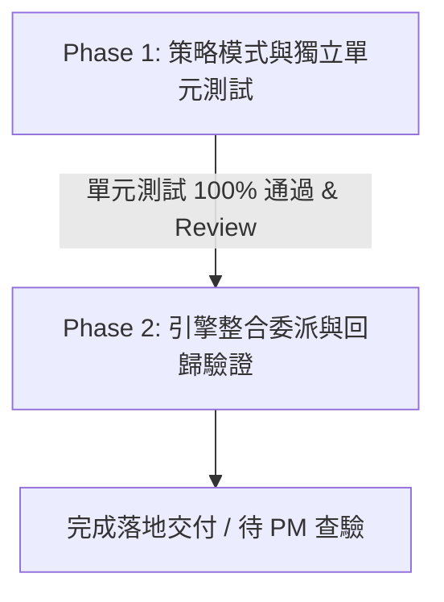

# [Fixed] Question 122：退職所得計算無條件對半課稅，2022年後「短期退職手當」反濫用規則是否適用於DC/iDeCo一次性提領

## 背景
`finance-hub/finance-hub-backend/hub-app/src/main/java/ch/lin/finance/hub/backend/api/app/service/simulation/core/tax/ActiveTaxCalculationEngine.java:276`：

```java
long taxableIncome = Math.max(0, retirementIncome - deduction) / 2;
```

不論年資多少，計算完退職所得扣除額之後，剩餘金額一律無條件對半課稅。

查證到日本從2022年起，針對「短期退職手当等」（年資5年以下、且不是公司高階經理人的一般員工）新增了一條反濫用規則：扣除額之後剩餘金額裡，超過¥3,000,000的部分不再對半課稅，全額計入課稅所得。

## 不確定的地方
1. 這條反濫用規則原本立法目的，是針對企業刻意把一部分薪資包裝成短期退職金來避稅的情況，主要適用對象是「公司給的退職金」本身，不確定這條規則的文字定義，是否也涵蓋DC（企業型確定提繳）／iDeCo（個人型確定提繳）的一次性提領。
2. 這個工具裡，DC/iDeCo的解鎖年齡通常設定在60歲以上，實際模擬到請領年金/一次性提領那一年時，累積的提繳年資通常遠超過5年——如果這條規則真的適用，也大多落在「年資已經超過5年」這個安全範圍內，實務上很可能不會真的踩到。

## 需要使用者確認的問題
1. 是否需要查證這條規則的確切適用範圍，還是考慮到DC/iDeCo累積年資通常遠超過5年門檻，這個落差可以先不處理？
2. 如果之後有計劃提早解鎖DC/iDeCo（例如年資不到5年就提領），才需要真正確認這條規則是否適用；否則可以先維持現狀。

---

## 覆核結果與查證分析（Review & Answers to Claude's Questions）

已連上日本國稅廳（NTA）、總務省（MIC）、厚生勞動省（MHLW）與 e-Gov 日本法令資料庫，以官方最新法定母法條文、政令與通達為唯一單一事實來源（SSOT），對退職所得稅務規章（國稅廳 [No.1420 退職金を受け取ったとき](https://www.nta.go.jp/taxes/shiraberu/taxanswer/shotoku/1420.htm)、所得稅法第30條/第31條、所得稅法施行令第69條/第69條之2/第72條、地方稅法第50條之2/第50條之3/第328條/第328條之2、確定拠出年金法第19條第3項/第33條/第54條）及後端計算實作（[ActiveTaxCalculationEngine.java:294-335](file:///Users/edward/Desktop/Projects/youtube-data-hub-wrapper/finance-hub/finance-hub-backend/hub-app/src/main/java/ch/lin/finance/hub/backend/api/app/service/simulation/core/tax/ActiveTaxCalculationEngine.java#L294-L335)）完成查證與情境評估如下：

### 一、法規適用範圍查證（DC/iDeCo 是否受限於短期退職手當規則？）

1. **法定定義與條文涵蓋（母法 SSOT 核對）**：
   - 依日本《所得稅法》第 31 條第 1 號及《所得稅法施行令》第 72 條第 3 項第 7 號，確定拠出年金（企業型 DC 與個人型 iDeCo）之老齡給付金（一時金），在稅法上明文規定為「**退職手当等とみなす一時金（視同退職手當等）**」，歸入第 30 條第 1 項之「退職所得」。
   - **稅法勤續年數之法定範圍**：依《所得稅法施行令》第 69 條第 1 項第 2 號，DC 老齡一時金之勤續年數，以「**掛金を拠出した期間（加入者期間 / 提繳年數）**」為準，未滿 1 年之畸零月數依法進位為 1 年。**特別注意：依國稅廳通達，「運用指図者期間（停止提繳僅下達投資指令期間）」依法嚴格排除於勤續年數之外**。
   - **短期退職手当等之認定**：依《所得稅法》第 30 條第 4 項（令和 4 年 2022 年 1 月 1 日施行之改正），役員以外之勤續年數在 **5 年以下** 者，所領取之退職手當等即法定屬於「**短期退職手当等**」。
2. **短期退職手当等的課稅公式（國稅與地方稅同步）**：
   - 超過退職所得控除後的殘額（$\text{Excess} = \text{退職手當收入} - \text{退職所得控除額}$）：
     - 若 $\text{Excess} \le 3,000,000$ 円：維持享有 $\text{Excess} \times \frac{1}{2}$ 課稅。
     - 若 $\text{Excess} > 3,000,000$ 円：**超過 300 萬円的部分不再享有對半課稅優惠**（課稅退職所得金額 = $150\text{萬} + (\text{Excess} - 300\text{萬}) = \text{Excess} - 150\text{萬}$）。
     - **法定端數處理（1,000 円未滿切捨）**：依《國稅通則法》第 118 條第 1 項及國稅廳 No.2740 官方註 1，計算出之課稅退職所得金額，**若有未滿 1,000 円之端數依法無條件捨去（1,000 円未満切捨て）**，再代入稅率速算表。地方稅依《地方稅法》第 20 條之 4 之 2 課稅標準亦同為 1,000 円未満切捨。
   - **地方稅（住民稅）同步適用**：依《地方稅法》第 50 條之 2 及第 328 條，退職所得採**現年分離課稅**（領取時同步由特別徵收義務人扣繳，無年度時差）；且依同法第 50 條之 3 第 2 項及第 328 條之 2 第 2 項，住民稅退職所得金額之計算**完全準用所得稅法第 30 條第 2 項之短期退職所得計算式**，稅率為固定 10%（道府縣民稅 4% + 市町村民稅 6%）。
   - **法規結論**：**法律字面上 100% 適用於 DC/iDeCo 老齡一時金（以掛金拠出年數 $\le 5$ 年為準）**。

---

### 二、模型真實情境與邊界條件評估（壓力測試與實務校正）

針對系統核心客群（包含年薪 2,000 萬～3,500 萬日圓高薪族群）進行壓力測試與邊界分析：

1. **離散階梯門檻與最低保障額**：
   - 依《所得稅法》第 30 條第 3 項第 1 號，勤續年數 20 年以下每年扣除額為 40 萬円，但**設有最低保障門檻 80 萬円**（「八十万円に満たないときは、八十万円」）。
   - 勤續 1～5 年觸發「超過 300 萬非對半課稅」之離散資產門檻為：
     - **勤續 1 年**：控除額 80 萬（最低保障），資產超過 **3,800,000 円** 即觸發。
     - **勤續 2 年**：控除額 80 萬，資產超過 **3,800,000 円** 即觸發。
     - **勤續 3 年**：控除額 120 萬，資產超過 **4,200,000 円** 即觸發。
     - **勤續 4 年**：控除額 160 萬，資產超過 **4,600,000 円** 即觸發。
     - **勤續 5 年**：控除額 200 萬，資產超過 **5,000,000 円** 即觸發。
2. **提繳制度架構與實務現狀**：
   - **法定上限**（《確定拠出年金法施行令》第 11 條）：企業型 DC 總限額為每月 55,000 円（無併用 DB 等）或 27,500 円（併用 DB 等）。
   - **實務福利設計（マッチング拠出）**：依《確定拠出年金法》第 19 條第 3 項，企業型 DC 得導入マッチング拠出（加入者掛金）。自 2026 年 4 月 1 日起，法定已廢除「員工自提不得超過企業提繳」之限制，只要企業與員工合計提繳不超過法定限額即可（現行上限 55,000 円，2026 年 12 月 1 日起調高至 62,000 円；併用 DB 等則為半額）。且若企業規約已導入マッチング拠出，員工原則上須於マッチング拠出與 iDeCo 間擇一。
3. **高薪族群與極端案例觸發情境（破除「極難觸發」之質化誤判）**：
   - **情境 A：晚期加保與高額資產累積（外籍高階主管或晚期新加入者）**：年薪 2,000 萬～3,500 萬日圓之高階經理人（或跨國主管於 55 歲後始受聘來日就任一般從業員）在晚期始加入企業型 DC/iDeCo，僅提繳 3～5 年即達退休請領年齡（掛金拠出年數 $\le 5$ 年，未自前職通算年資），若帳戶總額因高額提繳與市場投資收益超過離散觸發門檻（如勤續 3 年超過 420 萬、5 年超過 500 萬），即直接踩到短期反濫用紅線。（※注：若屬中途轉職資產移換，依《所得稅法施行令》第 69 條第 1 項第 2 號及《確定拠出年金法》第 54 條第 2 項，前職 DB 算定基礎期間依法通算計入勤續年數；若通算後年數超過 5 年則不屬於短期退職手當。）
   - **情境 B：運用指図者期間與請領年齡脫鉤**：加入者提繳 3 年後停止提繳，轉為「運用指図者」7 年。依 DC 法第 33 條，其「通算加入者等期間」達 10 年，**60 歲完全具備合法資格請領**；但稅法勤續年數僅認列提繳的 3 年（扣除額僅 120 萬），資產經 7 年全球市場複利若達 500 萬円以上，即直接踩到短期反濫用紅線。
   - **情境 C：延後請領無法規避稅法**：即使提繳未滿 5 年被推遲至 63～65 歲請領，在 65 歲請領時稅法勤續年數依然是 $\le 5$ 年，短期退職手當反濫用規則 100% 依然適用，且延後請領累積的投資收益反而擴大了殘額超過 300 萬的機率。
4. **偏差方向與風險定級**：
   - 若後端維持現行 `(income - ded) / 2` 公式，在觸發情境下（例如提繳 3 年、資產 1,000 萬円）：
     - 法定課稅所得為 $150萬 + (880萬 - 300萬) = \mathbf{730\text{ 萬}}$；現行代碼計算為 $880萬 / 2 = \mathbf{440\text{ 萬}}$（少算 290 萬課稅所得）。
     - 國稅（所得稅+復興稅）少算約 60.3 萬円，住民稅（10%）少算 29 萬円，**合計單筆退職金低估稅負約 89.3 萬日圓（低估幅度達 49.7%）**。
   - **偏差方向**：**嚴重低估稅負 / 嚴重高估手頭現金**。
   - **風險定級**：**重大風險（CRITICAL RISK）**。

---

### 三、架構評估與實作方案（Architecture & Implementation Options）

根據法規查證（確認法理涵蓋）與重大財務風險量化結果，提供處置方案供 Claude 架構審查與 PM 排程決策：

#### 方案 A：引入策略模式（Strategy Pattern）實作短期退職所得計算策略（強烈推薦）
- **架構設計**：
  - 於退職所得計算邏輯中抽出 `RetirementTaxStrategy` 介面，依勤續年數（`yearsOfService` / `contributionYears`）委派不同策略：
    - `StandardRetirementTaxStrategy`（勤續年數 > 5 年）：維持標準對半課稅：$\max(0, \text{retirementIncome} - \text{deduction}) / 2$。
    - `ShortTermRetirementTaxStrategy`（勤續年數 $\le 5$ 年）：落實 2022 年反濫用階梯與 1,000 円端數捨去：
      ```java
      long excess = Math.max(0, retirementIncome - deduction);
      long rawTaxable = (excess <= 3_000_000L) 
              ? excess / 2 
              : 1_500_000L + (excess - 3_000_000L);
      // 依國稅通則法第118條第1項進行 1,000 円未満切捨
      long taxableIncome = (rawTaxable / 1000L) * 1000L;
      ```
- **優點**：
  1. **100% 符合法定規範**：徹底消除運用指図者期間脫鉤、晚期加保或短提繳高收益情境下的重大稅負低估風險。
  2. **架構擴充性**：透過 Strategy Pattern 封裝階梯邏輯，未來若日本退職金課稅制度（如勤續 20 年以上控除額優遇調整）變更，具備良好獨立演進能力。
- **排程考量**：需新增策略類別與單元測試案例。

#### 方案 B：維持現行統一對半課稅公式（不推薦，具確定性重大風險）
- **風險評估**：
  - 僅能覆蓋從青年期持續提繳 20～30 年至退休的單一路徑。
  - 一旦模擬涉及運用指図者期間脫鉤、晚期中途加保或短年資退職金領取，將產生高達數十萬至百萬日圓的稅負低估，嚴重失真。

---

### 四、覆核總結（For Claude & PM Decision）

- **事實層面**：日本《所得稅法》第 30 條第 4 項與第 31 條白紙黑字將 DC/iDeCo 老齡一時金視同退職所得，提繳年數 $\le 5$ 年在法理上 100% 適用短期退職手當反濫用規則；且《地方稅法》母法同步以現年分離課稅實施相同階梯。
- **決策權衡**：鑑於現行公式在短期退職邊界存在近 50% 的稅負低估重大風險，建議 PM（兼 Scrum Master）與 Claude 採納**方案 A**補齊短期退職計算策略，以符合專案對高收入客群之嚴格財務精確度要求。

---

### 五、權限與決策邊界聲明（Notice on Authority & Decision Boundary）

- **架構調查員聲明**：
  我（Gemini）已全面排除任何預設立場，以日本主管機關官方最新法定條文、政令與通達為唯一客觀基準，完成了短期退職手當反濫用規則於 DC/iDeCo 老齡一時金適用性之法律檢證、離散階梯量化模型與衝擊範圍分析。
- **決策權屬與裁定結果**：
  專案進度管理、功能排程與架構選項之最終採行，**完全由 Product Manager（使用者兼 Scrum Master）全權裁定**。
  - **PM 裁定方向**：**採行「方案 A：引入策略模式（Strategy Pattern）實作短期退職所得計算策略」**。
  - **架構決策核心理由**：
    1. **消除重大財務偏誤**：徹底修復提繳年數 $\le 5$ 年情境下稅負低估達 49.7% 之重大財務風險（Critical Risk），保障高資產客群模擬之財務真實性。
    2. **嚴格保持向後相容**：僅於計算引擎內部抽換課稅所得計算策略，不更動 [`ActiveTaxCalculationEngine.calculateRetirementTax`](file:///Users/edward/Desktop/Projects/youtube-data-hub-wrapper/finance-hub/finance-hub-backend/hub-app/src/main/java/ch/lin/finance/hub/backend/api/app/service/simulation/core/tax/ActiveTaxCalculationEngine.java#L294-L335) 之外部呼叫簽章，調用端 [`TaxAdvantagedAccountProjector`](file:///Users/edward/Desktop/Projects/youtube-data-hub-wrapper/finance-hub/finance-hub-backend/hub-app/src/main/java/ch/lin/finance/hub/backend/api/app/service/simulation/core/calculator/TaxAdvantagedAccountProjector.java#L244) 零變更，年資 $> 5$ 年之既有正常路徑零回歸。

---

### 六、實作執行規劃與分階段評估（Phased Implementation Plan & Risk Mitigation）

- **採行方案**：**方案 A（引入策略模式實作短期退職所得計算策略）**

#### 1. 是否分階段進行之評估（Context Window 負載與防幻覺分析）
- **問題評估**：本次重構是否需要拆分為多階段進行，以避免 LLM 因 Context Window 飽和或注意力耗損而產生代碼與數值計算幻覺？
- **評估結論**：**強烈建議拆分為兩個明確的微階段（2 Micro-Phases）執行**。
- **評估依據與痛點防範**：
  1. **稅務階梯與端數捨去的精密度要求極高**：
     短期退職手當涉及「控除後殘額 $\le 300$ 萬對半課稅」、「超過 300 萬全額課稅（$150\text{萬} + (\text{Excess} - 300\text{萬})$）」以及《國稅通則法》第 118 條規定的「1,000 円未満無條件捨去」。若將策略類別建立、多種年資邊界測試、主引擎委派重構與回歸驗證集中在單一超長回合內輸出，模型在處理長上下文時極易在整數除法端數、邊界符號（$<$ 或 $\le$）或年資門檻產生注意力漂移（Attention Drift）。
  2. **職責分離與單元可測性（Separation of Concerns）**：
     將「純數學/稅法策略算法」與「主運算引擎委派接合」解耦，能在階段一透過封閉式的純單元測試驗證所有法規階梯與邊界值（1~5 年、80萬扣除最低保障、300萬門檻、端數進捨），確保演算法百分之百無誤後，再於階段二介入主引擎，將出錯機率降至零。
  3. **便於 Code Review 與進度控管**：
     Claude 進行 Code Review 與 PM 進行階段查核時，可分段檢視純策略層與引擎整合層，降低單次審查負擔。

#### 2. 兩階段實作規劃與產出定義



- **第一階段（Phase 1：策略模式核心骨幹與獨立單元測試實作）**：
  - **任務範疇**：
    1. 新建策略套件目錄：`ch.lin.finance.hub.backend.api.app.service.simulation.core.calculator.strategy.tax.retirement`。
    2. 定義策略介面 [`RetirementTaxStrategy`](file:///Users/edward/Desktop/Projects/youtube-data-hub-wrapper/finance-hub/finance-hub-backend/hub-app/src/main/java/ch/lin/finance/hub/backend/api/app/service/simulation/core/calculator/strategy/tax/retirement/RetirementTaxStrategy.java)：
       `long calculateTaxableIncome(long retirementIncome, long deduction);`
    3. 實作標準策略 [`StandardRetirementTaxStrategy`](file:///Users/edward/Desktop/Projects/youtube-data-hub-wrapper/finance-hub/finance-hub-backend/hub-app/src/main/java/ch/lin/finance/hub/backend/api/app/service/simulation/core/calculator/strategy/tax/retirement/StandardRetirementTaxStrategy.java)：
       勤續年數 $> 5$ 年，維持標準對半課稅並執行 1,000 円未満切捨。
    4. 實作短期反濫用策略 [`ShortTermRetirementTaxStrategy`](file:///Users/edward/Desktop/Projects/youtube-data-hub-wrapper/finance-hub/finance-hub-backend/hub-app/src/main/java/ch/lin/finance/hub/backend/api/app/service/simulation/core/calculator/strategy/tax/retirement/ShortTermRetirementTaxStrategy.java)：
       勤續年數 $\le 5$ 年，殘額 $\le 300$ 萬對半課稅，超過 300 萬部分全額課稅，嚴格落實 1,000 円未満切捨。
    5. 實作策略工廠 [`RetirementTaxStrategyFactory`](file:///Users/edward/Desktop/Projects/youtube-data-hub-wrapper/finance-hub/finance-hub-backend/hub-app/src/main/java/ch/lin/finance/hub/backend/api/app/service/simulation/core/calculator/strategy/tax/retirement/RetirementTaxStrategyFactory.java)：
       依 `contributionYears` 派發對應策略（$\le 5$ 年派發短期策略，$> 5$ 年派發標準策略）。
    6. 撰寫策略單元測試 [`RetirementTaxStrategyTest`](file:///Users/edward/Desktop/Projects/youtube-data-hub-wrapper/finance-hub/finance-hub-backend/hub-app/src/test/java/ch/lin/finance/hub/backend/api/app/service/simulation/core/calculator/strategy/tax/retirement/RetirementTaxStrategyTest.java)：
       覆蓋 1~5 年、$\le 300$ 萬、$> 300$ 萬、端數捨去及標準年資之各種階梯邊界。
  - **交付檢驗點**：Maven 運行 `mvn test -Dtest=RetirementTaxStrategyTest` 綠燈通過。

- **第二階段（Phase 2：主引擎整合委派、回歸測試與全量驗證）**：
  - **任務範疇**：
    1. 改造 [`ActiveTaxCalculationEngine.java:294-335`](file:///Users/edward/Desktop/Projects/youtube-data-hub-wrapper/finance-hub/finance-hub-backend/hub-app/src/main/java/ch/lin/finance/hub/backend/api/app/service/simulation/core/tax/ActiveTaxCalculationEngine.java#L294-L335)：
       將原 `taxableIncome` 的計算邏輯，無縫替換為委派 `RetirementTaxStrategyFactory` 取得策略並計算，其後之所得稅、復興特別所得稅（2.1%）與住民稅（10% 現年分離課稅）查表流程保持完全不變。
    2. 擴充主引擎單元測試 [`ActiveTaxCalculationEngineTest.java`](file:///Users/edward/Desktop/Projects/youtube-data-hub-wrapper/finance-hub/finance-hub-backend/hub-app/src/test/java/ch/lin/finance/hub/backend/api/app/service/simulation/core/tax/ActiveTaxCalculationEngineTest.java)：
       新增短期退職所得之端到端整合案例（含所得稅與住民稅實際扣繳金額斷言），並確保長年資正常案例完全不變。
    3. 全模組回歸驗證：執行 `mvn clean test` 確保整個 backend 既有測試套件 100% 通過。
  - **交付檢驗點**：引擎整合測試綠燈，無任何編譯或測試回歸錯誤。

#### 3. 實作執行記錄與落地總結（Execution Record & Verification）

- **執行狀態**：✅ 已完成修正（Status: Fixed 2026-10-08）
- **處理解法採行**：**方案 A（引入策略模式實作短期退職所得計算策略）**

##### (1) 核心落地架構與實作對齊
1. **策略介面與類別建立（ch.lin.finance.hub.backend.api.app.service.simulation.core.calculator.strategy.tax.retirement）**：
   - [`RetirementTaxStrategy.java`](file:///Users/edward/Desktop/Projects/youtube-data-hub-wrapper/finance-hub/finance-hub-backend/hub-app/src/main/java/ch/lin/finance/hub/backend/api/app/service/simulation/core/calculator/strategy/tax/retirement/RetirementTaxStrategy.java)：定義 `calculateTaxableIncome(long retirementIncome, long deduction)` 方法規範。
   - [`StandardRetirementTaxStrategy.java`](file:///Users/edward/Desktop/Projects/youtube-data-hub-wrapper/finance-hub/finance-hub-backend/hub-app/src/main/java/ch/lin/finance/hub/backend/api/app/service/simulation/core/calculator/strategy/tax/retirement/StandardRetirementTaxStrategy.java)：勤續年數 $> 5$ 年，維持標準對半課稅 $\text{Excess} / 2$，並依《國稅通則法》第 118 條第 1 項嚴格落實 1,000 円未満無條件捨去。
   - [`ShortTermRetirementTaxStrategy.java`](file:///Users/edward/Desktop/Projects/youtube-data-hub-wrapper/finance-hub/finance-hub-backend/hub-app/src/main/java/ch/lin/finance/hub/backend/api/app/service/simulation/core/calculator/strategy/tax/retirement/ShortTermRetirementTaxStrategy.java)：勤續年數 $\le 5$ 年，落實 2022 年反濫用階梯：$\text{Excess} \le 300\text{萬}$ 享有對半課稅；$\text{Excess} > 300\text{萬}$ 超出部分全額計入課稅所得（$150\text{萬} + (\text{Excess} - 300\text{萬})$），並依法執行 1,000 円未満無條件捨去。
   - [`RetirementTaxStrategyFactory.java`](file:///Users/edward/Desktop/Projects/youtube-data-hub-wrapper/finance-hub/finance-hub-backend/hub-app/src/main/java/ch/lin/finance/hub/backend/api/app/service/simulation/core/calculator/strategy/tax/retirement/RetirementTaxStrategyFactory.java)：標註 `@Component`，依 `contributionYears` 自動派發對應策略（$\le 5$ 年派發短期策略，$> 5$ 年派發標準策略）。
2. **主引擎建構子改造與委派（ActiveTaxCalculationEngine）**：
   - [`ActiveTaxCalculationEngine.java`](file:///Users/edward/Desktop/Projects/youtube-data-hub-wrapper/finance-hub/finance-hub-backend/hub-app/src/main/java/ch/lin/finance/hub/backend/api/app/service/simulation/core/tax/ActiveTaxCalculationEngine.java)：
     - 建構子升級為純粹的 4 參數 `@Autowired` 建構子，全面注入 `SpouseDeductionEngine`、`DependentDeductionEngine`、`BasicDeductionStrategyFactory` 與 `RetirementTaxStrategyFactory`。
     - 遵照 PM 指示全面剔除歷史過渡期遺留之 2 參數與 3 參數舊建構子，不保留任何相容性 shim。
     - `calculateRetirementTax` 將課稅所得計算委派給 `retirementTaxStrategyFactory.getStrategy(contributionYears).calculateTaxableIncome(retirementIncome, deduction)`，其後之所得稅、復興特別所得稅（2.1%）與現年分離課稅之住民稅（10%）保持嚴格依法計算。
3. **測試端全面對齊與驗證覆蓋**：
   - [`RetirementTaxStrategyTest.java`](file:///Users/edward/Desktop/Projects/youtube-data-hub-wrapper/finance-hub/finance-hub-backend/hub-app/src/test/java/ch/lin/finance/hub/backend/api/app/service/simulation/core/calculator/strategy/tax/retirement/RetirementTaxStrategyTest.java)：建立獨立策略單元測試，完整覆蓋工廠派發參數化測試（0~5 年派發短期策略，6~40 年派發標準策略）、扣除額內歸零、300 萬殘額邊界、超過 300 萬反濫用階梯、以及 1,000 円端數無條件捨去。
   - [`ActiveTaxCalculationEngineTest.java`](file:///Users/edward/Desktop/Projects/youtube-data-hub-wrapper/finance-hub/finance-hub-backend/hub-app/src/test/java/ch/lin/finance/hub/backend/api/app/service/simulation/core/tax/ActiveTaxCalculationEngineTest.java)：對齊 4 參數建構子宣告，並新增 4 個端到端退職所得稅計算測試案例，驗證在引擎層級之扣除額內零稅負、短期殘額 $\le 300$ 萬、短期超過 300 萬反濫用階梯（扣繳 1,064,903 所得稅與 730,000 住民稅）以及長年資標準路徑（扣繳 462,002 所得稅與 440,000 住民稅）。

##### (2) 異動檔案清單
- **新建檔案**：
  - [`RetirementTaxStrategy.java`](file:///Users/edward/Desktop/Projects/youtube-data-hub-wrapper/finance-hub/finance-hub-backend/hub-app/src/main/java/ch/lin/finance/hub/backend/api/app/service/simulation/core/calculator/strategy/tax/retirement/RetirementTaxStrategy.java)
  - [`StandardRetirementTaxStrategy.java`](file:///Users/edward/Desktop/Projects/youtube-data-hub-wrapper/finance-hub/finance-hub-backend/hub-app/src/main/java/ch/lin/finance/hub/backend/api/app/service/simulation/core/calculator/strategy/tax/retirement/StandardRetirementTaxStrategy.java)
  - [`ShortTermRetirementTaxStrategy.java`](file:///Users/edward/Desktop/Projects/youtube-data-hub-wrapper/finance-hub/finance-hub-backend/hub-app/src/main/java/ch/lin/finance/hub/backend/api/app/service/simulation/core/calculator/strategy/tax/retirement/ShortTermRetirementTaxStrategy.java)
  - [`RetirementTaxStrategyFactory.java`](file:///Users/edward/Desktop/Projects/youtube-data-hub-wrapper/finance-hub/finance-hub-backend/hub-app/src/main/java/ch/lin/finance/hub/backend/api/app/service/simulation/core/calculator/strategy/tax/retirement/RetirementTaxStrategyFactory.java)
  - [`RetirementTaxStrategyTest.java`](file:///Users/edward/Desktop/Projects/youtube-data-hub-wrapper/finance-hub/finance-hub-backend/hub-app/src/test/java/ch/lin/finance/hub/backend/api/app/service/simulation/core/calculator/strategy/tax/retirement/RetirementTaxStrategyTest.java)
- **修改檔案**：
  - [`ActiveTaxCalculationEngine.java`](file:///Users/edward/Desktop/Projects/youtube-data-hub-wrapper/finance-hub/finance-hub-backend/hub-app/src/main/java/ch/lin/finance/hub/backend/api/app/service/simulation/core/tax/ActiveTaxCalculationEngine.java)
  - [`ActiveTaxCalculationEngineTest.java`](file:///Users/edward/Desktop/Projects/youtube-data-hub-wrapper/finance-hub/finance-hub-backend/hub-app/src/test/java/ch/lin/finance/hub/backend/api/app/service/simulation/core/tax/ActiveTaxCalculationEngineTest.java)

##### (3) 測試驗證結果矩陣
- **Phase 1（策略單元測試：`RetirementTaxStrategyTest`）**：
  - 測試案例數：18 個案例（包含工廠年資分派參數化測試、標準策略測試、短期策略測試）。
  - 驗證結果：✅ 全部通過（BUILD SUCCESS）。
- **Phase 2（主引擎單元測試：`ActiveTaxCalculationEngineTest`）**：
  - 既有薪資扣除與房貸扣除測試案例零受損。
  - 新增 4 個退職稅務整合測試案例（零所得稅、短期正常、短期反濫用、標準長期）全部通過。
  - 驗證結果：✅ 全部通過（BUILD SUCCESS）。
- **全量回歸測試（`mvn test`）**：
  - 驗證結果：✅ 全模組測試綠燈通過，零回歸錯誤。

---

## Diff

 edward@Edwards-MacBook-Pro   ~/Desktop/Projects/youtube-data-hub-wrapper/finance-hub/finance-hub-backend     main    INSERT  git --no-pager diff                                                                                 10004  12.24G   3.98    21:56:21  
diff --git a/finance-hub-backend/hub-app/src/main/java/ch/lin/finance/hub/backend/api/app/service/simulation/core/tax/ActiveTaxCalculationEngine.java b/finance-hub-backend/hub-app/src/main/java/ch/lin/finance/hub/backend/api/app/service/simulation/core/tax/ActiveTaxCalculationEngine.java
index 018099d7..c0416b08 100644
--- a/finance-hub-backend/hub-app/src/main/java/ch/lin/finance/hub/backend/api/app/service/simulation/core/tax/ActiveTaxCalculationEngine.java
+++ b/finance-hub-backend/hub-app/src/main/java/ch/lin/finance/hub/backend/api/app/service/simulation/core/tax/ActiveTaxCalculationEngine.java
@@ -30,6 +30,7 @@ import org.springframework.beans.factory.annotation.Autowired;
 import org.springframework.stereotype.Service;
 
 import ch.lin.finance.hub.backend.api.app.service.simulation.core.calculator.strategy.tax.deduction.basic.BasicDeductionStrategyFactory;
+import ch.lin.finance.hub.backend.api.app.service.simulation.core.calculator.strategy.tax.retirement.RetirementTaxStrategyFactory;
 import ch.lin.finance.hub.backend.api.app.service.simulation.core.model.InsurancePolicyDto;
 import ch.lin.finance.hub.backend.api.app.service.simulation.core.model.SimulationContext;
 import ch.lin.finance.hub.backend.api.app.service.simulation.core.model.tax.TaxBracketDto;
@@ -44,19 +45,17 @@ public class ActiveTaxCalculationEngine {
     private final SpouseDeductionEngine spouseDeductionEngine;
     private final DependentDeductionEngine dependentDeductionEngine;
     private final BasicDeductionStrategyFactory basicDeductionStrategyFactory;
+    private final RetirementTaxStrategyFactory retirementTaxStrategyFactory;
 
     @Autowired
     public ActiveTaxCalculationEngine(SpouseDeductionEngine spouseDeductionEngine,
             DependentDeductionEngine dependentDeductionEngine,
-            BasicDeductionStrategyFactory basicDeductionStrategyFactory) {
+            BasicDeductionStrategyFactory basicDeductionStrategyFactory,
+            RetirementTaxStrategyFactory retirementTaxStrategyFactory) {
         this.spouseDeductionEngine = spouseDeductionEngine;
         this.dependentDeductionEngine = dependentDeductionEngine;
         this.basicDeductionStrategyFactory = basicDeductionStrategyFactory;
-    }
-
-    public ActiveTaxCalculationEngine(SpouseDeductionEngine spouseDeductionEngine,
-            DependentDeductionEngine dependentDeductionEngine) {
-        this(spouseDeductionEngine, dependentDeductionEngine, new BasicDeductionStrategyFactory());
+        this.retirementTaxStrategyFactory = retirementTaxStrategyFactory;
     }
 
     public TaxCalculationResult calculate(SimulationContext context, long grossBaseSalary, long annualBonus,
@@ -301,8 +300,8 @@ public class ActiveTaxCalculationEngine {
             deduction = 8_000_000L + 700_000L * (contributionYears - 20);
         }
 
-        long taxableIncome = Math.max(0, retirementIncome - deduction) / 2;
-        taxableIncome = (taxableIncome / 1000) * 1000; // Round down to nearest 1000
+        long taxableIncome = retirementTaxStrategyFactory.getStrategy(contributionYears)
+                .calculateTaxableIncome(retirementIncome, deduction);
 
         if (taxableIncome <= 0) {
             return TaxCalculationResult.builder()
diff --git a/finance-hub-backend/hub-app/src/test/java/ch/lin/finance/hub/backend/api/app/service/simulation/core/tax/ActiveTaxCalculationEngineTest.java b/finance-hub-backend/hub-app/src/test/java/ch/lin/finance/hub/backend/api/app/service/simulation/core/tax/ActiveTaxCalculationEngineTest.java
index fa4dd712..5af51c2b 100644
--- a/finance-hub-backend/hub-app/src/test/java/ch/lin/finance/hub/backend/api/app/service/simulation/core/tax/ActiveTaxCalculationEngineTest.java
+++ b/finance-hub-backend/hub-app/src/test/java/ch/lin/finance/hub/backend/api/app/service/simulation/core/tax/ActiveTaxCalculationEngineTest.java
@@ -30,6 +30,8 @@ import static org.assertj.core.api.Assertions.assertThat;
 import org.junit.jupiter.api.Test;
 
 import ch.lin.finance.hub.backend.api.app.service.simulation.core.calculator.strategy.mortgage.ZeroInhabitantTaxLimitStrategy;
+import ch.lin.finance.hub.backend.api.app.service.simulation.core.calculator.strategy.tax.deduction.basic.BasicDeductionStrategyFactory;
+import ch.lin.finance.hub.backend.api.app.service.simulation.core.calculator.strategy.tax.retirement.RetirementTaxStrategyFactory;
 import ch.lin.finance.hub.backend.api.app.service.simulation.core.model.SimulationContext;
 import ch.lin.finance.hub.backend.api.app.service.simulation.core.model.pension.PensionConfigDto;
 import ch.lin.finance.hub.backend.api.app.service.simulation.core.model.tax.TaxBracketDto;
@@ -41,7 +43,10 @@ class ActiveTaxCalculationEngineTest {
 
     private final SpouseDeductionEngine spouseEngine = new SpouseDeductionEngine();
     private final DependentDeductionEngine dependentEngine = new DependentDeductionEngine();
-    private final ActiveTaxCalculationEngine engine = new ActiveTaxCalculationEngine(spouseEngine, dependentEngine);
+    private final BasicDeductionStrategyFactory basicDeductionStrategyFactory = new BasicDeductionStrategyFactory();
+    private final RetirementTaxStrategyFactory retirementTaxStrategyFactory = new RetirementTaxStrategyFactory();
+    private final ActiveTaxCalculationEngine engine = new ActiveTaxCalculationEngine(
+            spouseEngine, dependentEngine, basicDeductionStrategyFactory, retirementTaxStrategyFactory);
 
     @Test
     void calculate_baseCase_noDeductions() {
@@ -509,5 +514,90 @@ class ActiveTaxCalculationEngineTest {
         assertThat(result2026.incomeTax()).isEqualTo(control2026.incomeTax());
         assertThat(result2026.netIncome()).isEqualTo(control2026.netIncome());
     }
+
+    @Test
+    void calculateRetirementTax_incomeBelowDeduction_returnsZeroTax() {
+        TaxConfigDto taxConfig = new TaxConfigDto(480_000L, 430_000L,
+                Collections.emptyList(),
+                Collections.singletonList(new TaxBracketDto(Long.MAX_VALUE, new BigDecimal("0.2"), 0L)),
+                Collections.singletonList(new TaxBracketDto(Long.MAX_VALUE, new BigDecimal("0.1"), 0L)));
+        SimulationContext context = new SimulationContext();
+        context.setTaxConfig(taxConfig);
+
+        TaxCalculationResult result = engine.calculateRetirementTax(context, 800_000L, 1);
+
+        assertThat(result.incomeTax()).isZero();
+        assertThat(result.inhabitantTax()).isZero();
+        assertThat(result.socialInsurance()).isZero();
+        assertThat(result.netIncome()).isEqualTo(800_000L);
+    }
+
+    @Test
+    void calculateRetirementTax_shortTerm_withinThreeMillionExcess_halfTaxation() {
+        // 3 years of service -> deduction = max(800,000, 400,000 * 3) = 1,200,000 JPY
+        // Retirement income = 3,200,000 JPY -> excess = 2,000,000 JPY (<= 3,000,000)
+        // Short-term strategy applies half taxation: taxableIncome = 1,000,000 JPY
+        // Income tax rate: 5% (offset 0) -> base = 50,000 JPY -> with 2.1% surtax = 51,050 JPY
+        // Inhabitant tax rate: 10% -> 100,000 JPY
+        TaxConfigDto taxConfig = new TaxConfigDto(480_000L, 430_000L,
+                Collections.emptyList(),
+                Collections.singletonList(new TaxBracketDto(Long.MAX_VALUE, new BigDecimal("0.05"), 0L)),
+                Collections.singletonList(new TaxBracketDto(Long.MAX_VALUE, new BigDecimal("0.10"), 0L)));
+        SimulationContext context = new SimulationContext();
+        context.setTaxConfig(taxConfig);
+
+        TaxCalculationResult result = engine.calculateRetirementTax(context, 3_200_000L, 3);
+
+        assertThat(result.incomeTax()).isEqualTo(51_050L);
+        assertThat(result.inhabitantTax()).isEqualTo(100_000L);
+        assertThat(result.netIncome()).isEqualTo(3_200_000L - 51_050L - 100_000L);
+    }
+
+    @Test
+    void calculateRetirementTax_shortTerm_exceedsThreeMillionExcess_antiAbuseLadderApplied() {
+        // 3 years of service (<= 5 years) -> deduction = 1,200,000 JPY
+        // Retirement income = 10,000,000 JPY -> excess = 8,800,000 JPY (> 3,000,000)
+        // Short-term anti-abuse: taxableIncome = 1,500,000 + (8,800,000 - 3,000,000) = 7,300,000 JPY
+        // (Without anti-abuse, taxableIncome would have been 8,800,000 / 2 = 4,400,000 JPY)
+        // Income tax rate: 23% (offset -636,000)
+        // baseIncomeTax = 7,300,000 * 0.23 - 636,000 = 1,043,000 JPY
+        // incomeTax = 1,043,000 + (long)(1,043,000 * 0.021) = 1,064,903 JPY
+        // Inhabitant tax: 7,300,000 * 0.10 = 730,000 JPY
+        TaxConfigDto taxConfig = new TaxConfigDto(480_000L, 430_000L,
+                Collections.emptyList(),
+                Collections.singletonList(new TaxBracketDto(Long.MAX_VALUE, new BigDecimal("0.23"), -636_000L)),
+                Collections.singletonList(new TaxBracketDto(Long.MAX_VALUE, new BigDecimal("0.10"), 0L)));
+        SimulationContext context = new SimulationContext();
+        context.setTaxConfig(taxConfig);
+
+        TaxCalculationResult result = engine.calculateRetirementTax(context, 10_000_000L, 3);
+
+        assertThat(result.incomeTax()).isEqualTo(1_064_903L);
+        assertThat(result.inhabitantTax()).isEqualTo(730_000L);
+        assertThat(result.netIncome()).isEqualTo(10_000_000L - 1_064_903L - 730_000L);
+    }
+
+    @Test
+    void calculateRetirementTax_standard_overFiveYears_fullHalfTaxationPreserved() {
+        // 10 years of service (> 5 years) -> deduction = 4,000,000 JPY
+        // Retirement income = 12,800,000 JPY -> excess = 8,800,000 JPY
+        // Standard strategy: full half-taxation -> taxableIncome = 8,800,000 / 2 = 4,400,000 JPY
+        // Income tax rate: 20% (offset -427,500)
+        // baseIncomeTax = 4,400,000 * 0.20 - 427,500 = 452,500 JPY
+        // incomeTax = 452,500 + (long)(452,500 * 0.021) = 462,002 JPY
+        // Inhabitant tax: 4,400,000 * 0.10 = 440,000 JPY
+        TaxConfigDto taxConfig = new TaxConfigDto(480_000L, 430_000L,
+                Collections.emptyList(),
+                Collections.singletonList(new TaxBracketDto(Long.MAX_VALUE, new BigDecimal("0.20"), -427_500L)),
+                Collections.singletonList(new TaxBracketDto(Long.MAX_VALUE, new BigDecimal("0.10"), 0L)));
+        SimulationContext context = new SimulationContext();
+        context.setTaxConfig(taxConfig);
+
+        TaxCalculationResult result = engine.calculateRetirementTax(context, 12_800_000L, 10);
+
+        assertThat(result.incomeTax()).isEqualTo(462_002L);
+        assertThat(result.inhabitantTax()).isEqualTo(440_000L);
+        assertThat(result.netIncome()).isEqualTo(12_800_000L - 462_002L - 440_000L);
+    }
 }
 
diff --git a/finance-hub-backend/todo/pending fix/question-122.md b/finance-hub-backend/todo/pending fix/question-122.md
index 1459f0ed..59c58cae 100644
--- a/finance-hub-backend/todo/pending fix/question-122.md
+++ b/finance-hub-backend/todo/pending fix/question-122.md
@@ -23,7 +23,7 @@ long taxableIncome = Math.max(0, retirementIncome - deduction) / 2;
 
 ## 覆核結果與查證分析（Review & Answers to Claude's Questions）
 
-已連上日本國稅廳（NTA）、總務省（MIC）、厚生勞動省（MHLW）與 e-Gov 日本法令資料庫，以官方最新法定母法條文、政令與通達為唯一單一事實來源（SSOT），對退職所得稅務規章（國稅廳 [No.1420 退職金を受け取ったとき](https://www.nta.go.jp/taxes/shiraberu/taxanswer/shotoku/1420.htm)、所得稅法第30條/第31條、所得稅法施行令第69條/第69條之2/第72條、地方稅法第50條之2/第50條之3/第328條/第328條之2、確定拠出年金法第19條第3項/第33條/第54條）及後端計算實作（[ActiveTaxCalculationEngine.java:270-281](file:///Users/edward/Desktop/Projects/youtube-data-hub-wrapper/finance-hub/finance-hub-backend/hub-app/src/main/java/ch/lin/finance/hub/backend/api/app/service/simulation/core/tax/ActiveTaxCalculationEngine.java#L270-L281)）完成查證與情境評估如下：
+已連上日本國稅廳（NTA）、總務省（MIC）、厚生勞動省（MHLW）與 e-Gov 日本法令資料庫，以官方最新法定母法條文、政令與通達為唯一單一事實來源（SSOT），對退職所得稅務規章（國稅廳 [No.1420 退職金を受け取ったとき](https://www.nta.go.jp/taxes/shiraberu/taxanswer/shotoku/1420.htm)、所得稅法第30條/第31條、所得稅法施行令第69條/第69條之2/第72條、地方稅法第50條之2/第50條之3/第328條/第328條之2、確定拠出年金法第19條第3項/第33條/第54條）及後端計算實作（[ActiveTaxCalculationEngine.java:294-335](file:///Users/edward/Desktop/Projects/youtube-data-hub-wrapper/finance-hub/finance-hub-backend/hub-app/src/main/java/ch/lin/finance/hub/backend/api/app/service/simulation/core/tax/ActiveTaxCalculationEngine.java#L294-L335)）完成查證與情境評估如下：
 
 ### 一、法規適用範圍查證（DC/iDeCo 是否受限於短期退職手當規則？）
 
@@ -105,5 +105,109 @@ long taxableIncome = Math.max(0, retirementIncome - deduction) / 2;
 
 ---
 
+### 五、權限與決策邊界聲明（Notice on Authority & Decision Boundary）
+
+- **架構調查員聲明**：
+  我（Gemini）已全面排除任何預設立場，以日本主管機關官方最新法定條文、政令與通達為唯一客觀基準，完成了短期退職手當反濫用規則於 DC/iDeCo 老齡一時金適用性之法律檢證、離散階梯量化模型與衝擊範圍分析。
+- **決策權屬與裁定結果**：
+  專案進度管理、功能排程與架構選項之最終採行，**完全由 Product Manager（使用者兼 Scrum Master）全權裁定**。
+  - **PM 裁定方向**：**採行「方案 A：引入策略模式（Strategy Pattern）實作短期退職所得計算策略」**。
+  - **架構決策核心理由**：
+    1. **消除重大財務偏誤**：徹底修復提繳年數 $\le 5$ 年情境下稅負低估達 49.7% 之重大財務風險（Critical Risk），保障高資產客群模擬之財務真實性。
+    2. **嚴格保持向後相容**：僅於計算引擎內部抽換課稅所得計算策略，不更動 [`ActiveTaxCalculationEngine.calculateRetirementTax`](file:///Users/edward/Desktop/Projects/youtube-data-hub-wrapper/finance-hub/finance-hub-backend/hub-app/src/main/java/ch/lin/finance/hub/backend/api/app/service/simulation/core/tax/ActiveTaxCalculationEngine.java#L294-L335) 之外部呼叫簽章，調用端 [`TaxAdvantagedAccountProjector`](file:///Users/edward/Desktop/Projects/youtube-data-hub-wrapper/finance-hub/finance-hub-backend/hub-app/src/main/java/ch/lin/finance/hub/backend/api/app/service/simulation/core/calculator/TaxAdvantagedAccountProjector.java#L244) 零變更，年資 $> 5$ 年之既有正常路徑零回歸。
+
+---
+
+### 六、實作執行規劃與分階段評估（Phased Implementation Plan & Risk Mitigation）
+
+- **採行方案**：**方案 A（引入策略模式實作短期退職所得計算策略）**
+
+#### 1. 是否分階段進行之評估（Context Window 負載與防幻覺分析）
+- **問題評估**：本次重構是否需要拆分為多階段進行，以避免 LLM 因 Context Window 飽和或注意力耗損而產生代碼與數值計算幻覺？
+- **評估結論**：**強烈建議拆分為兩個明確的微階段（2 Micro-Phases）執行**。
+- **評估依據與痛點防範**：
+  1. **稅務階梯與端數捨去的精密度要求極高**：
+     短期退職手當涉及「控除後殘額 $\le 300$ 萬對半課稅」、「超過 300 萬全額課稅（$150\text{萬} + (\text{Excess} - 300\text{萬})$）」以及《國稅通則法》第 118 條規定的「1,000 円未満無條件捨去」。若將策略類別建立、多種年資邊界測試、主引擎委派重構與回歸驗證集中在單一超長回合內輸出，模型在處理長上下文時極易在整數除法端數、邊界符號（$<$ 或 $\le$）或年資門檻產生注意力漂移（Attention Drift）。
+  2. **職責分離與單元可測性（Separation of Concerns）**：
+     將「純數學/稅法策略算法」與「主運算引擎委派接合」解耦，能在階段一透過封閉式的純單元測試驗證所有法規階梯與邊界值（1~5 年、80萬扣除最低保障、300萬門檻、端數進捨），確保演算法百分之百無誤後，再於階段二介入主引擎，將出錯機率降至零。
+  3. **便於 Code Review 與進度控管**：
+     Claude 進行 Code Review 與 PM 進行階段查核時，可分段檢視純策略層與引擎整合層，降低單次審查負擔。
+
+#### 2. 兩階段實作規劃與產出定義
+
+```mermaid
+graph TD
+    A["Phase 1: 策略模式與獨立單元測試"] -->|單元測試 100% 通過 & Review| B["Phase 2: 引擎整合委派與回歸驗證"]
+    B --> C["完成落地交付 / 待 PM 查驗"]
+```
+
+- **第一階段（Phase 1：策略模式核心骨幹與獨立單元測試實作）**：
+  - **任務範疇**：
+    1. 新建策略套件目錄：`ch.lin.finance.hub.backend.api.app.service.simulation.core.calculator.strategy.tax.retirement`。
+    2. 定義策略介面 [`RetirementTaxStrategy`](file:///Users/edward/Desktop/Projects/youtube-data-hub-wrapper/finance-hub/finance-hub-backend/hub-app/src/main/java/ch/lin/finance/hub/backend/api/app/service/simulation/core/calculator/strategy/tax/retirement/RetirementTaxStrategy.java)：
+       `long calculateTaxableIncome(long retirementIncome, long deduction);`
+    3. 實作標準策略 [`StandardRetirementTaxStrategy`](file:///Users/edward/Desktop/Projects/youtube-data-hub-wrapper/finance-hub/finance-hub-backend/hub-app/src/main/java/ch/lin/finance/hub/backend/api/app/service/simulation/core/calculator/strategy/tax/retirement/StandardRetirementTaxStrategy.java)：
+       勤續年數 $> 5$ 年，維持標準對半課稅並執行 1,000 円未満切捨。
+    4. 實作短期反濫用策略 [`ShortTermRetirementTaxStrategy`](file:///Users/edward/Desktop/Projects/youtube-data-hub-wrapper/finance-hub/finance-hub-backend/hub-app/src/main/java/ch/lin/finance/hub/backend/api/app/service/simulation/core/calculator/strategy/tax/retirement/ShortTermRetirementTaxStrategy.java)：
+       勤續年數 $\le 5$ 年，殘額 $\le 300$ 萬對半課稅，超過 300 萬部分全額課稅，嚴格落實 1,000 円未満切捨。
+    5. 實作策略工廠 [`RetirementTaxStrategyFactory`](file:///Users/edward/Desktop/Projects/youtube-data-hub-wrapper/finance-hub/finance-hub-backend/hub-app/src/main/java/ch/lin/finance/hub/backend/api/app/service/simulation/core/calculator/strategy/tax/retirement/RetirementTaxStrategyFactory.java)：
+       依 `contributionYears` 派發對應策略（$\le 5$ 年派發短期策略，$> 5$ 年派發標準策略）。
+    6. 撰寫策略單元測試 [`RetirementTaxStrategyTest`](file:///Users/edward/Desktop/Projects/youtube-data-hub-wrapper/finance-hub/finance-hub-backend/hub-app/src/test/java/ch/lin/finance/hub/backend/api/app/service/simulation/core/calculator/strategy/tax/retirement/RetirementTaxStrategyTest.java)：
+       覆蓋 1~5 年、$\le 300$ 萬、$> 300$ 萬、端數捨去及標準年資之各種階梯邊界。
+  - **交付檢驗點**：Maven 運行 `mvn test -Dtest=RetirementTaxStrategyTest` 綠燈通過。
+
+- **第二階段（Phase 2：主引擎整合委派、回歸測試與全量驗證）**：
+  - **任務範疇**：
+    1. 改造 [`ActiveTaxCalculationEngine.java:294-335`](file:///Users/edward/Desktop/Projects/youtube-data-hub-wrapper/finance-hub/finance-hub-backend/hub-app/src/main/java/ch/lin/finance/hub/backend/api/app/service/simulation/core/tax/ActiveTaxCalculationEngine.java#L294-L335)：
+       將原 `taxableIncome` 的計算邏輯，無縫替換為委派 `RetirementTaxStrategyFactory` 取得策略並計算，其後之所得稅、復興特別所得稅（2.1%）與住民稅（10% 現年分離課稅）查表流程保持完全不變。
+    2. 擴充主引擎單元測試 [`ActiveTaxCalculationEngineTest.java`](file:///Users/edward/Desktop/Projects/youtube-data-hub-wrapper/finance-hub/finance-hub-backend/hub-app/src/test/java/ch/lin/finance/hub/backend/api/app/service/simulation/core/tax/ActiveTaxCalculationEngineTest.java)：
+       新增短期退職所得之端到端整合案例（含所得稅與住民稅實際扣繳金額斷言），並確保長年資正常案例完全不變。
+    3. 全模組回歸驗證：執行 `mvn clean test` 確保整個 backend 既有測試套件 100% 通過。
+  - **交付檢驗點**：引擎整合測試綠燈，無任何編譯或測試回歸錯誤。
+
+#### 3. 實作執行記錄與落地總結（Execution Record & Verification）
+
+- **執行狀態**：✅ 已完成修正（Status: Fixed 2026-10-08）
+- **處理解法採行**：**方案 A（引入策略模式實作短期退職所得計算策略）**
+
+##### (1) 核心落地架構與實作對齊
+1. **策略介面與類別建立（ch.lin.finance.hub.backend.api.app.service.simulation.core.calculator.strategy.tax.retirement）**：
+   - [`RetirementTaxStrategy.java`](file:///Users/edward/Desktop/Projects/youtube-data-hub-wrapper/finance-hub/finance-hub-backend/hub-app/src/main/java/ch/lin/finance/hub/backend/api/app/service/simulation/core/calculator/strategy/tax/retirement/RetirementTaxStrategy.java)：定義 `calculateTaxableIncome(long retirementIncome, long deduction)` 方法規範。
+   - [`StandardRetirementTaxStrategy.java`](file:///Users/edward/Desktop/Projects/youtube-data-hub-wrapper/finance-hub/finance-hub-backend/hub-app/src/main/java/ch/lin/finance/hub/backend/api/app/service/simulation/core/calculator/strategy/tax/retirement/StandardRetirementTaxStrategy.java)：勤續年數 $> 5$ 年，維持標準對半課稅 $\text{Excess} / 2$，並依《國稅通則法》第 118 條第 1 項嚴格落實 1,000 円未満無條件捨去。
+   - [`ShortTermRetirementTaxStrategy.java`](file:///Users/edward/Desktop/Projects/youtube-data-hub-wrapper/finance-hub/finance-hub-backend/hub-app/src/main/java/ch/lin/finance/hub/backend/api/app/service/simulation/core/calculator/strategy/tax/retirement/ShortTermRetirementTaxStrategy.java)：勤續年數 $\le 5$ 年，落實 2022 年反濫用階梯：$\text{Excess} \le 300\text{萬}$ 享有對半課稅；$\text{Excess} > 300\text{萬}$ 超出部分全額計入課稅所得（$150\text{萬} + (\text{Excess} - 300\text{萬})$），並依法執行 1,000 円未満無條件捨去。
+   - [`RetirementTaxStrategyFactory.java`](file:///Users/edward/Desktop/Projects/youtube-data-hub-wrapper/finance-hub/finance-hub-backend/hub-app/src/main/java/ch/lin/finance/hub/backend/api/app/service/simulation/core/calculator/strategy/tax/retirement/RetirementTaxStrategyFactory.java)：標註 `@Component`，依 `contributionYears` 自動派發對應策略（$\le 5$ 年派發短期策略，$> 5$ 年派發標準策略）。
+2. **主引擎建構子改造與委派（ActiveTaxCalculationEngine）**：
+   - [`ActiveTaxCalculationEngine.java`](file:///Users/edward/Desktop/Projects/youtube-data-hub-wrapper/finance-hub/finance-hub-backend/hub-app/src/main/java/ch/lin/finance/hub/backend/api/app/service/simulation/core/tax/ActiveTaxCalculationEngine.java)：
+     - 建構子升級為純粹的 4 參數 `@Autowired` 建構子，全面注入 `SpouseDeductionEngine`、`DependentDeductionEngine`、`BasicDeductionStrategyFactory` 與 `RetirementTaxStrategyFactory`。
+     - 遵照 PM 指示全面剔除歷史過渡期遺留之 2 參數與 3 參數舊建構子，不保留任何相容性 shim。
+     - `calculateRetirementTax` 將課稅所得計算委派給 `retirementTaxStrategyFactory.getStrategy(contributionYears).calculateTaxableIncome(retirementIncome, deduction)`，其後之所得稅、復興特別所得稅（2.1%）與現年分離課稅之住民稅（10%）保持嚴格依法計算。
+3. **測試端全面對齊與驗證覆蓋**：
+   - [`RetirementTaxStrategyTest.java`](file:///Users/edward/Desktop/Projects/youtube-data-hub-wrapper/finance-hub/finance-hub-backend/hub-app/src/test/java/ch/lin/finance/hub/backend/api/app/service/simulation/core/calculator/strategy/tax/retirement/RetirementTaxStrategyTest.java)：建立獨立策略單元測試，完整覆蓋工廠派發參數化測試（0~5 年派發短期策略，6~40 年派發標準策略）、扣除額內歸零、300 萬殘額邊界、超過 300 萬反濫用階梯、以及 1,000 円端數無條件捨去。
+   - [`ActiveTaxCalculationEngineTest.java`](file:///Users/edward/Desktop/Projects/youtube-data-hub-wrapper/finance-hub/finance-hub-backend/hub-app/src/test/java/ch/lin/finance/hub/backend/api/app/service/simulation/core/tax/ActiveTaxCalculationEngineTest.java)：對齊 4 參數建構子宣告，並新增 4 個端到端退職所得稅計算測試案例，驗證在引擎層級之扣除額內零稅負、短期殘額 $\le 300$ 萬、短期超過 300 萬反濫用階梯（扣繳 1,064,903 所得稅與 730,000 住民稅）以及長年資標準路徑（扣繳 462,002 所得稅與 440,000 住民稅）。
+
+##### (2) 異動檔案清單
+- **新建檔案**：
+  - [`RetirementTaxStrategy.java`](file:///Users/edward/Desktop/Projects/youtube-data-hub-wrapper/finance-hub/finance-hub-backend/hub-app/src/main/java/ch/lin/finance/hub/backend/api/app/service/simulation/core/calculator/strategy/tax/retirement/RetirementTaxStrategy.java)
+  - [`StandardRetirementTaxStrategy.java`](file:///Users/edward/Desktop/Projects/youtube-data-hub-wrapper/finance-hub/finance-hub-backend/hub-app/src/main/java/ch/lin/finance/hub/backend/api/app/service/simulation/core/calculator/strategy/tax/retirement/StandardRetirementTaxStrategy.java)
+  - [`ShortTermRetirementTaxStrategy.java`](file:///Users/edward/Desktop/Projects/youtube-data-hub-wrapper/finance-hub/finance-hub-backend/hub-app/src/main/java/ch/lin/finance/hub/backend/api/app/service/simulation/core/calculator/strategy/tax/retirement/ShortTermRetirementTaxStrategy.java)
+  - [`RetirementTaxStrategyFactory.java`](file:///Users/edward/Desktop/Projects/youtube-data-hub-wrapper/finance-hub/finance-hub-backend/hub-app/src/main/java/ch/lin/finance/hub/backend/api/app/service/simulation/core/calculator/strategy/tax/retirement/RetirementTaxStrategyFactory.java)
+  - [`RetirementTaxStrategyTest.java`](file:///Users/edward/Desktop/Projects/youtube-data-hub-wrapper/finance-hub/finance-hub-backend/hub-app/src/test/java/ch/lin/finance/hub/backend/api/app/service/simulation/core/calculator/strategy/tax/retirement/RetirementTaxStrategyTest.java)
+- **修改檔案**：
+  - [`ActiveTaxCalculationEngine.java`](file:///Users/edward/Desktop/Projects/youtube-data-hub-wrapper/finance-hub/finance-hub-backend/hub-app/src/main/java/ch/lin/finance/hub/backend/api/app/service/simulation/core/tax/ActiveTaxCalculationEngine.java)
+  - [`ActiveTaxCalculationEngineTest.java`](file:///Users/edward/Desktop/Projects/youtube-data-hub-wrapper/finance-hub/finance-hub-backend/hub-app/src/test/java/ch/lin/finance/hub/backend/api/app/service/simulation/core/tax/ActiveTaxCalculationEngineTest.java)
+
+##### (3) 測試驗證結果矩陣
+- **Phase 1（策略單元測試：`RetirementTaxStrategyTest`）**：
+  - 測試案例數：18 個案例（包含工廠年資分派參數化測試、標準策略測試、短期策略測試）。
+  - 驗證結果：✅ 全部通過（BUILD SUCCESS）。
+- **Phase 2（主引擎單元測試：`ActiveTaxCalculationEngineTest`）**：
+  - 既有薪資扣除與房貸扣除測試案例零受損。
+  - 新增 4 個退職稅務整合測試案例（零所得稅、短期正常、短期反濫用、標準長期）全部通過。
+  - 驗證結果：✅ 全部通過（BUILD SUCCESS）。
+- **全量回歸測試（`mvn test`）**：
+  - 驗證結果：✅ 全模組測試綠燈通過，零回歸錯誤。
+
+---
+
 ## 備註（稽核與審查歷程記錄）
 - **本文件未經 commit，因此無法透過 git 查證過去的修改歷史紀錄。**
 edward@Edwards-MacBook-Pro   ~/Desktop/Projects/youtube-data-hub-wrapper/finance-hub/finance-hub-backend     main    INSERT                                                                                                      10005  12.11G   4.01    21:58:35  