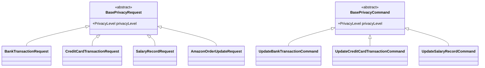

# Plan 19: 個別項目隱私層級寫入支援與前端設定 UI (Item-Level Privacy Level Write Support & UI)

## 🎯 背景與問題陳述 (Background & Problem Statement)

在 [Plan-02](Plan-02-多使用者架構、家族共享與隱私控制.md) 的多使用者架構中，系統建立了完整的隱私防護體系：
1. **資料庫層級**：所有實體均透過 `MultiUserBaseEntity` 或 `PrivacyOverrideBaseEntity` 具備 `privacy_level` 欄位（`SHARED`, `AGGREGATE_ONLY`, `PRIVATE`，預設為 `SHARED`）。
2. **查詢與遮罩層級**：SQL 查詢透過 Hibernate Filter 過濾 `PRIVATE` 資料，DTO 層則透過 `PrivacyMaskingUtil` 在 Java 記憶體中對 `AGGREGATE_ONLY` 或非擁有者之機密資料實施名稱與備註脫敏（Fail-Closed 遮罩）。

**遺留之技術債 (Design Debt)**：
雖然防護機制與查詢過濾完全就緒，但目前後端所有領域（銀行交易、信用卡交易、購物訂單、薪資、年金、DC/iDeCo、NISA、公司股票等）的 Controller Request DTO 與 Service Command 中，**皆未開放 `privacyLevel` 欄位讓前端傳入**。
同時，前端 UI 亦無提供個別交易或帳戶的隱私層級調整介面。
這導致在日常使用時，所有資料均維持全域預設的 `SHARED`；使用者若想將特定單筆私房花費（例如禮物、個人娛樂等）設為 `PRIVATE`（不給家人看）或 `AGGREGATE_ONLY`（僅計入總資產而不公開明細），目前無法透過 UI 或 API 達成。

---

## 🏛️ 架構設計理念：基底類別繼承模式 (Base Class Inheritance Architecture)

為了避免在十幾個不同領域的 Request DTO 與 Command 重複撰寫相同的欄位宣告與驗證邏輯，本計畫比照 `MultiUserBaseEntity` 的成功經驗，在 DTO 與 Command 層引入**抽象基底類別繼承模式**：



### 1. DTO 基底類別設計
```java
package ch.lin.finance.hub.backend.api.controller.base;

import ch.lin.finance.hub.backend.api.domain.model.base.PrivacyLevel;
import lombok.AllArgsConstructor;
import lombok.Data;
import lombok.NoArgsConstructor;
import lombok.experimental.SuperBuilder;

/**
 * 支援隱私層級設定之通用請求 DTO 基底類別
 */
@Data
@SuperBuilder
@NoArgsConstructor
@AllArgsConstructor
public abstract class BasePrivacyRequest {
    /** 隱私層級（選填，若未傳入則維持預設 SHARED 或不變更） */
    private PrivacyLevel privacyLevel;
}
```

### 2. Command 基底類別設計
```java
package ch.lin.finance.hub.backend.api.app.service.base;

import ch.lin.finance.hub.backend.api.domain.model.base.PrivacyLevel;
import lombok.AllArgsConstructor;
import lombok.Getter;
import lombok.experimental.SuperBuilder;

/**
 * 支援隱私層級設定之通用 Service Command 基底類別
 */
@Getter
@SuperBuilder
@AllArgsConstructor
public abstract class BasePrivacyCommand {
    private final PrivacyLevel privacyLevel;
}
```

### 3. 實作眉角與注意事項 (Implementation Notes)
1. **Lombok `@SuperBuilder` 轉換**：
   - 原有 DTO 若使用 `@Builder`，在繼承抽象類別時無法繼承父類別屬性的 builder 方法，必須將父類別與子類別同步改為 Lombok 的 `@SuperBuilder`。
2. **MapStruct 自動對應**：
   - 由於屬性名稱統一命名為 `privacyLevel`，MapStruct 能自動將 `BasePrivacyRequest` 中的隱私值對應至 Command，再自動對應至 Entity 的 `privacyLevel`，大幅減少手動撰寫映射代碼的負擔。

---

## 📋 規劃與改造範圍 (Scope & Deliverables)

本計畫將分為三個階段循序完成：

### Phase 1: 建立基底類別並推展至各領域 DTO / Command
1. **建立共用基底類別**：
   - 建立 `BasePrivacyRequest` 與 `BasePrivacyCommand`。
2. **各領域繼承改造**：
   - **金融交易領域 (Bank & Credit Card)**：
     - `BankTransactionRequest` / `UpdateBankTransactionCommand` 繼承基底類別。
     - `CreditCardTransactionRequest` / `UpdateCreditCardTransactionCommand` 繼承基底類別。
   - **購物明細與訂單領域 (Shopping)**：
     - `AmazonOrderUpdateRequest`、`RakutenOrderUpdateRequest` 繼承基底類別。
     - 支援子明細 (`OrderItem`) 透過 `PrivacyOverrideBaseEntity` 覆蓋父層設定。
   - **資產與薪資領域 (Accounting Records)**：
     - `SalaryRecordRequest`、`PensionRecordRequest`、`NisaSnapshotRecordRequest`、`DefinedContributionAccountSnapshotRequest` 繼承基底類別。

### Phase 2: 後端 Service 寫入與擁有者權限防護檢核 (Anti-Privilege Escalation)
1. **擁有者嚴格校驗 (Fail-Closed Check)**：
   - 在各 Service 執行更新前，必須檢核發起操作者是否為資料擁有者：
     ```java
     if (!entity.getOwnerUserId().equals(SecurityUtil.getCurrentUserId())) {
         throw new ReadOnlyFamilyRecordException("Only the record owner can modify privacy settings.");
     }
     ```
   - **防禦目的**：防止家庭成員 A 在家族共享模式下，惡意或誤觸將家庭成員 B 的帳單隱私層級擅自竄改。
2. **通用設定邏輯**：
   - 若 `command.getPrivacyLevel() != null`，則執行 `entity.setPrivacyLevel(command.getPrivacyLevel())`；未傳入時維持原有層級不變。

### Phase 3: 前端 UI 隱私設定選單與共用元件
1. **共用前端下拉元件 `<PrivacyLevelSelect />`**：
   - 封裝包含圖示與語意色彩的通用選擇器：
     - 👥 **完全公開 (`SHARED`)**：家人可見總額與明細（預設）
     - 🛡️ **僅計入總額 (`AGGREGATE_ONLY`)**：家人僅能在總資產看見數字，明細自動遮罩為通用類別名稱
     - 🔒 **私密隱藏 (`PRIVATE`)**：家人檢視模式下完全不可見
2. **嵌入各表單與編輯 Dialog**：
   - 在交易編輯 Dialog（Transaction Edit Dialog）、薪資/資產編輯 Dialog 中加入該下拉選單。
3. **唯讀防護提示**：
   - 當處於家族檢視模式（`X-View-Scope: FAMILY`）且查看非本人的資料時，該隱私選單自動禁用（Disabled），並顯示提示「僅資料擁有者可調整隱私權限」。

---

## 🔗 關聯文件
- 上游多使用者架構：[Plan-02-多使用者架構、家族共享與隱私控制.md](Plan-02-多使用者架構、家族共享與隱私控制.md)
- 下游家族模擬服務：[Plan-03-家族財務服務與模擬器整合.md](Plan-03-家族財務服務與模擬器整合.md)
